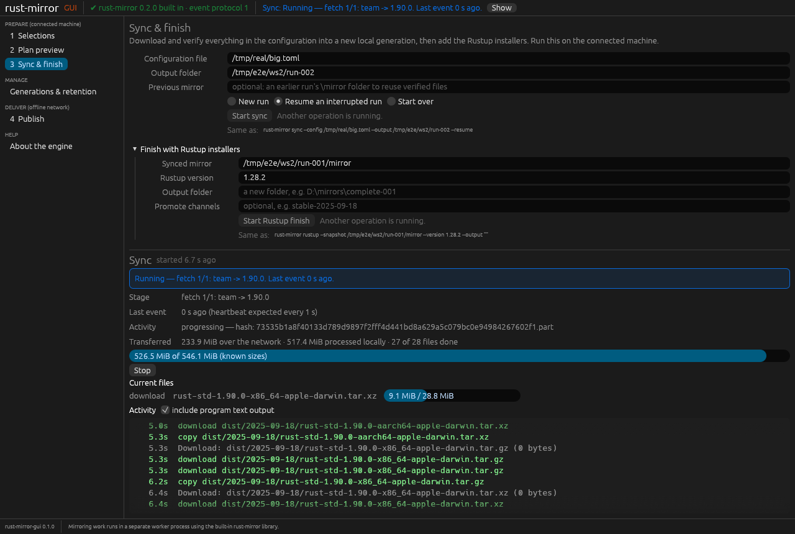

# rust-mirror-gui

A desktop app for building offline Rust toolchain mirrors with
[rust-mirror](https://crates.io/crates/rust-mirror). Use it to choose
toolchains and platforms, preview the files, download and verify them with live
progress, stop and resume, add the Rustup installers, and publish the result to
Nexus Raw or another static HTTPS host.

It is one executable. The rust-mirror library is compiled in. Each operation runs
in a hidden worker copy of the same program, which reports progress to the window
over a JSON-lines event protocol. If an operation hangs, the window says so and
can stop or end it.



**New here?** Read the [tutorial](docs/TUTORIAL.md): your first mirror in about 10 minutes.

**Status: 0.1.0, first release.** It works for the flows listed below. Remote
Desktop, screen readers and Windows/macOS runtime behavior are not yet verified;
see [known limits](docs/releases/v0.1.0.md#validation-and-limits).

## Install

Requires Rust **1.95** or newer.

```sh
cargo install rust-mirror-gui --locked
rust-mirror-gui
```

No separate rust-mirror installation is needed.

**Linux:** building needs no extra packages. To run, the app needs a Vulkan or
OpenGL driver and xkbcommon. Desktop distributions already have them. On a
minimal or GPU-less Debian/Ubuntu machine, install:

```sh
sudo apt install libxkbcommon-x11-0 libvulkan1 mesa-vulkan-drivers libegl1
```

## 60-second demo

This uses a new, empty folder and downloads about 330 MB from
`static.rust-lang.org`. It never touches your Rustup or Cargo installation.

1. **Selections:**
   - Keep one selection: toolchain `1.90.0`, your platform, profile **minimal**.
   - **Save as** `demo/mirror.toml`.
2. **Plan preview:** press **Preview plan** to see every file it would download.
3. **Sync & finish:**
   - Output folder `demo/run-001` (a folder that doesn't exist yet), then **Start sync**.
   - Press **Stop** partway, choose **Resume an interrupted run**, and start again.
4. **Optional:** **Start Rustup finish** with the output folder `demo/complete-001`.

Every page shows the equivalent `rust-mirror` command for scripting. Publishing
writes to a server: use only a fresh, empty test repository.

## What it does and doesn't do

- **Pages:**
  - Selections: writes a new configuration file. It can't edit an existing one yet.
  - Plan preview.
  - Sync, with resume or start over.
  - Rustup finish.
  - Generations and retention: list, preview, then delete only after you type a
    confirmation.
  - Publish, with a no-write destination check first.
- **Planned:** loading existing configurations and download sizes in the preview.
- **Never** activates Nexus groups, deletes remote data or changes clients.
  Credentials are passed only to the worker process and never saved.

## Documentation

- [Changelog](CHANGELOG.md) and [GitHub Releases](https://github.com/rustcommons/rust-mirror-gui/releases)
- [Release notes for 0.1.0](docs/releases/v0.1.0.md)
- [Design and architecture](docs/DESIGN.md)
- [Windows trial guide](TRYING.md)
- [Release policy](https://github.com/rustcommons/.github/blob/main/docs/RELEASING.md)

For development, run `cargo test --all-features`. The `fake-backend` feature
builds a scripted test worker; it is never installed.

## License

Apache-2.0. See [LICENSE](LICENSE).
