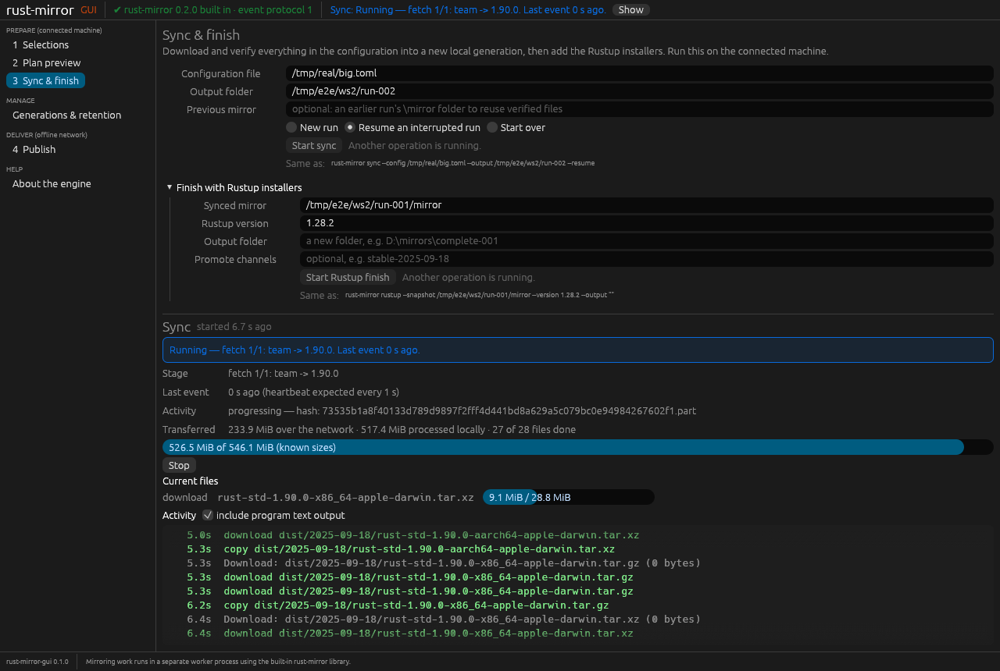

# rust-mirror-gui

[](https://github.com/rustcommons/rust-mirror-gui/actions/workflows/ci.yml)
[](https://scorecard.dev/viewer/?uri=github.com/rustcommons/rust-mirror-gui)
[](https://crates.io/crates/rust-mirror-gui)
[](https://docs.rs/rust-mirror-gui)
[](LICENSE)

A desktop app for building offline Rust toolchain mirrors with
[rust-mirror](https://crates.io/crates/rust-mirror). Use it to choose
toolchains and platforms, preview the files, download and verify them with live
progress, stop and resume, add the Rustup installers, and publish the result to
Nexus Raw or another static HTTPS host. It can also mirror an approved set of
crates.io crates for offline Cargo builds.

It is one executable. The rust-mirror library is compiled in. Each operation runs
in a hidden worker copy of the same program, which reports progress to the window
over a JSON-lines event protocol. If an operation hangs, the window says so and
can stop or end it.



**New here?** Read the [tutorial](docs/TUTORIAL.md): your first mirror in about 10 minutes.

**Status: 0.5.0.** 0.5.0 builds its fonts in (no system fonts needed) and
documents the [supported platforms](#supported-platforms). 0.4.3 is the
first release with prebuilt downloads for Windows, Linux and macOS, and its
window opens on Linux machines without a GPU that have an older Mesa (for
example Ubuntu 20.04). 0.4.2 uses far less
CPU while an operation runs (it matters most over Remote Desktop and without
a GPU), handles large crate previews, and builds in rust-mirror 0.5.1. 0.4.1 made every page usable on
small windows and scaled displays. 0.4.0 added Cargo.lock import and crate
retention. Tested inside real Remote Desktop sessions on Windows Server 2022
and 2025 and with xrdp on Linux ([record](docs/evals/2026-11-15-remote-desktop.md));
macOS runtime and screen readers are not yet verified; see
[known limits](docs/releases/v0.5.0.md#validation-and-limits).

## Supported platforms

**Supported.** "Tested" means the release workflow checks it for every
release (Windows Server 2022, macOS, AlmaLinux 8, Ubuntu 20.04), or a
recorded qualification covered it (Windows Server 2025, Remote Desktop,
xrdp, Windows 11):

| Platform | Tested | Expected to work, not tested |
| --- | --- | --- |
| Windows x64 | Windows Server 2022 and 2025, with and without a GPU, including Remote Desktop; Windows 11 with a GPU | Windows 10 |
| macOS 11 or newer | Apple silicon and Intel: the program starts and its engine runs | The window on macOS: not yet tested |
| Linux x86-64, glibc 2.28 or newer, X11 | AlmaLinux 8, Ubuntu 20.04; software rendering (no GPU), including xrdp | RHEL and Rocky Linux 8 (same as AlmaLinux 8), newer Ubuntu and RHEL-family releases, Debian 10 or newer, SLES 15 SP4 or newer, Wayland |

- **Window:** usable down to 900×600 at 100%, 125% and 150% scaling.
- **Rendering:** a GPU or software rendering (Remote Desktop, xrdp, virtual
  machines without a GPU).

**Not supported: use the [rust-mirror command line](https://github.com/rustcommons/rust-mirror)
instead.** It does everything the window does.
- **Linux older than glibc 2.28:** RHEL/CentOS 7, Ubuntu 16.04 and 18.04,
  Debian 9, SLES 12. The CLI's static Linux download runs there; the GUI's
  download does not start. A test build for glibc 2.17 drew its window
  only on Debian 9, because older X and graphics libraries stop it
  elsewhere ([measurements](docs/evals/2026-11-15-glibc-experiments.md)).
  That build may work but is not published or supported.
- **32-bit systems, ARM Linux, Windows on ARM:** there are no GUI downloads.
  The CLI has [downloads](https://github.com/rustcommons/rust-mirror/releases/latest)
  for x86-64 Linux, Windows x64 and macOS. On other systems, use
  `cargo install rust-mirror --locked`.

**Known limits:**
- **Software rendering on some processors:** on AMD EPYC machines without a
  GPU, the window uses about 66% of one processor core while a download
  runs. It is 0% when idle
  ([record](docs/evals/2026-11-15-remote-desktop.md)).
- **Screen readers** are not tested.
- **Downloads are not code-signed:** Windows and macOS ask before the first
  run (see below).

## Install

### Download a prebuilt binary

Each [GitHub Release](https://github.com/rustcommons/rust-mirror-gui/releases)
from 0.4.3 on has ready-to-run archives:

| System | File |
| --- | --- |
| Windows x86-64 | `rust-mirror-gui-<version>-x86_64-pc-windows-msvc.zip` |
| Linux x86-64 (glibc 2.28 or newer: RHEL/AlmaLinux/Rocky 8, Ubuntu 20.04, Debian 10, SLES 15 SP4 or newer) | `rust-mirror-gui-<version>-x86_64-unknown-linux-gnu.tar.gz` |
| macOS Apple silicon | `rust-mirror-gui-<version>-aarch64-apple-darwin.tar.gz` |
| macOS Intel | `rust-mirror-gui-<version>-x86_64-apple-darwin.tar.gz` |

Unpack it and run `rust-mirror-gui` (`rust-mirror-gui.exe` on Windows) from
the folder. No separate rust-mirror installation is needed. On Windows, no
extra runtime is needed either: the C runtime is linked into the executable,
so the Visual C++ Redistributable isn't required.

**Check the download** against `SHA256SUMS` on the same release page:

```powershell
# Windows (PowerShell): compare with the line for this file in SHA256SUMS
Get-FileHash .\rust-mirror-gui-0.5.0-x86_64-pc-windows-msvc.zip
```

```sh
sha256sum -c --ignore-missing SHA256SUMS         # Linux
shasum -a 256 -c --ignore-missing SHA256SUMS     # macOS
```

Every archive also has a signed build-provenance attestation, which proves it
was built by this repository's release workflow from the tagged source. With
the [GitHub CLI](https://cli.github.com/):

```sh
gh attestation verify rust-mirror-gui-0.5.0-x86_64-unknown-linux-gnu.tar.gz --repo rustcommons/rust-mirror-gui
```

**The binaries are not code-signed**, so your system may warn the first time:

- **Windows:** SmartScreen may say "Windows protected your PC". After checking
  the SHA-256, choose **More info**, then **Run anyway**. Company policy may
  block unsigned programs; ask IT to allow it, or install with Cargo below.
- **macOS:** Gatekeeper may say the app "cannot be opened because the
  developer cannot be verified". After checking the SHA-256, right-click the
  program in Finder and choose **Open**, or run once in Terminal:
  `xattr -d com.apple.quarantine ./rust-mirror-gui`.
- **Linux:** no prompt. The binary is built on AlmaLinux 8 (glibc 2.28), and
  each release is launch-tested on AlmaLinux 8 and Ubuntu 20.04. The window
  needs X11 or Wayland, a Vulkan or OpenGL (EGL) driver and xkbcommon. Its
  fonts are built in, so no system fonts are needed.
  Desktop distributions already have them. On a minimal or GPU-less machine,
  install:

  ```sh
  # Debian/Ubuntu
  sudo apt install libxkbcommon-x11-0 libvulkan1 mesa-vulkan-drivers libegl1 libgl1-mesa-dri libxcursor1 libxrandr2 libxi6
  # RHEL, AlmaLinux, Rocky Linux
  sudo dnf install libxkbcommon-x11 vulkan-loader mesa-vulkan-drivers mesa-libEGL mesa-dri-drivers libXcursor libXrandr libXi
  ```

### Install with Cargo

Requires Rust **1.95** or newer.

```sh
cargo install rust-mirror-gui --locked
rust-mirror-gui
```

Building needs no extra packages on Linux. On Windows you need the Microsoft
C++ build tools, as for any Rust install.

**Company proxy or HTTPS inspection?** Open **Network settings** in the app
and press **Test connection** first. See the tutorial's
[corporate network section](docs/TUTORIAL.md#11-corporate-network-proxy-company-certificate-sizes-and-release-list).

## 60-second demo

This uses a new, empty folder and downloads about 300 MB from
`static.rust-lang.org`. It never touches your Rustup or Cargo installation.

1. **Selections:**
   - Keep one selection: toolchain `1.90.0`, your platform, profile **minimal**.
   - **Save as** `demo/mirror.toml`.
2. **Plan preview:** press **Preview plan** to see every file it would download.
3. **Sync & finish:**
   - Output folder `demo/run-001` (a folder that doesn't exist yet), then **Start sync**.
   - Press **Stop** partway, choose **Resume an interrupted run**, and start again.
4. **Optional:** **Start Rustup finish** with the output folder `demo/complete-001`.

Every page shows the equivalent `rust-mirror` command for scripting. Publishing
writes to a server: use only a fresh, empty test repository.

## What it does and doesn't do

- **Pages:**
  - Network settings: direct, proxy from environment, or manual proxy with
    login; NO_PROXY; an extra company CA; timeouts; Test connection. Saved per
    computer; the proxy password is never saved.
  - Selections: writes a new configuration file, with a toolchain picker from
    the cached release list. It can't edit an existing file yet.
  - Plan preview, with optional download-size estimates against your budget.
  - Sync, with resume or start over, and percent and time left when sizes are
    measured.
  - Rustup finish.
  - Generations and retention: list, preview, then delete only after you type a
    confirmation.
  - Publish, with a no-write destination check first.
  - Crate catalog: paste a `[dependencies]` block (each refused line is
    explained), per-crate rules (newest N, pins, features, two ranges of one
    crate). Saved through rust-mirror; comments and order are not kept.
  - Crate preview & sync: one row per crate version (size, yanked/lock-only/kept
    flags, reason), change summary, index age, budget checks, **Why?**, one
    approval for the whole list, download with stop/resume and retry reasons,
    and **Client setup** with the `.cargo/config.toml` snippet.
  - Crate retention: list crate mirrors, set the policy, preview the exact
    folders and sizes with keep reasons, then delete only after you type a
    confirmation. A preview that is out of date is refused.
- **Not supported:** SOCKS proxies, and proxy logins other than Basic (for
  example NTLM or Kerberos).
  - Cargo.lock import: add lock files as named sources, review an import
    summary (versions added and removed, skipped git and path entries,
    line-numbered problems) before writing, re-import with a diff, and
    remove a source. Preview rows show which sources need each version.
- **Not in the app yet:** git/path/alternate-registry crates (git and path
  entries in a Cargo.lock are skipped and reported).
- **Planned:** loading existing toolchain configurations.
- **Never** activates Nexus groups, deletes remote data or changes clients.
  Credentials are passed only to the worker process and never saved.

## Documentation

- [Changelog](CHANGELOG.md) and [GitHub Releases](https://github.com/rustcommons/rust-mirror-gui/releases)
- [Release notes for 0.5.0](docs/releases/v0.5.0.md), [0.4.3](docs/releases/v0.4.3.md), [0.4.2](docs/releases/v0.4.2.md), [0.4.1](docs/releases/v0.4.1.md), [0.4.0](docs/releases/v0.4.0.md), [0.3.0](docs/releases/v0.3.0.md), [0.2.0](docs/releases/v0.2.0.md) and [0.1.0](docs/releases/v0.1.0.md)
- [Design and architecture](docs/DESIGN.md)
- [Roadmap](docs/ROADMAP.md): planned and deferred work, including no-GPU and Remote Desktop testing
- [Windows trial guide](TRYING.md)
- [Release policy](https://github.com/rustcommons/.github/blob/main/docs/RELEASING.md) and this repository's [release procedure](docs/RELEASING.md), including prebuilt binaries

For development, run `cargo test --all-features`. The `fake-backend` feature
builds a scripted test worker; it is never installed.

## License

Apache-2.0. See [LICENSE](LICENSE).
