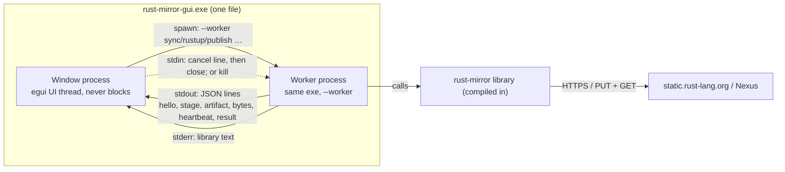
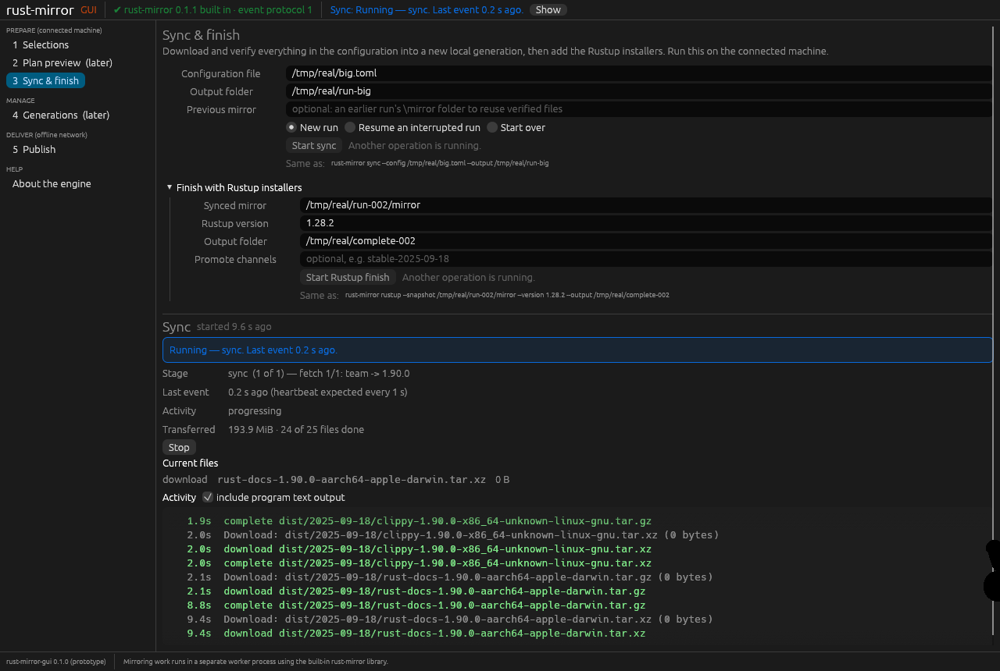
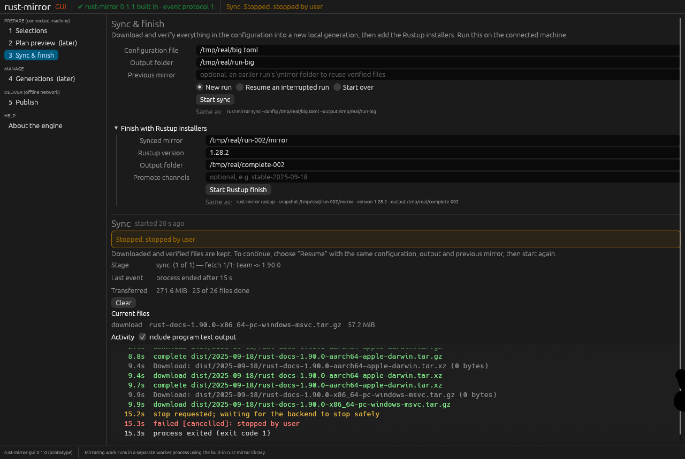
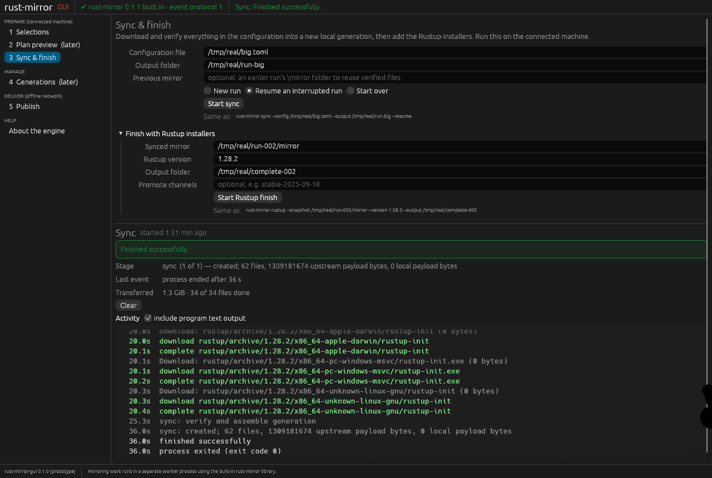
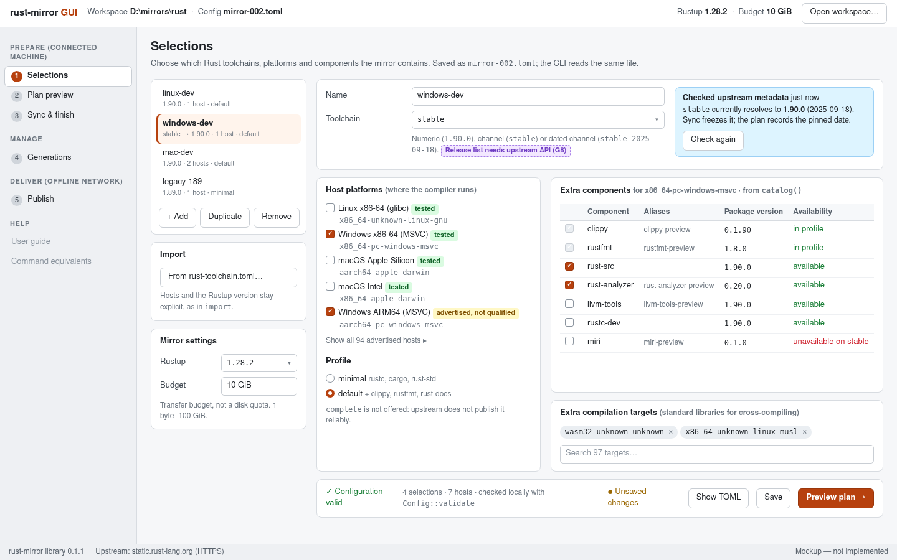
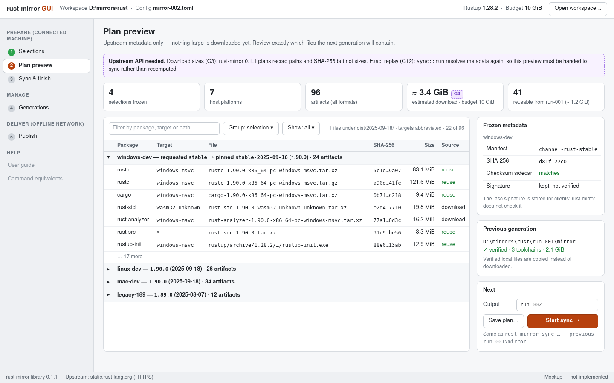
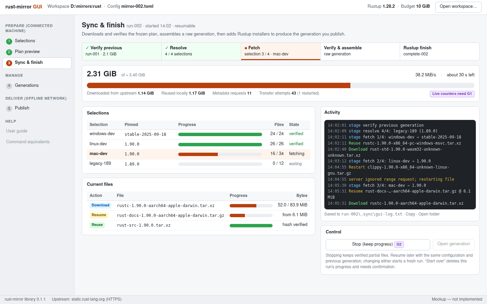
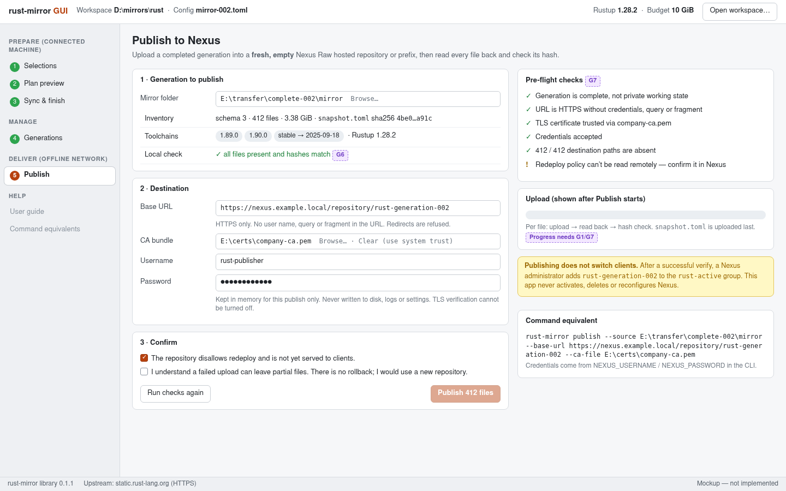
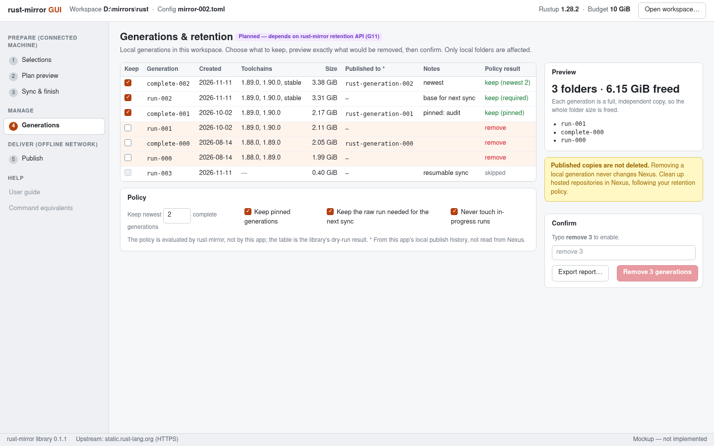

# rust-mirror-gui design

Status: **approved direction, prototype in progress.**

## Decisions (owner, 2026-11-11)

- **Framework:** eframe/egui is approved. A prototype comes first, for the owner
  to try. The spike checks S1–S3 (Section 3.3) follow, and the owner's own trial
  counts as input to them.
- **Architecture: one executable, process isolation.** The first decision was a
  separate rust-mirror program driven as a child process. The owner then refined
  it: rust-mirror is **compiled into** rust-mirror-gui. The executable depends on
  the rust-mirror library crate and runs every operation as a child process of
  itself (`rust-mirror-gui --worker COMMAND …`). The worker calls the library and
  writes the JSON-lines event protocol (rust-mirror `docs/EVENTS.md`, 0.2.0) to
  the window: protocol version, stage, artifact and byte events, heartbeats, and
  a final result with a typed error kind. Benefits:
  - one file for air-gapped installs;
  - the window and engine versions can never mismatch;
  - a hung or crashed operation can still be stopped or killed without losing
    the window.

  See [Section 3.4](#34-architecture).
- **Provisional until rust-mirror 0.2.0.** The protocol spec is not yet on
  rust-mirror's main branch, and 0.1.1 has no event or cancel API. The worker
  ([`src/worker.rs`](../src/worker.rs)) therefore bridges 0.1.1 through its
  public `Source` trait. Before the prototype PR merges, it switches to the
  crates.io 0.2.0 event API.

Sections 2 and 3.1–3.3 below are the original proposal (merged in PR #1) and are
kept as written. The gaps in Section 2.3 now apply to the library API used by the
worker. G1 events, G2 cancel and G4 error kinds are requested for 0.2.0. G7
publish progress, G6 inspect and G11 retention follow.

## Original proposal

Prepared 2026-11-11 against rust-mirror **0.1.1**
([crates.io](https://crates.io/crates/rust-mirror/0.1.1),
[docs.rs](https://docs.rs/rust-mirror/0.1.1)), repository
[rustcommons/rust-mirror](https://github.com/rustcommons/rust-mirror) at commit
`18a4675`. API statements below come from reading that source (`src/lib.rs`,
`src/selection.rs`, `src/selection/{sync,collection,rustup}.rs`, `src/publish.rs`,
`src/resume.rs`, `src/main.rs`) and its
[user guide](https://github.com/rustcommons/rust-mirror/blob/main/docs/USER-GUIDE.md)
and [CLI reference](https://github.com/rustcommons/rust-mirror/blob/main/docs/CLI-REFERENCE.md).
Nothing was run against a real Rustup/Cargo home or a Nexus server.

## 1. Users and scope

Administrators who build offline Rust toolchain mirrors on Windows, Linux or macOS.
They use two machines:

- a **connected** machine that chooses toolchains, plans, downloads and verifies;
- a machine **inside the offline network** that publishes a finished generation to
  Nexus Raw (or another static host).

So the GUI itself must install and run with no network access, from a file copied
across the air gap.

The GUI is a front end only. Planning, hashing, trust checks, assembly, publication
and retention stay in the `rust-mirror` library. Where the GUI needs more than the
library offers, we ask upstream (Section 2.3) instead of re-implementing it here.

## 2. Library coverage

### 2.1 Workflow and public API (0.1.1)

| CLI step | Public library entry point | Blocking network/disk work |
| --- | --- | --- |
| `init` | `selection::Config::parse`, `selection::write_config` | none (local) |
| `list` | `selection::catalog(toolchain, host, &source)` | metadata download |
| `import` | `selection::import_toolchain(path, name, hosts, rustup)` | none (local) |
| `plan` | `selection::resolve(&config, name, &source)` → `ResolvedPlan::save` | metadata download |
| `fetch` | `selection::fetch` / `selection::fetch_resuming`, `selection::load_plan` | payload download, hashing |
| `sync` | `selection::sync::run` / `sync::run_forced` → `SyncResult { mirror, report }` | full cohort |
| `assemble` | `selection::collection::assemble(inputs, previous, output, max_bytes)` | local copy and hashing |
| `rustup` | `selection::rustup::prepare(snapshot, version, channels, output, max_bytes, &source)` | installer download, copy |
| `publish` | `publish::publish(root, &publish::Options)` → `publish::Report` | upload and read-back |
| `fetch-toolchain` | `prepare(&Options, &source)` (legacy, Linux minimal only) | not exposed in GUI |

Useful properties for a GUI:

- `Config`, `Selection`, `Plan`, `Artifact`, `Catalog`, `SelectionSnapshot`,
  `CollectionSnapshot` and both `Report` types are public and serde-serializable,
  so screens can display them directly.
- The `Source` trait is public. The GUI can wrap `HttpsSource` and observe or
  stop each upstream transfer at write time (see G1/G2 workarounds).
- `publish::Options` takes credentials explicitly; the library never reads
  environment variables. The GUI can keep the password in memory only.
- All mutating calls refuse existing outputs, verify whole-file SHA-256 and write
  into staging before an atomic rename. The GUI does not need its own safety layer.

### 2.2 What the GUI can drive today

| Flow | Today with 0.1.1 | Limits |
| --- | --- | --- |
| Edit selections (create, import, validate, save) | Yes | Save refuses an existing file (G9); no list of available releases (G8) |
| Availability per host (components, targets, profiles) | Yes, `catalog` | One host per call; free-text toolchain only |
| Plan preview per selection | Yes, `resolve` | No sizes (G3); sync does not reuse the preview (G12) |
| One-shot sync with resume/force | Yes, on a worker thread | Progress only via the `Source` wrapper (G1); stop is coarse (G2); errors are strings (G4) |
| Detailed route (plan → fetch → assemble) | Yes | Same as sync |
| Rustup finishing step | Yes | Same as sync |
| Publish to Nexus Raw / static host | Yes, all or nothing | No preflight, progress or stop (G7) |
| Open and inspect an existing generation | Only by parsing `snapshot.toml` ourselves | Verification is crate-private (G6) |
| Retention / pruning | No | Sibling work in rust-mirror (G11) |

### 2.3 Upstream API gaps

These should be filed as issues in rustcommons/rust-mirror once the owner approves
this direction. Each one has an interim workaround so a first GUI does not have to
wait, except G6, G7 and G11.

| ID | Gap (evidence) | Proposed upstream API | Interim GUI workaround |
| --- | --- | --- | --- |
| **G1** | **Structured progress.** Progress goes to stderr as text: `sync.rs` `stage()`, `resume.rs` `eprintln_status` (Reuse/Resume/Download/Restart), `HttpsSource::fetch` "Downloading". A GUI cannot capture it, and a GUI process has no useful stderr. | A `Progress` observer (trait object or `FnMut(Event)`) passed to `sync::run`, `fetch`, `assemble`, `rustup::prepare` and `publish`. Events: `Stage { name, index, total }`, `Artifact { path, action, offset, expected_bytes }`, `Bytes { path, n }`, `Hashing { path, n, total }`, `Done(report)`. The stderr text becomes the CLI's observer. | Wrap `HttpsSource` in our own `Source` to count bytes per URL. Covers upstream transfer bytes only, not stages, local reuse, hashing or assembly. |
| **G2** | **Cancellation.** All calls block until done. No stop signal. A stalled read can block for up to the 180 s timeout. | A `CancelToken` (an `Arc<AtomicBool>` is enough) checked between files, inside copy/hash loops and in transfer writes. Return a distinct `Cancelled` error that leaves resumable state. | Our `Source` wrapper returns an error on the next write once Stop is pressed. Sync/fetch already keep resumable state on failure. Hashing, assembly, Rustup copy and publish cannot be stopped. |
| **G3** | **Download sizes.** `Artifact` has no byte size; the CLI prints "archive sizes unknown until download". Plan preview cannot show totals, budget fit or ETA. | Optional `expected_bytes` per artifact from an HTTP `HEAD` (Content-Length), clearly labelled as an estimate; verification stays hash-based. Needs a `Source::content_length` method with a default of `None`. | Show counts only; show bytes after download. |
| **G4** | **Typed errors.** `Result` is `Box<dyn Error>` with English strings. The GUI cannot tell "output exists, offer Resume" from "hash mismatch" or "network down". | A public `ErrorKind` enum, e.g. `OutputExists`, `ResumeMismatch`, `Locked`, `Network`, `Integrity`, `Budget`, `RemoteExists`, `Auth`, `Tls`, `Cancelled`, `Invalid`, with the message kept. | Show the message as is; don't match on text. |
| **G5** | **Run state.** Before starting, the GUI should know whether an output is new, resumable for this exact config and previous, completed, locked or unrelated. That logic is private (`sync.rs` `State`, `lock`, `resume::Session`). | `sync::inspect(output, &config, previous) -> RunState` and `selection::inspect_fetch(plan, output)`. Read only. | Offer Resume and let the call fail with its message. |
| **G6** | **Open and verify a generation.** `collection::read_input` is `pub(super)` and `publication_files` is `pub(crate)`. The GUI needs to list toolchains, size and schema of a mirror folder and verify it before publishing. | `pub fn inspect(root) -> GenerationSummary` (schema, rustup version, toolchain records, file count, bytes, inventory SHA-256) and `pub fn verify(root, progress, cancel)`. | Parse `snapshot.toml` for display only. No verification claim. |
| **G7** | **Publish preflight, progress and stop.** `publish::publish` validates, checks remote absence, uploads and verifies in one call. The GUI cannot show "412 / 412 paths absent" before the user confirms, or progress during upload. | Split into `publish::preflight(root, &Options) -> Preflight` (local closure, URL, TLS, auth, absence of every path; no writes) and `publish::publish(…, progress, cancel)`. Stopping must report that remote data may be partial. | One "Publish" button; indeterminate progress until it returns. |
| **G8** | **Release discovery.** `catalog` needs a toolchain first. There is no list of releases, channel dates or Rustup versions. | `selection::releases(&source)` using upstream `manifests.txt`, and a Rustup version list if upstream exposes one. | Free-text field checked by `Selection::validate` and `catalog`. |
| **G9** | **Saving an edited config.** `write_config` refuses an existing destination. | `write_config_replace(config, path)` with an atomic temp-file rename, or make TOML formatting public so the GUI can do the rename. | Serialize with `toml` ourselves and do a temp-file rename. The format is the library's own serde output, so this is not re-implementing logic. |
| **G10** | **Network settings for upstream.** `HttpsSource` has a fixed 180 s timeout, no proxy and the system trust store only. Many admin networks need an HTTPS proxy. | `HttpsSource::builder()` with proxy URL, timeout and optional CA bundle. Keep the official-origin and no-redirect rules. | None. Document that a direct connection is required. |
| **G11** | **Retention.** No pruning API exists in 0.1.1 (`sync` docs: "Publication, activation and pruning are separate operations"). A sibling thread is adding it. | For the screen in 3.4 the GUI needs: list local generations and runs; a policy (keep newest N, pinned, the run needed as the next `--previous`, never touch in-progress or locked runs); a **dry-run** returning the exact folders and bytes; and `apply(dry_run_result)` that refuses if the disk changed since the dry run. Progress and cancel as in G1/G2. | Screen hidden until the API ships. |
| **G12** | **Exact plan replay.** `sync::run` resolves metadata again. A moving channel (`stable`) can change between preview and sync. | `sync::resolve_cohort(&config, previous, &source) -> Cohort` (serializable, like `Plan`) and `sync::run_cohort(cohort, …)`. | Show the pinned identities from `SyncResult.report.frozen` after the run and flag any difference from the preview. |

Priorities for a first usable GUI: **G1, G2, G4, G7**, then G3, G5, G6, G12.

## 3. GUI framework

### 3.1 What matters here

1. **Air-gapped install:** one self-contained file or installer per OS, with no
   runtime downloads, including on Windows Server.
2. **Works where admins run it:** Windows Server through Remote Desktop and VMs
   without a GPU, plus normal Linux and macOS desktops.
3. **Accessibility:** keyboard navigation and screen readers (Narrator/NVDA,
   VoiceOver, Orca).
4. **License** compatible with an Apache-2.0 project without extra conditions.
5. **Dependency weight and supply chain:** the library is deliberately small and
   trust-focused. Avoid a second language toolchain.
6. **Maturity and API stability.**
7. **Fit:** long blocking library calls on a worker thread; large virtualized
   tables (up to 32 selections × up to 1,024 files); forms; progress.

### 3.2 Comparison

Versions and dependency counts were checked on 2026-11-11. Counts are unique
package versions from `cargo tree -e normal,build --target <triple>` for a scratch
crate depending on `rust-mirror 0.1.1` plus the framework with default features.
`rust-mirror` alone is 84–86. Counts were taken in a throwaway directory outside
this repository; nothing was added here.

| | **egui / eframe 0.37** | **Tauri 2.12** | **Slint 1.18** | **iced 0.14** |
| --- | --- | --- | --- | --- |
| Model | Immediate-mode Rust, own renderer (wgpu by default) | Rust backend + system webview, HTML/JS UI | Declarative `.slint` markup + Rust | Elm-style retained Rust |
| License | MIT OR Apache-2.0 | MIT OR Apache-2.0 | GPL-3.0 OR Slint royalty-free 2.0 (attribution required) OR commercial | MIT |
| API stability | 0.x, breaking release about every 3 months | 2.x stable | 1.x stable | 0.x, breaking releases |
| Crates (Win / Linux / macOS) | 216 / 309 / 217 | 240 / 279 / 239, **plus** a system webview and usually an npm toolchain | 279 / 375 / 285 | 229 / 298 / 224 |
| Minimum Rust | 1.95 | 1.90 | 1.92 | 1.88 |
| Air-gapped install | Single executable, no runtime | Needs WebView2 on Windows (often missing on Windows Server; embedding the offline or fixed runtime adds about 130–180 MB). Needs WebKitGTK 4.1 on Linux | Single executable | Single executable |
| Remote Desktop / no GPU | **Unproven.** Reported not to work over RDP with the OpenGL backend; wgpu's DX12 path may work (spike S1) | Works (Chromium software rendering) | Built-in software renderer | Has a software renderer (tiny-skia) |
| Accessibility | AccessKit built in by default (Windows UIA, macOS, Linux AT-SPI) | Best: browser accessibility tree | AccessKit, enabled by default | No AccessKit upstream (only in forks) |
| Packaging | None built in; `cargo-packager`/WiX/`.app` scripts | Built-in MSI/NSIS, deb/rpm/AppImage, dmg | None built in | None built in |
| Look | Custom, consistent, not native | Whatever we build in HTML/CSS | Native-like styles (Fluent, Cupertino) | Custom |

Not shortlisted: GTK4 (needs GTK runtime on Windows/macOS), Qt bindings (C++
toolchain and LGPL packaging), Dioxus desktop (same webview tradeoffs as Tauri).

### 3.3 Recommendation: egui (eframe), conditional on a short spike

**Use eframe 0.37 with the default wgpu renderer and AccessKit.**

Why:

- **Same toolchain as the library.** Pure Rust, one `cargo build`, no npm, no
  webview, no C/C++ toolchain. The dependency surface is the smallest of the
  candidates once Tauri's webview and JavaScript stack are counted, and it is
  reviewable with the same `cargo` tools rust-mirror already uses.
- **Air-gapped friendly.** A single executable per OS that runs from a USB stick or
  a network share. No WebView2 or WebKitGTK prerequisite on locked-down Windows
  Server or RHEL hosts.
- **Clean license.** MIT/Apache-2.0, same as the project. Slint would add a
  non-OSI license with an attribution obligation to every binary we ship.
- **Accessibility is on by default.** AccessKit gives a real accessibility tree on
  all three platforms. iced does not have this upstream.
- **Good fit for this app.** Immediate mode makes "poll a worker thread's events
  and repaint" simple. `egui_extras` tables are virtualized for thousands of rows.
  The mockups use only standard egui widgets.

What we accept:

- **0.x API churn.** Pin the exact version and upgrade on purpose.
- **Minimum Rust 1.95,** higher than rust-mirror's 1.90. That is fine for a separate
  binary crate; the library's minimum is unchanged.
- **Not a native look.** Acceptable for an admin tool.
- **We build installers ourselves.** Plain archives first; MSI/dmg later.

**Go/no-go spike before committing (about one day, no new dependency on `main`):**

- **S1, Remote Desktop:** an eframe window renders and accepts input over RDP on
  Windows Server 2022 and on a GPU-less VM. If wgpu DX12 fails, test the
  software-renderer fallback.
- **S2, Screen readers:** NVDA (Windows), VoiceOver (macOS) and Orca (Linux) can
  reach and operate a form, a checkbox table and a progress bar.
- **S3, Offline launch:** the release binary starts on clean, offline Windows Server
  2022, Ubuntu 24.04 and macOS 15 machines. Record binary size.

**If S1 fails without a workable fallback,** switch to **Slint** (software renderer,
stable 1.x API), provided the owner accepts the royalty-free license's attribution
requirement. **If accessibility is ranked above air-gapped simplicity,** Tauri is
the alternative, with the WebView2 offline runtime bundled on Windows.

### 3.4 Architecture

Implemented in the prototype ([`src/worker.rs`](../src/worker.rs),
[`src/job.rs`](../src/job.rs), [`src/app.rs`](../src/app.rs)):

Solid arrows show runtime data flow. The dotted arrow shows stop and kill. The
window process never calls the library for operations and never touches upstream
or Nexus itself.

- **Worker self-check:** at startup the window runs `--worker --version` (10 s
  timeout). The answer reports the GUI version, the compiled-in library version
  and the protocol version. A failure means the child process could not run, for
  example because security software blocked it.
- **Liveness:** each event resets a "last event" clock. The `hello` event states
  the heartbeat interval (1 s for the built-in worker). With no event for 3× that
  interval (minimum 5 s), the job is shown as **stalled**. Heartbeats also carry
  `idle_ms`, the time since the last transfer progress. This separates "worker
  alive but nothing moving" from "worker unresponsive". `idle_ms` is provisional
  until EVENTS.md.
- **Stop:** writes a cancel line to stdin, then closes stdin. While stopping, or
  when stalled, the window offers "End process now", which terminates the worker.
  For sync, verified progress is kept for Resume. For publish, the server may
  hold partial files and must not be activated.
- **Results:** the outcome comes from the final `result` event. A worker that
  exits without one is reported as such. Unknown or unreadable lines are counted
  and logged, never fatal.
- **0.1.1 bridge** (until 0.2.0):
  - Artifact and byte events come from wrapping the public `Source` trait.
  - Stop takes effect at the next transfer write. Hashing, assembly and publish
    cannot be interrupted, so the window offers ending the process.
  - Error kinds are only `cancelled` or `unclassified`.
  - Sync stages appear as the library's stderr text.
- **Credentials** (publish) go only into the worker's environment
  (`NEXUS_USERNAME`/`NEXUS_PASSWORD`), never into arguments, logs or settings.
- **Config file:** the Selections page writes schema-1 TOML text. The library
  validates it when the worker reads it.

## 4. Screens

### Prototype (running app)

These are real screenshots of `rust-mirror-gui`, captured 2026-11-11 on Linux
aarch64 (Xvfb with Mesa lavapipe software Vulkan). They show the built-in worker
with the rust-mirror 0.1.1 library, downloading from static.rust-lang.org into
`/tmp`. The run covered 1.90.0, default profile plus rust-src, and 4 hosts (about
1.3 GB). It was stopped and then resumed to completion.

More: [small sync finished](screenshots/real-sync-finished.png),
[Rustup finish](screenshots/real-rustup-finished.png). Stall detection and
"end process" are covered by the automated tests against the fake backend
(`tests/backend.rs`).

### Mockups (original proposal)

Static mockups. HTML sources and the render script are in
[`design/mockups/`](design/mockups/); re-render with
`python3 docs/design/mockups/render.py` (headless Chromium, 1440×900). Purple
dashed tags mark data or controls that depend on an upstream gap.

### Selection builder

Edit `mirror.toml`: selections list, toolchain field with live availability
(`catalog`), host checkboxes that separate the four qualified hosts from
"advertised, not qualified", profile, extra components and targets, global Rustup
version and budget. Validation uses `Config::validate`.

### Plan preview

Frozen identities (requested → pinned), every artifact grouped by selection,
local reuse from the previous generation, and frozen manifest hashes. Sizes need
G3; exact replay into sync needs G12.

### Sync and finish progress

Stage stepper (verify previous → resolve → fetch → assemble → Rustup finish),
overall and per-selection progress, per-file actions (Download, Resume, Reuse,
Restart), activity log, and a Stop that keeps resumable progress. Live data needs
G1; Stop needs G2.

### Publish to Nexus

Choose a completed generation, a fresh Raw hosted URL, an optional CA bundle and
credentials kept in memory only. Pre-flight checks and an explicit confirmation
come before any write. The screen repeats that publishing does not activate
anything. Needs G6 and G7 for the checks and progress.

### Generations and retention (planned, depends on G11)

Lists local generations and runs with the library's dry-run policy result, the
exact folders and bytes to free, and a typed confirmation. It never touches
in-progress runs or anything on Nexus.

## 5. Open decisions for the owner

1. ~~Approve eframe/egui~~: approved 2026-11-11.
2. Protocol needs (G1, G2, G4, G7) are being handled by the rust-mirror 0.2.0
   event protocol. File the remaining gaps when needed.
3. Confirm the first release scope: Selections, Plan, Sync, Publish. Retention
   follows G11.
4. Confirm serde and serde_json as dependencies (needed for the event protocol).
5. Requirement ID prefix for this repository's future `docs/REQUIREMENTS.md`. The
   organization convention table does not list `rust-mirror-gui` yet.
