# rust-mirror-gui tutorial (version 0.4.0)

This tutorial teaches you to build an offline Rust toolchain mirror with
rust-mirror-gui and publish it to Nexus, and mirror an approved set of
crates.io crates (0.3.0). New in 0.4.0: import projects' Cargo.lock files and
remove old crate mirrors safely.
It describes only what version 0.4.0 does.

**Behind a company proxy, or seeing certificate errors?** Do
[section 11, Corporate network](#11-corporate-network-proxy-company-certificate-sizes-and-release-list)
first.

> **Quick start**
>
> 1. `cargo install rust-mirror-gui --locked` (needs Rust 1.95+), then run `rust-mirror-gui`.
> 2. **Selections:** toolchain `1.90.0`, one host, profile **minimal**. Save as `demo/mirror.toml`.
> 3. **Plan preview:** **Preview plan** lists every file. Nothing is downloaded.
> 4. **Sync & finish:** output `demo/run-001` (a new folder), **Start sync**, about 300 MB.
> 5. **Stop** any time, then choose **Resume an interrupted run** and start again.
> 6. **Start Rustup finish** with output `demo/complete-001`. Copy `complete-001/mirror` to the offline network.
> 7. **Publish:** **Check destination (no writes)** first, then **Publish** into a new, empty Nexus Raw repository.
> 8. Every page shows the matching `rust-mirror` command under **Same as**.
> 9. Company proxy? Use **Network settings**, then **Test connection** first ([section 11](#11-corporate-network-proxy-company-certificate-sizes-and-release-list)).
> 10. Crates: **Crate catalog** → paste a `[dependencies]` block → **Crate preview & sync** → approve the preview once → **Client setup** ([section 12](#12-mirroring-crates)).
> 11. Old crate mirrors: **Crate retention** → **Discover** → **Preview removal** → type `delete N` ([section 12.6](#126-crate-retention)).
> 12. A project's exact versions: **Crate catalog** → **Cargo.lock sources** → add the file → **Preview import** → **Write** ([section 12.7](#127-import-cargolock-files)).

The screenshots come from Linux, so the paths look like `/tmp/tut/demo`. On
Windows you would use paths such as `C:\rm-demo`, and fonts and window borders
look slightly different.
- Sections 2–7 were captured with 0.1.0. In 0.2.0 the left menu also has
  **Network settings**, Selections has a release picker, and Plan preview and
  Sync have a **Measure download sizes** option. Everything else is the same.
- Section 11 was captured with 0.2.0; section 12 with 0.3.0, and 12.6–12.7
  with 0.4.0. In 0.3.0 the top bar reads "rust-mirror 0.4.0 built in"; from
  0.4.0 it reads "rust-mirror 0.5.0 built in". The first three crate
  retention screenshots were taken during development with rust-mirror 0.4.0
  built in; the page is the same.

## Contents

1. [Install and launch](#1-install-and-launch)
2. [Your first mirror in about 10 minutes](#2-your-first-mirror-in-about-10-minutes)
3. [Plan preview: what the numbers mean](#3-plan-preview-what-the-numbers-mean)
4. [Sync: reading the live status, Stop and Resume](#4-sync-reading-the-live-status-stop-and-resume)
5. [Rustup finish](#5-rustup-finish)
6. [Generations and retention](#6-generations-and-retention)
7. [Publish to Nexus](#7-publish-to-nexus)
8. [Move the mirror offline and point clients at it](#8-move-the-mirror-offline-and-point-clients-at-it)
9. [Troubleshooting](#9-troubleshooting)
10. ["Same as": the matching command-line commands](#10-same-as-the-matching-command-line-commands)
11. [Corporate network: proxy, company certificate, sizes and release list](#11-corporate-network-proxy-company-certificate-sizes-and-release-list)
12. [Mirroring crates](#12-mirroring-crates)

## 1. Install and launch

You need Rust 1.95 or newer.

```sh
cargo install rust-mirror-gui --locked
rust-mirror-gui
```

- The rust-mirror engine is built into the app. You don't install rust-mirror
  separately.
- **Windows:** you also need the Microsoft C++ build tools, as for any Rust
  install.
- **Linux:** building needs no extra packages. To run, the app needs a graphics
  driver (Vulkan or OpenGL) and xkbcommon. Desktop Linux already has them. On a
  minimal or GPU-less Debian/Ubuntu machine, install:

  ```sh
  sudo apt install libxkbcommon-x11-0 libvulkan1 mesa-vulkan-drivers libegl1
  ```

- **Settings:** the app remembers form values, never passwords, in
  `%APPDATA%\rust-mirror-gui\settings.json` on Windows or
  `~/.config/rust-mirror-gui/settings.json` on Linux.

When the app starts, the top bar should say
**"✔ rust-mirror 0.4.0 built in · event protocol 1"**. If it shows a red message,
open **About the engine** (see [Troubleshooting](#9-troubleshooting)).

## 2. Your first mirror in about 10 minutes

This demo downloads about **300 MB** from `static.rust-lang.org`: Rust 1.90.0,
minimal profile, one host. It writes only into the folder you choose. It never
touches your own Rustup or Cargo installation, or any server.

1. Create a **new, empty folder**, for example `C:\rm-demo` or `~/rm-demo`.
2. Open **1 Selections**. The app starts with one selection that is already
   right for the demo:
   - **Toolchain** `1.90.0`. Use a full version number so the result is
     repeatable. `stable` also works, but it moves over time.
   - **Host platforms:** tick exactly one, for example **Windows x86-64 (MSVC)**.
     The host is the computer your developers run the compiler on. It doesn't
     have to match the machine running this app.
   - **Profile:** **minimal** (rustc, cargo, rust-std).
3. In **Save as**, enter a file inside your new folder, for example
   `C:\rm-demo\mirror.toml`. Press **Save configuration**.

"Saved …" confirms it. Open **Show the file contents** to see the file. This is
the same configuration file the rust-mirror command line uses.


Good to know:
- The four named hosts are the ones rust-mirror has tested. Use **Other hosts**
  for anything else; those are advertised upstream but not tested.
- **Save configuration** refuses to overwrite an existing file unless you tick
  **Replace the file if it exists**.
- In 0.1.0 the editor **cannot open an existing configuration file**. To change
  one, build it again here, or edit the TOML file in a text editor.

## 3. Plan preview: what the numbers mean

Open **2 Plan preview**. The configuration path from step 2 is already filled in.
Press **Preview plan**.


- **"1 selection(s) · 7 files to download"** is how many payload files a sync
  will fetch. Each component comes in two formats (`.tar.gz` and `.tar.xz`), so
  rustc, cargo and rust-std make 6 files, plus `rustup-init` for the host.
- **"requested 1.90.0 → pinned 1.90.0 (Rust 1.90.0, 2025-09-18)"** shows what you
  asked for and the exact release it resolves to. With `stable`, the pinned
  value shows which dated release `stable` means today.
- The **SHA-256** column is the checksum each file must match. rust-mirror
  checks every download against it.
- **"Transferred … KiB"** in the status below is only the small metadata files
  the preview read. Nothing large is downloaded and nothing is written.
- Download sizes aren't in the upstream metadata. Tick **Measure download
  sizes** to ask the server for estimates first
  ([section 11](#11-corporate-network-proxy-company-certificate-sizes-and-release-list)).
  The sync also looks up metadata again, so a moving channel such as `stable`
  could change between preview and sync.

## 4. Sync: reading the live status, Stop and Resume

Open **3 Sync & finish**.

1. **Configuration file** is already filled in.
2. **Output folder:** enter a folder that **does not exist yet**, for example
   `C:\rm-demo\run-001`.
3. Leave **Previous mirror** empty for now. Later, put your last mirror here and
   the app reuses its verified files instead of downloading them again.
4. Choose **New run** and press **Start sync**.


How to read the live status:

| Line | Meaning |
| --- | --- |
| Blue **Running** box and top bar | The operation is working. The top bar repeats this on every page, with a **Show** button. |
| **Stage** | The current phase, for example `fetch 1/1: windows-dev -> 1.90.0`. |
| **Last event** | Time since the engine last reported anything. It sends a heartbeat about once a second, so this normally stays near 0 s. |
| **Activity** | What the engine says it is doing now: download, hash or copy, and which file. |
| **Transferred** | Bytes over the network, and bytes processed locally (hashing and copying). These are counted separately and are not added together. |
| Progress bar | Bytes of files whose size is known so far. Sizes become known as each download starts. |
| **Activity** log | Every step, in order. Grey lines are rust-mirror's own text output. |

**Warnings you may see:**
- **"No events for N s … rust-mirror may be stuck"** (amber) appears when the
  heartbeat stops for 5 seconds. The window keeps working. You can wait, press
  **Stop**, or press **End process now**.
- **"alive, but no new progress for N s"** appears when heartbeats continue but
  nothing has moved for 30 seconds, for example during a very slow network read.

**Stop and Resume:**
1. Press **Stop**. The engine stops at its next safe point, usually within a
   second, and the box says **"Stopped: operation cancelled"**. Verified files
   are kept.

   

2. Press **Clear**, choose **Resume an interrupted run**, and press
   **Start sync** again. Keep the same configuration, output folder and previous
   mirror. The engine reuses what it already verified and fetches the rest.
3. If it doesn't stop within 5 seconds, **End process now** appears. It ends the
   engine immediately. The window is unaffected, and Resume works in the same
   way.


When it finishes, the green box shows the result:
- **mirror:** the folder that was created (`…\run-001\mirror`);
- **files** and **recorded bytes:** about 294 MiB for this demo;
- how much came from upstream and how much was reused locally.

**Start over** deletes this output folder's progress and mirror, with no backup.
It asks you to tick a confirmation first.

## 5. Rustup finish

A sync produces the toolchains. Developers also need the Rustup installer files.
Below the sync form, in **Finish with Rustup installers**:

1. **Synced mirror** is filled in from your sync output (`…\run-001\mirror`).
2. **Rustup version:** `1.28.2`.
3. **Output folder:** a **new** folder, for example `C:\rm-demo\complete-001`.
4. **Promote channels:** leave empty for the demo. Fill it only if you want, for
   example, `stable-2025-09-18` served as your mirror's `stable`.
5. Press **Start Rustup finish**.


The result, `complete-001\mirror`, is the folder you move to the offline network
and publish. Keep `run-001\mirror` too: next time, use it as **Previous mirror**
so the next sync downloads only what changed.

The Rustup step doesn't resume. If it's interrupted, delete its unfinished
output folder and run it again.

## 6. Generations and retention

Over time you collect several mirror folders, called **generations**. Open
**Generations & retention**:

1. **Workspace folder:** the folder that holds your `run-…` and `complete-…`
   folders, for example `C:\rm-demo`. Press **Discover**. The table lists each
   generation, its toolchains and size, and each sync run folder with its state.
2. **Next sync's previous:** pick the generation your next sync will reuse
   (normally your newest `run-…\mirror`). It is always kept.
3. Adjust the policy if you want: newest stable releases to keep, previous
   generations to keep, nightly days, how many newest folders to always keep,
   and pinned releases.
4. Press **Preview removal**. This only reads and checks; it never deletes. It
   can take a while because every file is re-hashed.


The result lists every generation as **keep**, with the library's reasons, or
**remove**, with its size. In the demo nothing is removed. Both folders are the
newest, and `run-001\mirror` is also the next sync's previous.

**What Delete does** (shown only when the preview would remove something):
- A box asks you to type `delete N`, for example `delete 2`. The
  **Delete N generation(s)** button then becomes active.
- Before deleting, rust-mirror re-checks every file against the preview. It
  refuses if anything changed since.
- It removes only the listed local generation folders. It never touches Nexus,
  your sync run folders, or in-progress work.
- There is **no undo**. If a deletion stops partway, the files already removed
  stay removed.

> Tested: discovery and preview in the app, and the same deletion command run
> through the built-in engine. **Clicking Delete in the 0.1.0 window has not
> been tested end to end.**

## 7. Publish to Nexus

Run this on a machine that can reach your Nexus server, usually inside the
offline network. You need a **new, empty Nexus Raw hosted repository** that
doesn't allow redeploy. See rust-mirror's
[Nexus guide](https://github.com/rustcommons/rust-mirror/blob/main/docs/USER-GUIDE.md#nexus-publication-and-activation)
for how to set it up.

Open **4 Publish** and fill in:

| Field | Example (placeholder) |
| --- | --- |
| Generation folder | `E:\transfer\complete-001\mirror` |
| Base URL | `https://nexus.example.com/repository/rust-generation-001` |
| CA bundle (PEM) | Your company CA file, or empty to use the system trust |
| Username / Password | Your publishing account, or both empty for anonymous |


1. Press **Check destination (no writes)**. It checks:
   - that the local generation is complete;
   - that the URL, TLS certificate and login work;
   - that **every destination path is still empty**.

   Nothing is uploaded.
2. Tick both confirmations:
   - "The repository is new, disallows redeploy, and is not yet served to clients."
   - "I understand a failed upload can leave partial files; there is no rollback."
3. Press **Publish**. Each file is uploaded, then read back and checked. The
   inventory (`snapshot.toml`) goes last. The result shows **files** and
   **remote bytes verified**.

Things to know:
- The password is kept in memory only. It is passed to the engine as
  `NEXUS_USERNAME` / `NEXUS_PASSWORD`, and is never saved, logged or shown in
  **Same as**.
- **Publishing does not switch clients.** A Nexus administrator adds the new
  repository to the group your clients use. The app never activates, deletes or
  reconfigures anything in Nexus.
- **Stop during a publish** may leave some files on the server. Don't activate
  that repository; publish again into a new, empty one.

> Tested: check and publish against a local HTTPS test server with a private CA
> and a password. **Not yet tested against a real Nexus server from this app.**
> rust-mirror itself is qualified against Nexus.

## 8. Move the mirror offline and point clients at it

1. Copy the whole `complete-001\mirror` folder to the offline network, by
   approved removable media or transfer. Copy only that folder, not the private
   `.sync` folders.
2. Publish it there (section 7). You can also run the app inside the offline
   network: copy the `rust-mirror-gui` executable across, since it is a single
   file. Starting without a network was checked on Linux only; on Windows and
   macOS it is **untested**.
3. Point developer machines at your Nexus group URL. Developers use the normal
   Rustup and don't need this app. Follow rust-mirror's guide rather than this
   tutorial:
   - [Bootstrap a Windows client](https://github.com/rustcommons/rust-mirror/blob/main/docs/USER-GUIDE.md#bootstrap-a-windows-client)
   - [Bootstrap Linux or macOS clients](https://github.com/rustcommons/rust-mirror/blob/main/docs/USER-GUIDE.md#bootstrap-linux-or-macos-clients)
   - [Prepare the next generation](https://github.com/rustcommons/rust-mirror/blob/main/docs/USER-GUIDE.md#prepare-the-next-generation)

## 9. Troubleshooting

**The window does not open.**
- Linux: install the graphics packages from [section 1](#1-install-and-launch).
  With no Vulkan or OpenGL driver at all, the window can't be created.
- Windows over **Remote Desktop** has **not been tested**. Native Windows 11
  launches have been checked. On Windows Server 2025 **without a GPU**, 0.4.0
  opens and draws its first screen with Direct3D 12 on WARP, Windows' software
  renderer ([Windows qualification](evals/2026-11-14-windows-qualification.md));
  using it there, and Remote Desktop, are still untested. See the
  [roadmap](ROADMAP.md#deferred-qualification) and its
  [test plan](plans/NO-GPU-TEST-PLAN.md). If it fails for you, note the Windows
  version and how you connected, and tell the maintainers.

**The window opens but stays blank (Windows).** Some graphics drivers draw
nothing with Vulkan (seen with an AMD Radeon RX 580 on Windows 11). From
0.4.0 the app uses Direct3D 12 on Windows, which fixed it there. With 0.3.0,
or to try another renderer, set the `WGPU_BACKEND` environment variable
before starting the app, for example in PowerShell:
`$env:WGPU_BACKEND = "dx12"; rust-mirror-gui` (other values: `vulkan`,
`gl`). If every value stays blank, note your graphics card and Windows
version, and tell the maintainers.

**The top bar says "operation worker not working".** The app runs its operations
in a hidden copy of itself. Open **About the engine** for the message.
Security software may be blocking the program from starting that copy.

**"No events for N s … rust-mirror may be stuck".** The engine stopped reporting.
- Wait a little, or press **Stop**. If it still doesn't stop, press
  **End process now**.
- For a sync, then choose **Resume an interrupted run**; verified files are kept.

**"Failed [output_exists]: sync output already exists".** The output folder
already exists.
- To continue an interrupted run, choose **Resume an interrupted run**.
- Otherwise pick a new folder, or use **Start over** to discard it.

**"Failed [resume_mismatch]".** The configuration or previous mirror changed
since the interrupted run. Put them back, or use **Start over**.

**"Failed [locked]".** Another rust-mirror process is using that output folder.
Wait for it to finish.

**"Failed [network]".** Check the connection, then **Resume**. Behind a
company proxy, set it up in **Network settings** and use **Test connection**
([section 11](#11-corporate-network-proxy-company-certificate-sizes-and-release-list)).

**Downloads fail with "TLS" or a certificate error.** Your company probably
inspects HTTPS. Run **Test connection**; it names the certificate's issuer and
lets you add the company certificate (section 11).

**"Failed [auth]" during a download (not publish).** The proxy refused the
login. Enter the proxy username and password in **Network settings**. The
password is asked for again after each restart, because it is never saved.

**Publish: "Failed [tls]".** The server certificate isn't trusted. Choose your
company CA bundle (a PEM file) in **CA bundle**. TLS checking cannot be turned
off.

**Publish: "Failed [auth]".** The server refused the login. Check the username,
password and that the account may upload to this repository.

**Publish: "Failed [remote_exists]".** The destination already has files. Use a
new, empty repository or prefix.

Each failure shows a short "what to do next" line under the red box. The full
detail is in the **Activity** log.

## 10. "Same as": the matching command-line commands

Under every Start button, **Same as:** shows the matching
[rust-mirror](https://crates.io/crates/rust-mirror) command, for example:

```text
rust-mirror sync --config C:\rm-demo\mirror.toml --output C:\rm-demo\run-001 --resume
rust-mirror rustup --snapshot C:\rm-demo\run-001\mirror --version 1.28.2 --output C:\rm-demo\complete-001
rust-mirror publish --preflight --source E:\transfer\complete-001\mirror --base-url https://nexus.example.com/repository/rust-generation-001
```

- Use these to script the same steps later with the
  [command-line tool](https://github.com/rustcommons/rust-mirror/blob/main/docs/CLI-REFERENCE.md).
- Credentials never appear there. The CLI reads them from `NEXUS_USERNAME` and
  `NEXUS_PASSWORD`.
- **Plan preview** and **retention** don't have a one-to-one command:
  - Plan preview's CLI form is `rust-mirror plan`, once per selection.
  - Retention's CLI form is `rust-mirror prune`, with the policy in a
    `[retention]` section of the configuration file. The app passes the policy
    directly instead.

## 11. Corporate network: proxy, company certificate, sizes and release list

*New in 0.2.0.* Use this when your company sends internet traffic through a
proxy, or when HTTPS is inspected with a company certificate. These settings
apply only to downloads from `static.rust-lang.org`: plan preview, sync, Rustup
finish and the release list. Publishing keeps its own settings (section 7).

### Network settings

Open **Network settings** (top of the left menu) and choose one:

- **Direct (no proxy):** the default.
- **Proxy from environment:** uses `HTTPS_PROXY` (or `ALL_PROXY`) and `NO_PROXY`.
  Press **Show detected proxy** to see what will be used. A login in the
  variable is reported as "yes (not shown)"; its value is never displayed.
- **Manual proxy:**
  - **Proxy URL:** for example `http://proxy.example.com:8080`. Don't put
    `user:password@` in the URL.
  - **Proxy username** and **Proxy password:** optional.
  - **No proxy for:** hosts or domains that skip the proxy, for example
    `localhost, .corp.example.com`.
- **Extra CA file (PEM):** your company's root certificate. It is **added** to
  the built-in trusted roots and never replaces them. **Show certificate
  details** shows its subject, issuer, expiry date and SHA-256 fingerprint.
- **Timeouts:** connect and read timeouts, in seconds.

These settings are stored **for this computer only** in the app's settings
folder, never in the shared mirror configuration.

**The password is never saved.** It stays in memory for this session and is
handed to the worker privately. It does not appear in **Same as**, logs or
settings files. Basic proxy logins travel to the proxy without encryption, so
use this only with your company's own proxy.

### Test connection

Press **Test connection**. Each step shows **passed**, **failed** or
**skipped**:

| Step | What it checks | If it fails |
| --- | --- | --- |
| Find server (DNS) | The computer can look up static.rust-lang.org | Choose a proxy mode, or ask IT about name resolution |
| Connect | A connection opens, directly or through the proxy | Check the proxy address and port |
| Proxy login | The proxy accepts the login (skipped when direct) | Enter the proxy username and password |
| Secure connection (TLS) | The server's certificate is trusted | Usually HTTPS inspection: add the company certificate (below) |
| Test download | A small official file downloads | Ask IT whether the proxy blocks the download |

When the secure-connection step fails because your company inspects HTTPS, the
app shows **"Certificate issued by <issuer>"** with the name taken from the
certificate the server actually presented:

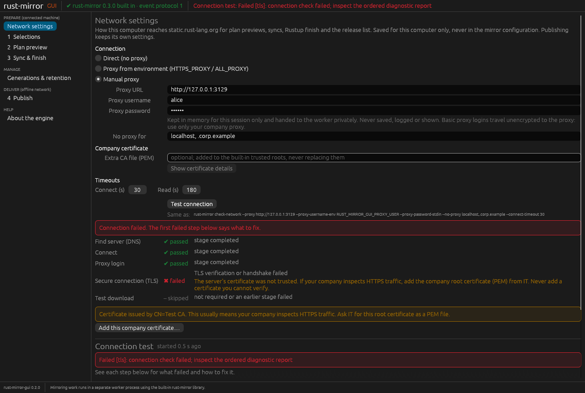

To add the company certificate:
1. Ask IT for the root certificate as a **PEM file**.
2. Press **Add this company certificate…** and enter the file path.
3. Press **Show details**. Compare the **SHA-256** fingerprint with what IT
   gives you.
4. Only then press **Use this certificate**.

Nothing is trusted automatically, and the app never downloads a certificate.

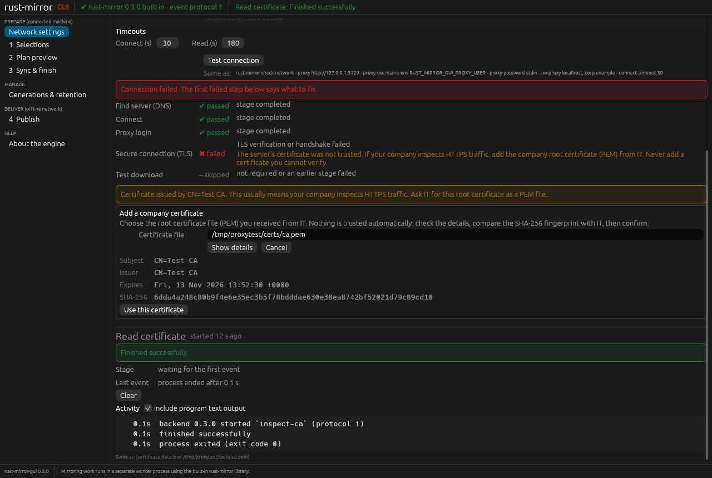

Press **Test connection** again. All five steps should pass:

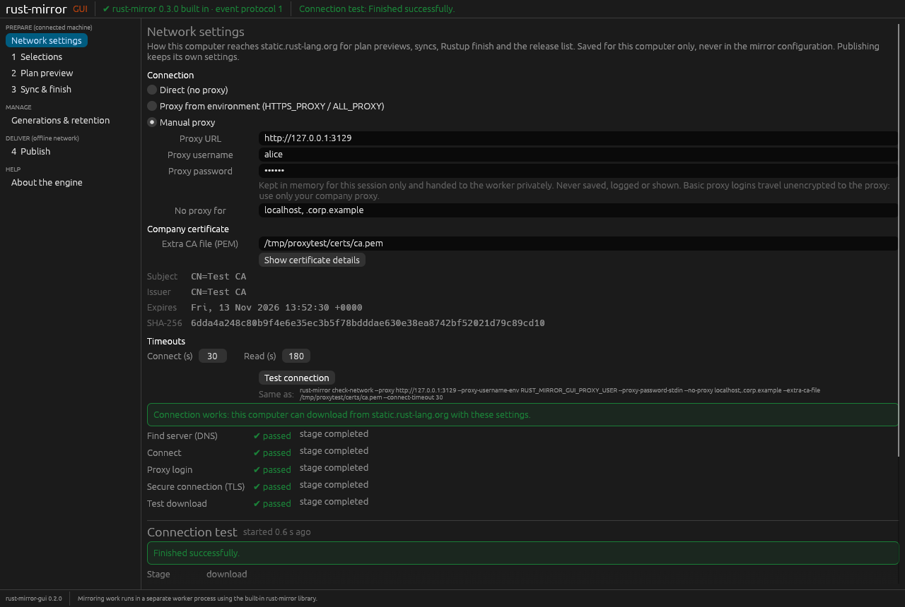

### Picking a toolchain from the release list

In **1 Selections**, next to **Toolchain**:
- **Pick from release list** lists all stable versions with their dates, plus
  recent beta and nightly builds.
- **Refresh** downloads the current list using your network settings. The app
  keeps a copy, so the list also works later without a network. The line below
  says how old the list is.
- You can still type any toolchain, for example `1.90.0` or `nightly-2025-01-15`.

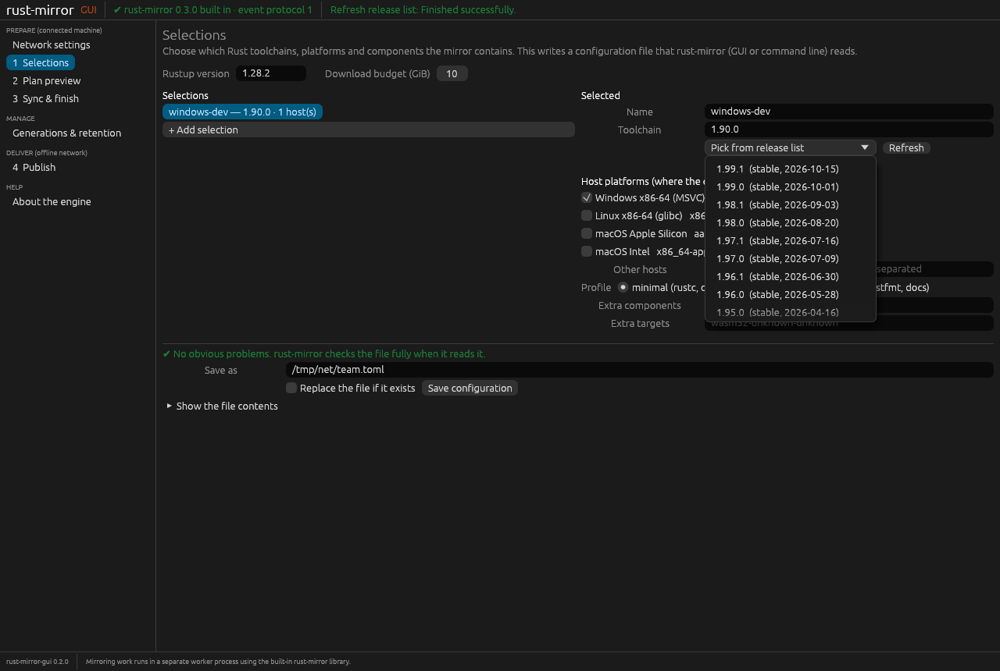

### Download sizes, percent and time left

Tick **Measure download sizes** in **2 Plan preview** or **3 Sync & finish**.
The app first asks the server how big each file is (HEAD requests).
- **Plan preview** then shows a **Size (est.)** column and a bar such as
  "about 1.5 GiB of 10.0 GiB budget (estimate)". It warns if the estimate is
  larger than your download budget. Files the server doesn't report show as
  "unknown".
- **Sync** shows percent, speed and time left, for example
  "13% · 190.6 MiB of about 1.5 GiB · 35.8 MiB/s · about 38 s left (estimate)".

Sizes are **estimates**. Every downloaded file is still checked against its
SHA-256 checksum.

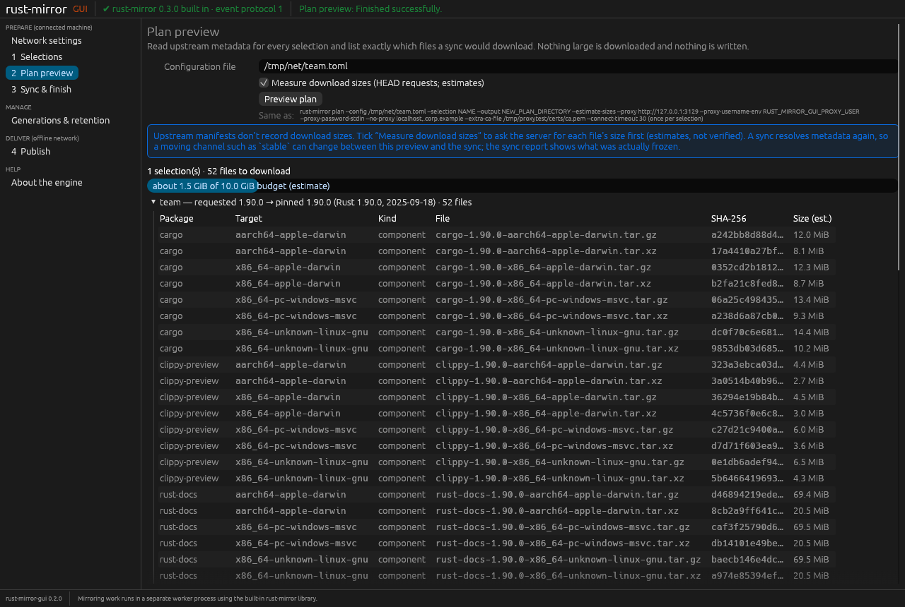
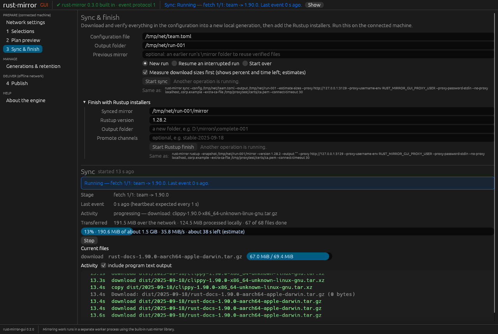

> Tested in 0.2.0 on Linux, against a local test proxy that required a login
> and inspected HTTPS with a test company certificate, with real downloads from
> static.rust-lang.org. **Not tested:** real corporate proxies other than that
> test proxy, NTLM/Kerberos proxy logins (not supported; Basic only), SOCKS
> proxies (not supported) and Windows.

## 12. Mirroring crates

*New in 0.3.0 (rust-mirror 0.4.0).* Mirror an organization-approved list of
crates.io crates, with everything they depend on, so that Cargo on the offline
network can build projects that use them. Run sections 12.1–12.4 on the
connected machine. They use the same **Network settings** (section 11).

The idea: you keep a **catalog** of approved crates. rust-mirror works out
every crate version those need and shows the complete list as a **preview**.
You approve that whole list once, and only then does it download.

### 12.1 Build the catalog

Open **Crate catalog** and press **New catalog**, or **Load** an existing
catalog file.

**Paste from Cargo.toml.** Open **Paste from Cargo.toml**, paste the lines of a
project's `[dependencies]` section, and press **Check pasted lines**.
rust-mirror checks every line:
- Lines it can use are listed in green.
- Each line it refuses shows the line and column and a fix in plain English.
  For example: git or local-path dependencies can't be mirrored, and
  `workspace = true` needs the real version from the workspace file.
- Pasting a whole `Cargo.toml` is refused; paste only the `[dependencies]` lines.

Nothing is added until you press **Add N usable crate(s) to the catalog**.

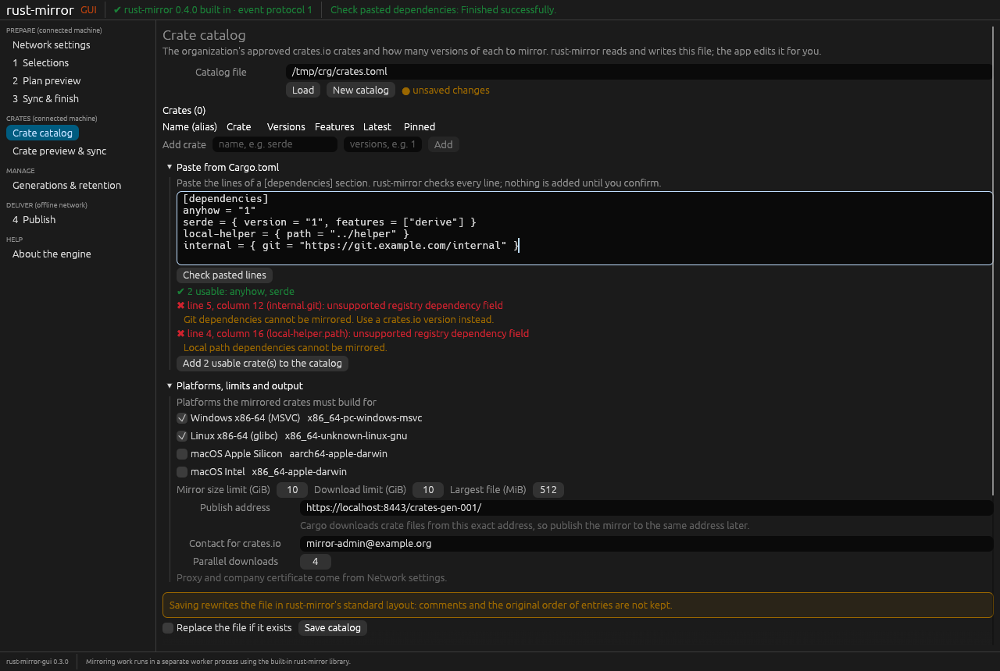

**Per-crate rules.** Press **Edit** on a crate:

| Field | Meaning |
| --- | --- |
| Versions | A Cargo version requirement, for example `1` or `>=1.2, <2` |
| Features / Default features | The features your projects use; dependencies are worked out for these |
| Newest versions | How many of the newest matching versions to mirror (yanked versions are skipped) |
| Pinned versions | Exact versions always included, even outside the range |
| Crate on crates.io | Use this to mirror two ranges of one crate: add a second name (for example `rand_old`) and set this to `rand` |

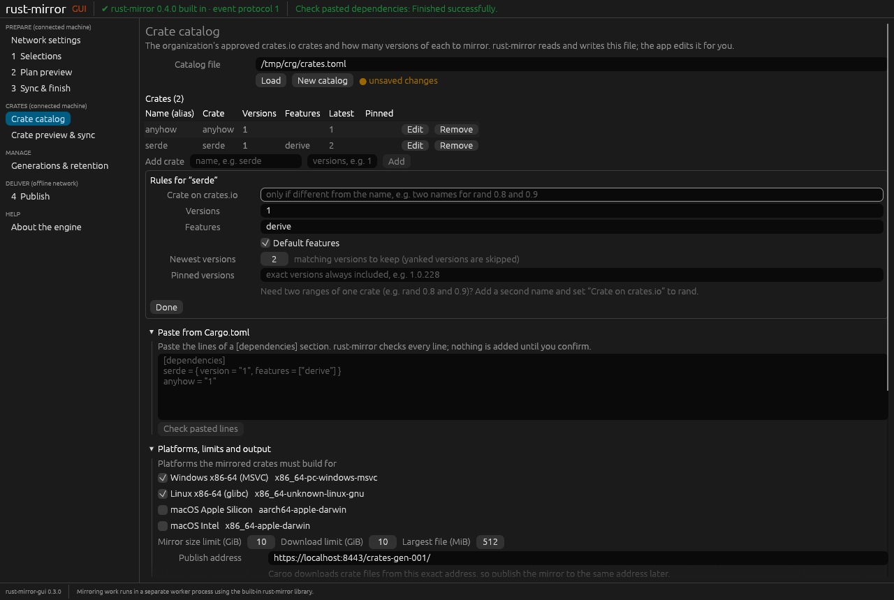

**Platforms, limits and output:**
- **Platforms:** the hosts the crates must build for.
- **Mirror size, download and largest-file limits.**
- **Publish address:** where you will publish this mirror. Cargo downloads
  crate files from exactly this address, so it must match the Publish step.
- **Contact for crates.io:** an email or URL, sent with each request so
  crates.io can reach you.
- **Parallel downloads.**

Press **Save catalog**. rust-mirror writes the file in its standard layout:
**comments and the original order of entries are not kept** (the app warns
about this before saving). The saved file also works with the command line
(`rust-mirror crates …`).

### 12.2 Preview and approve

Open **Crate preview & sync**:
1. The catalog file is filled in.
2. **Output folder:** a new folder, for example `D:\mirrors\crates-001`.
3. **Previous crate mirror** (optional): the last crate mirror's `mirror`
   folder. Its versions are kept, so old lock files keep working.
4. Tick **Measure download sizes** to see sizes before downloading.
5. Press **Preview**. rust-mirror reads the crates.io index and saves the
   complete list in the output folder. Nothing large is downloaded.

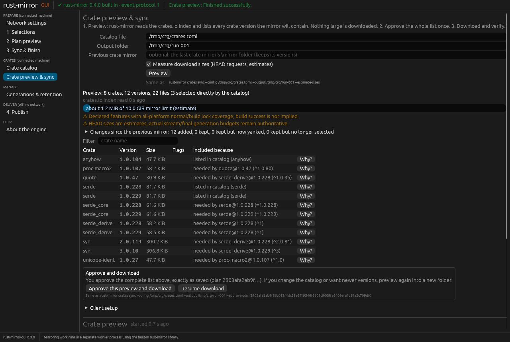

How to read it:
- **"8 crates, 12 versions, 22 files"**: the whole mirror. Files include the
  index entries.
- **"crates.io index read … ago"**: shows a warning after a day. Preview again
  into a new folder to pick up newer versions.
- **Size bar:** the estimated total against the catalog's size limit. Red
  messages mean a limit would be exceeded, and approval is disabled until you
  change the catalog.
- **Changes since the previous mirror:** counts of added, kept, kept but now
  yanked (old lock files still need them), and kept but no longer selected.
- **Each row:** crate, version, size (or "unknown"), and flags:
  - **yanked:** withdrawn on crates.io but kept;
  - **lock-only:** only needed so Cargo can write its lock file;
  - **kept from previous:** carried over from the previous mirror.

  The **Included because** column says whether the crate is listed in the
  catalog or which crate needs it.
- **Why?** opens every path from your catalog to that version, with versions,
  requirements and features. Example: `serde` with `derive` needs
  `serde_derive`, which needs `syn 3`.

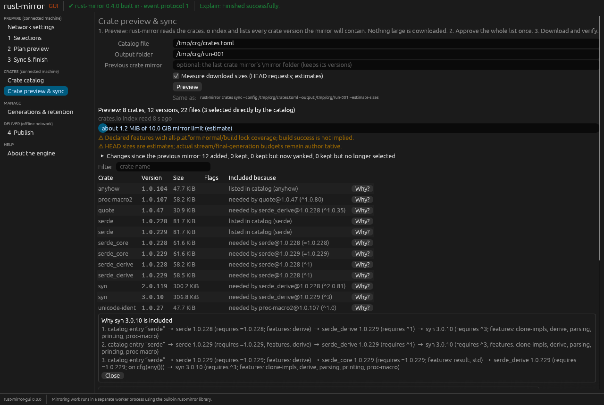

**Approve this preview and download** approves **the complete list, exactly as
saved**. You approve once, not per crate. If you change the catalog or want
newer versions, preview again into a new folder; the old approval doesn't carry
over.

### 12.3 Download, stop and resume

While downloading, the status shows the stage, time since the last event,
**"N of M crate files verified"** and the files in progress. Several files
download in parallel, and each one is checked against its SHA-256 from the
index.

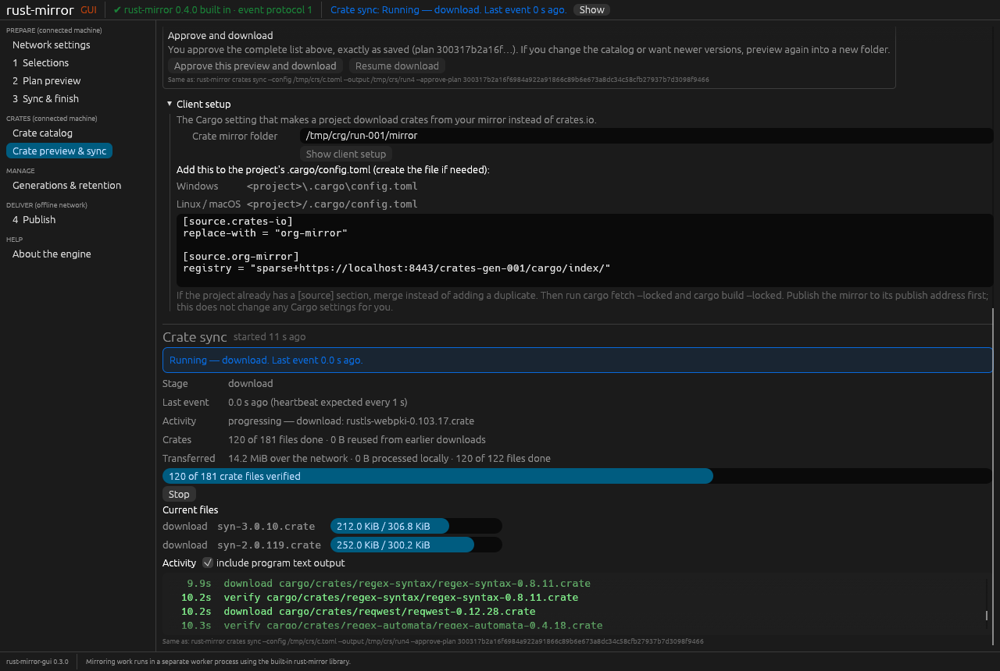

Press **Stop** at any time. Verified files are kept:

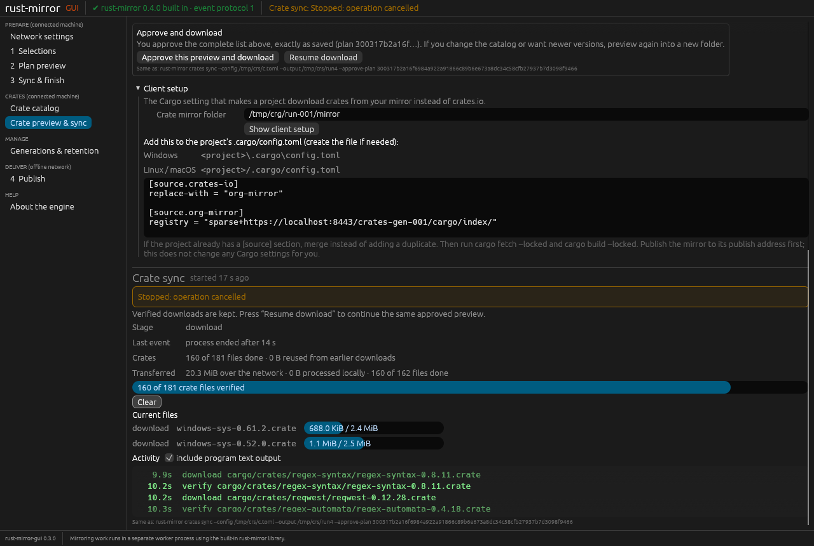

Press **Resume download** to continue **the same approved preview**. Only the
missing files are downloaded:

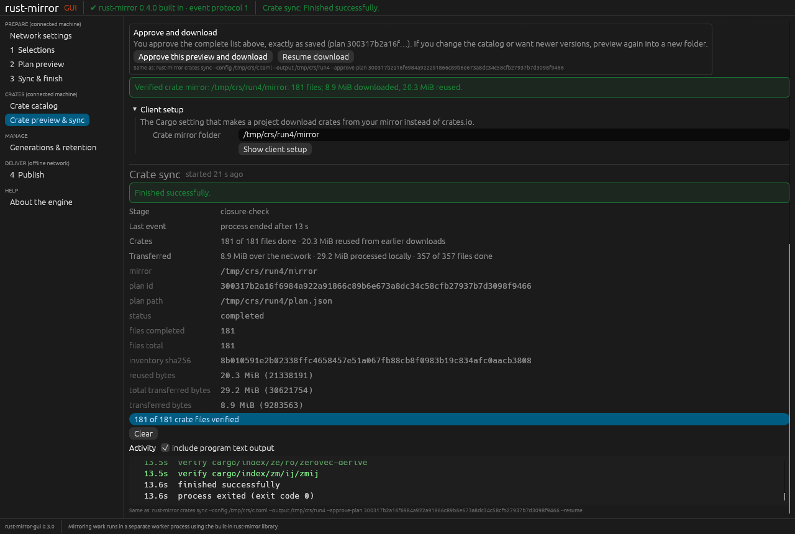

If crates.io asks the app to slow down, or a connection fails, the status
shows a **Retrying** line, for example "waited 30 s before attempt 2 … because
crates.io asked us to slow down". The download then continues by itself.

### 12.4 Client setup

**Client setup** shows the exact Cargo setting for a finished crate mirror:

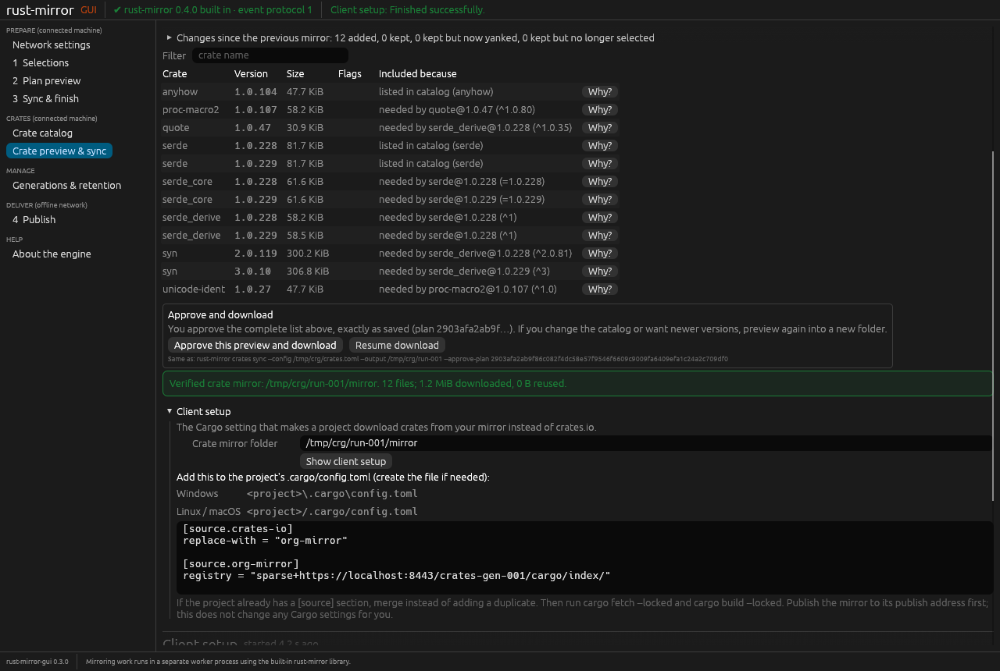

Add it to the project's `.cargo/config.toml`. The path is
`<project>\.cargo\config.toml` on Windows and `<project>/.cargo/config.toml` on
Linux/macOS. If the file already has a `[source]` section, merge them. The
snippet is the same on every operating system. Then use
`cargo fetch --locked` and `cargo build --locked`. The app never changes Cargo
settings for you.

### 12.5 Generations and publishing

- **Generations & retention** lists crate mirrors as "crates: N crates, M
  versions". The retention policy on that page applies to toolchain mirrors
  only. To remove crate mirrors, use **Crate retention** (section 12.6).

  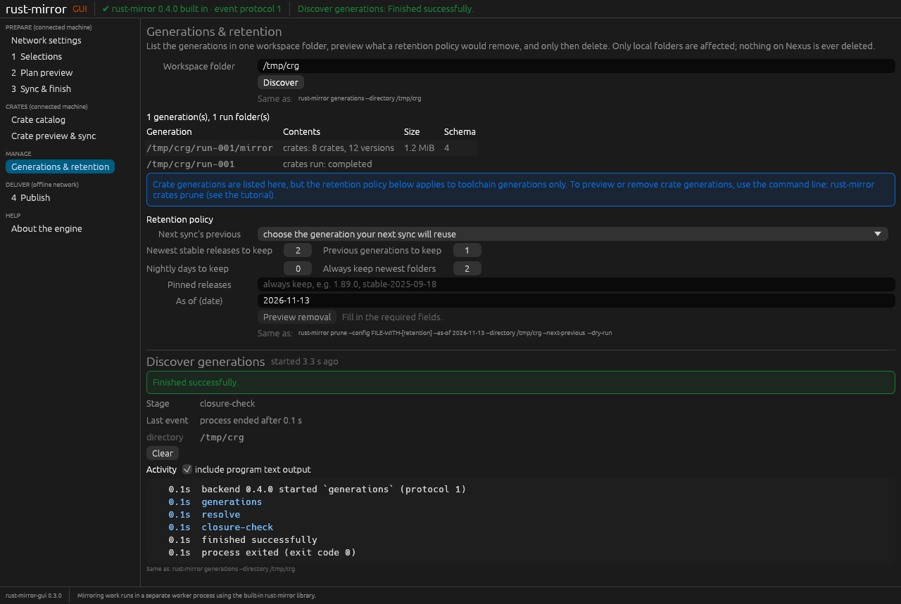
- **Publish** works as in section 7: use the crate mirror's `mirror` folder.
  The **Base URL must be the catalog's Publish address**. Otherwise
  **Check destination** refuses before uploading anything, and names both
  addresses.

  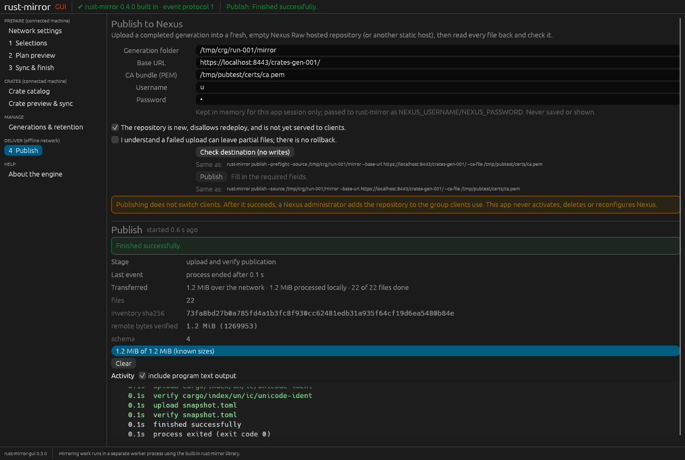

> **Tested in 0.3.0** (Linux, real crates.io):
> - catalog paste, rules and save;
> - previews of 12 and 181 versions;
> - "why included";
> - download, Stop mid-download and Resume;
> - client setup;
> - publish to a local HTTPS test server;
> - a real Cargo project fetching and building `--offline` from that published
>   mirror.
>
> **Not tested:**
> - a real retry wait from crates.io (the message is covered by an automated
>   test);
> - Windows and macOS runtime;
> - publishing crates to a real Nexus server.
>
> **Not in 0.3.0:** crate retention in the app (use the CLI), Cargo.lock
> import, git/path/alternate-registry crates, and authenticated Cargo readers.
> The first two are in 0.4.0 (sections 12.6 and 12.7).

### 12.6 Crate retention

*New in 0.4.0.* Crate mirrors pile up: every crate sync makes a new folder.
**Crate retention** shows which ones a policy would remove and why each other
one is kept. It deletes only after you type a confirmation. It removes local
folders only; nothing on Nexus is deleted.

1. Fill in **Crate catalog** (the catalog the mirrors were made from; its
   pinned versions are protected) and **Workspace folder** (the folder that
   holds your crate run folders). Press **Discover**. The table lists every
   crate mirror with its contents and size.
2. Set the policy:
   - **Next sync's previous**: the mirror your next crate sync will reuse.
     It is always kept.
   - **Always keep newest** N mirrors, and **Previous mirrors to keep**.
   - **Pinned mirrors**: tick any mirror that must never be removed.
   - **As of**: the date the policy is evaluated for (today by default).

   **Save policy in catalog** writes it into the catalog's
   `[crate-retention]`, so `rust-mirror crates prune` uses the same policy.
3. Press **Preview removal**. Nothing is deleted. Each folder is listed as
   **remove** (with its size) or **keep**, with every reason it is kept: the
   current generation, the newest, the next sync's previous, a pinned
   mirror, or a pinned crate version that lives in it.

   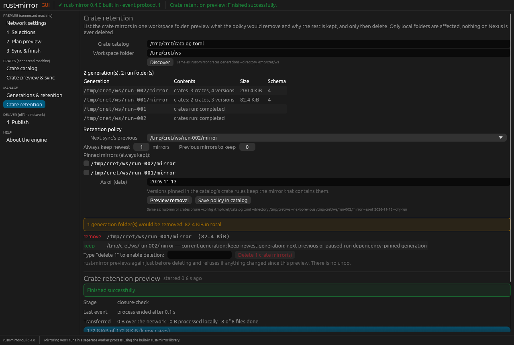

   Below that, **Kept because they hold versions that are still needed**
   names what protects each kept mirror: catalog crates with pinned
   versions, and each imported Cargo.lock source (section 12.7). A lock
   source protects the newest mirror that holds all of its versions. If no
   finished mirror holds them yet, the preview refuses: sync a crate mirror
   first, or remove that source.

   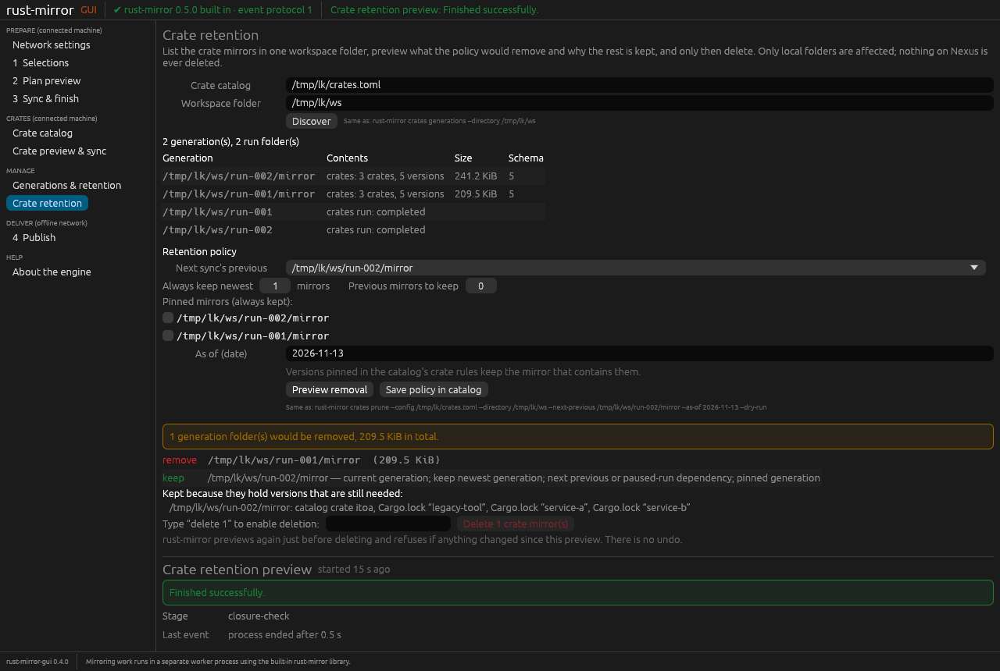
4. Type the phrase shown (for example `delete 1`). This enables
   **Delete N crate mirror(s)**. rust-mirror previews again just before
   deleting. If any folder changed since your preview (a new sync finished,
   a file changed), it refuses and deletes nothing. Then preview again.

   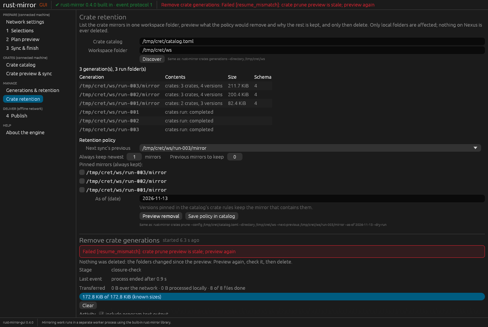

   On success the log lists every deleted file and the total size freed.
   There is no undo.

   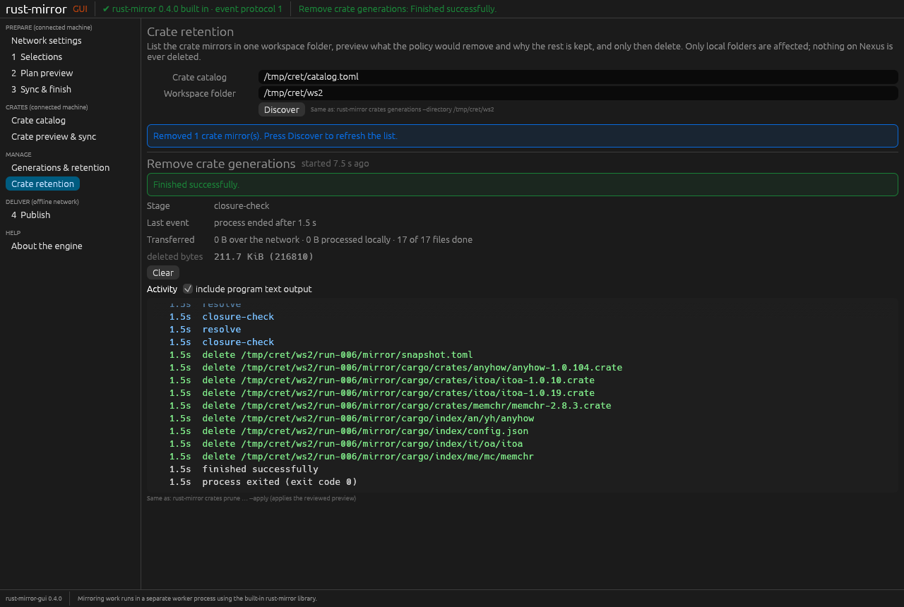

After a delete, Discover lists the emptied run folder as "crates run:
pruned". You can preview and delete again in the same folder.

The same steps on the command line:
`rust-mirror crates prune --config CATALOG --directory DIR --next-previous MIRROR --as-of YYYY-MM-DD`
does a dry run; add `--apply` to delete.

### 12.7 Import Cargo.lock files

*New in 0.4.0 (rust-mirror 0.5.0).* A project's `Cargo.lock` records the
exact crates.io versions it builds with, and their checksums. Import it,
and the mirror holds exactly those versions, so `cargo build --locked
--offline` works on the offline network without changing the lock file.

Import works on the saved catalog file. Save any unsaved catalog changes
first.

1. On **Crate catalog**, open **Cargo.lock sources**. Type a lock file's path
   and press **Add**, or drop one or more lock files on the window. Each
   file becomes a named **source**. The name is suggested from the project
   folder (`service-a/Cargo.lock` becomes `service-a`); you can change it.
2. Press **Preview import**. Nothing is written. For each file the summary
   shows:
   - the pinned versions it adds;
   - skipped entries: git dependencies and local path or workspace
     packages, with line numbers. These are not mirrored. The amber
     warning means the offline machine needs those sources separately;
   - problems, each with its line, column and a plain-English fix.

   If any file has a problem, **nothing** is imported: leave that file out
   with **✖**, or fix it, and preview again. Packages from another
   registry always refuse; the registry is shown without any password from
   its URL.

   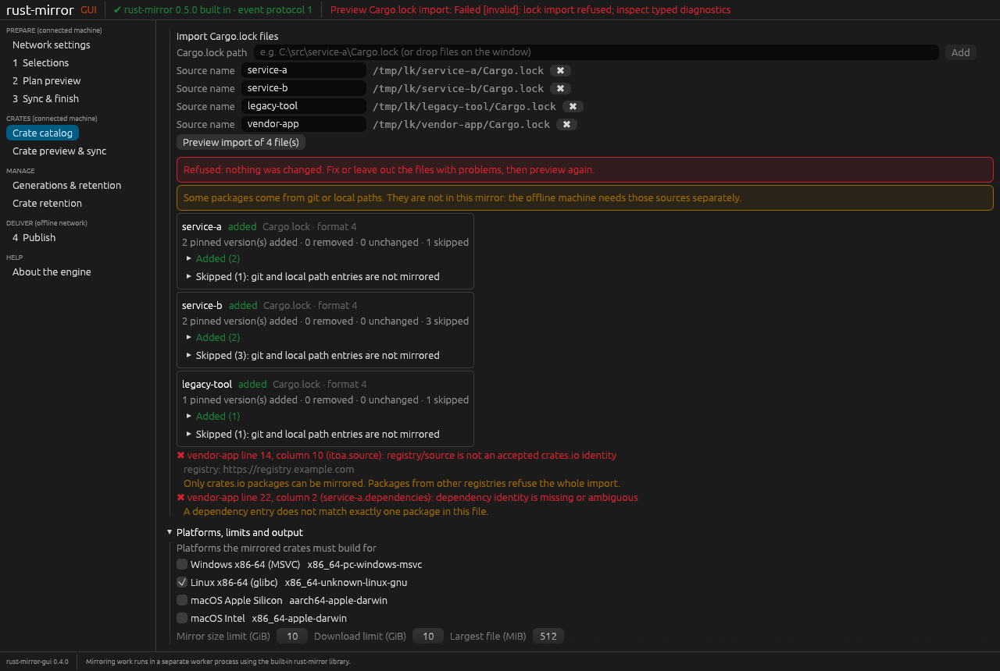

   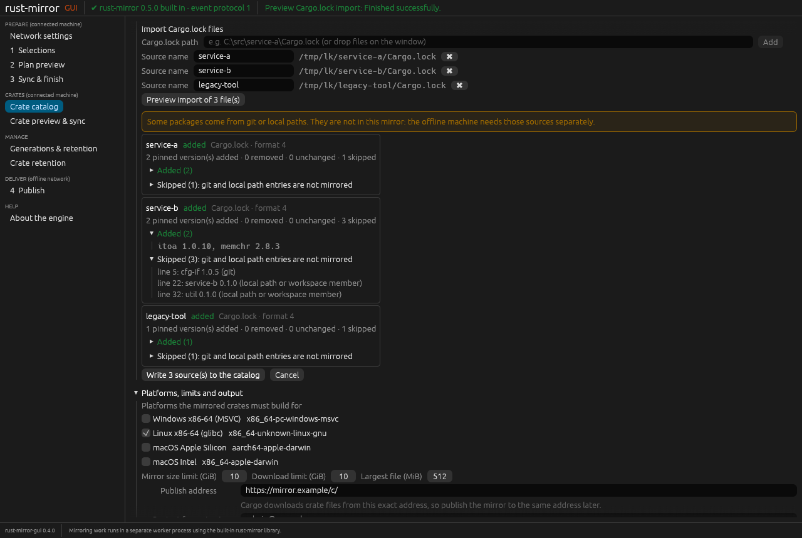
3. Press **Write N source(s) to the catalog**. rust-mirror writes the
   catalog file. The sources then appear as groups with their file, number
   of pinned versions, import date and SHA-256.

   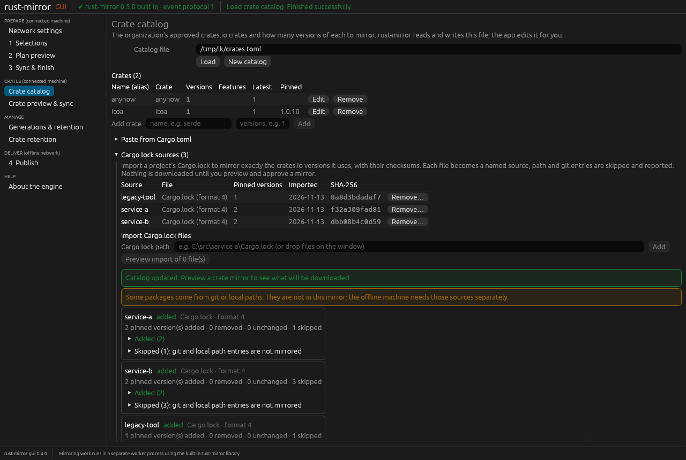
4. **When a project's lock file changes**, import it again under the same
   name. The summary marks the source **replaced** and shows exactly which
   versions are added or removed.

   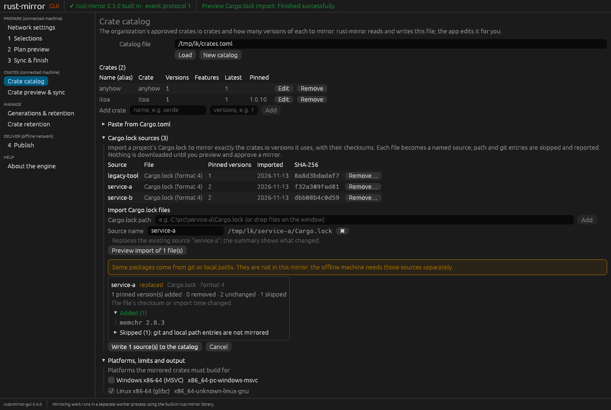
5. **Remove…** next to a source previews removing it. Removing only stops
   protecting its versions in future mirrors. Existing mirrors and their
   files are not deleted.

   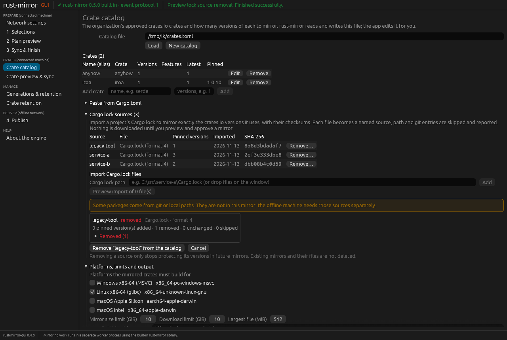
6. On **Crate preview & sync**, **Included because** shows each version's
   sources: "listed in catalog" for your own crates, and "Cargo.lock:" with
   every source that needs it. The filter also matches source names. A
   yanked version that a lock file still uses is flagged **yanked, kept for
   a Cargo.lock**. Cargo can still use it with `--locked`.

   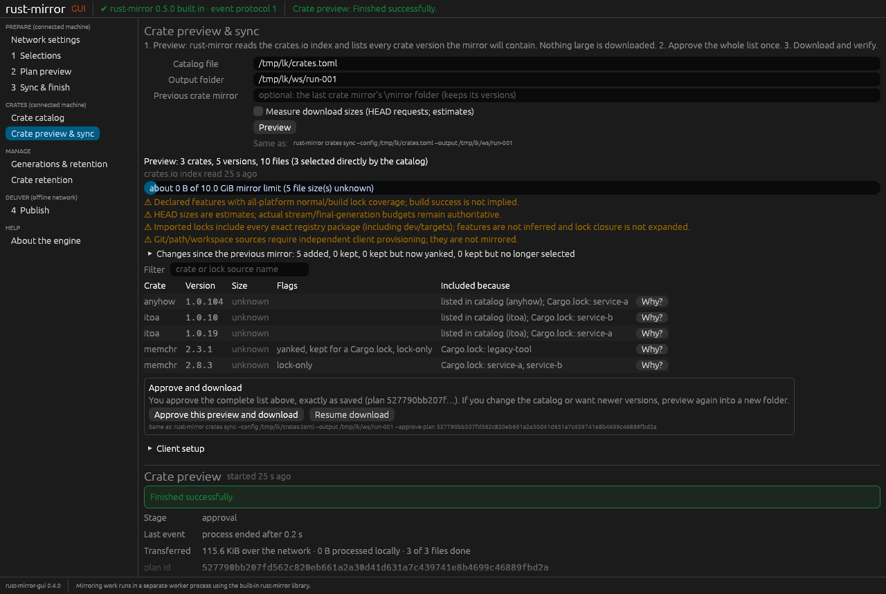

Then approve and download as in section 12.2, and set up clients as in
section 12.4.

The same steps on the command line:
`rust-mirror crates import-lock --config CATALOG --lock NAME=PATH [--lock NAME=PATH ...]`
previews; add `--write` to save. `rust-mirror crates remove-lock --config CATALOG --source NAME`
previews a removal; add `--write` to save.

> **Tested in 0.4.0** (Linux, real crates.io):
> - Cargo.lock import of three real projects, including git and path
>   dependencies and a real yanked version (`memchr 2.3.1`);
> - refusal of another registry, with the password in its URL not shown;
> - re-import differences and removal preview;
> - preview rows with sources;
> - download;
> - `cargo fetch --locked` then `cargo build --locked --offline` of two of
>   those projects from the mirror, served by a local HTTPS test server, with
>   the lock files unchanged;
> - crate retention with Cargo.lock keep reasons, and deleting twice in one
>   folder.
>
> **Not tested:** Windows and macOS runtime, and a real Nexus server.

---

More: [README](../README.md) · [Roadmap](ROADMAP.md) · [Release notes 0.4.0](releases/v0.4.0.md) · [0.3.0](releases/v0.3.0.md) · [0.2.0](releases/v0.2.0.md) · [0.1.0](releases/v0.1.0.md) ·
[Design](DESIGN.md) · [Changelog](../CHANGELOG.md)
