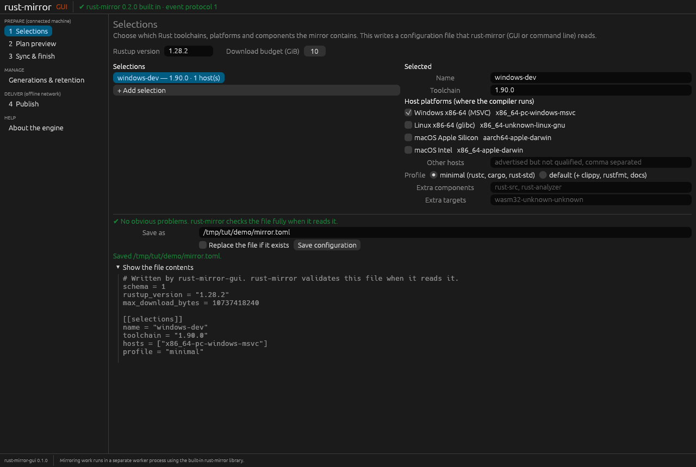
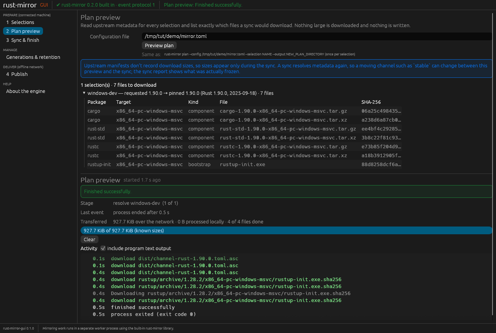
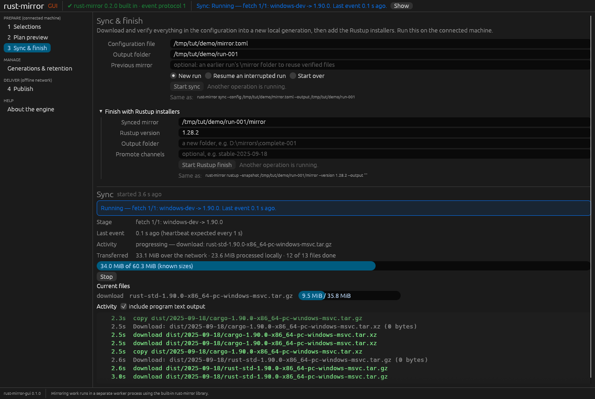
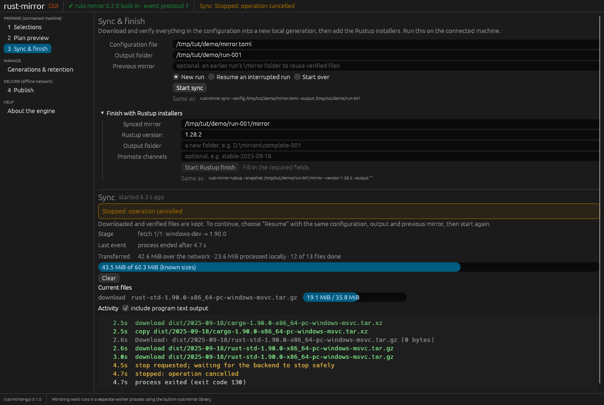
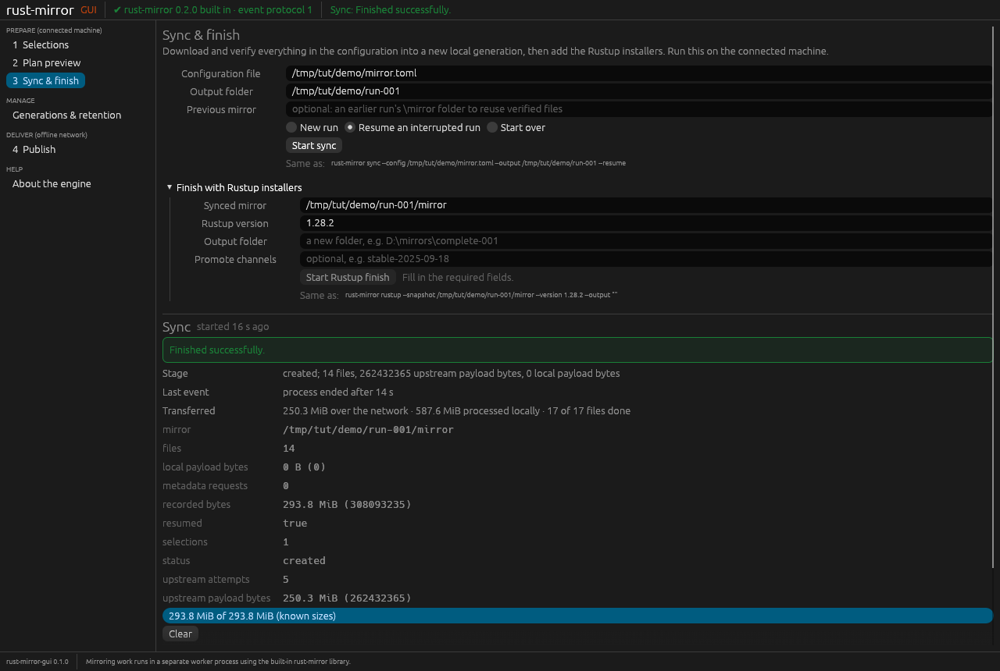
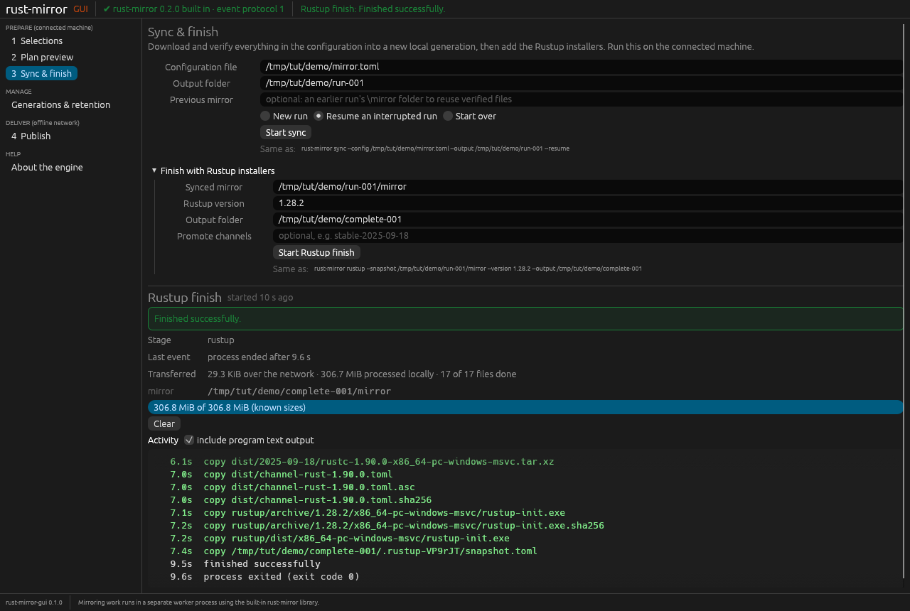
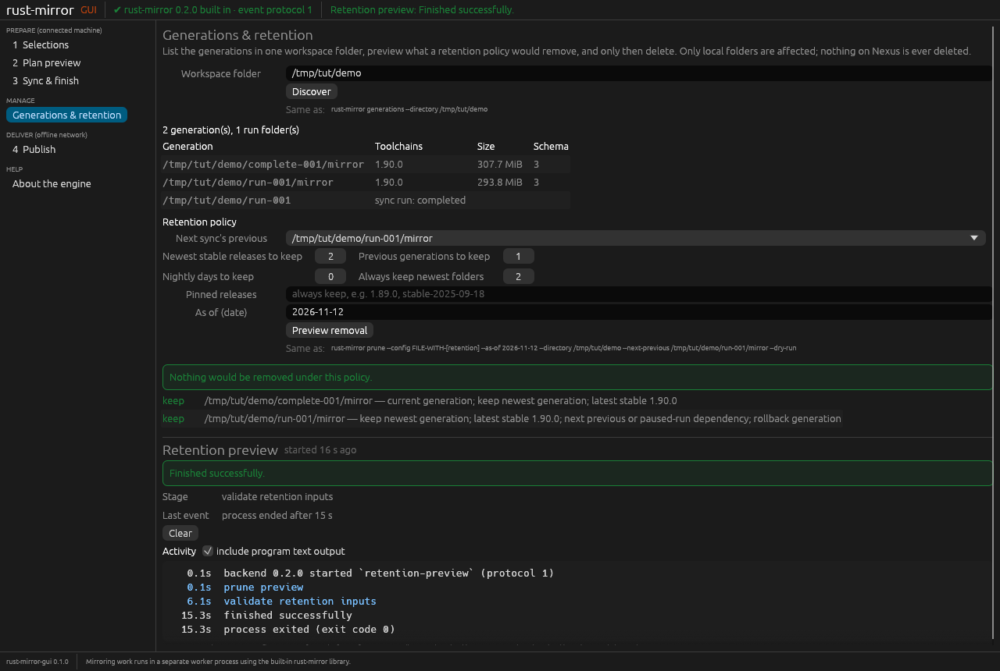
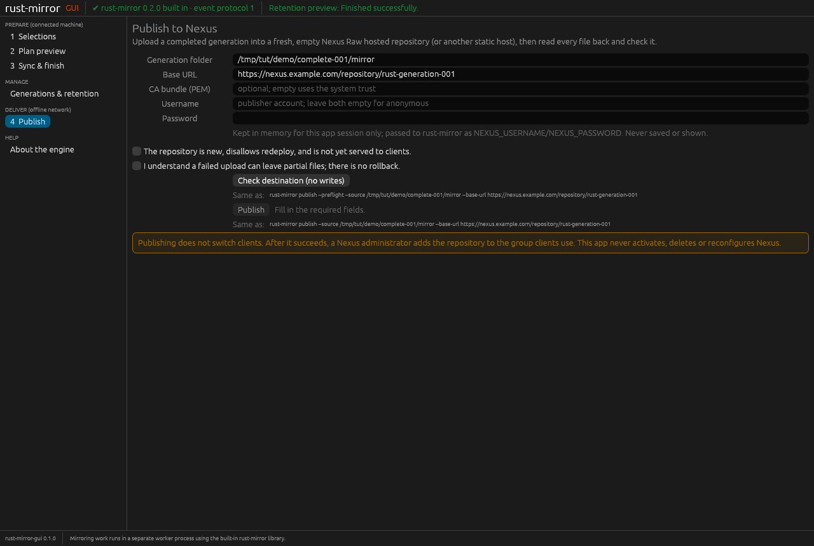

# rust-mirror-gui tutorial (version 0.1.0)

This tutorial teaches you to build an offline Rust toolchain mirror with
rust-mirror-gui and publish it to Nexus. It describes only what version 0.1.0
does.

> **Quick start**
>
> 1. `cargo install rust-mirror-gui --locked` (needs Rust 1.95+), then run `rust-mirror-gui`.
> 2. **Selections:** toolchain `1.90.0`, one host, profile **minimal**. Save as `demo/mirror.toml`.
> 3. **Plan preview:** **Preview plan** lists every file. Nothing is downloaded.
> 4. **Sync & finish:** output `demo/run-001` (a new folder), **Start sync**, about 300 MB.
> 5. **Stop** any time, then choose **Resume an interrupted run** and start again.
> 6. **Start Rustup finish** with output `demo/complete-001`. Copy `complete-001/mirror` to the offline network.
> 7. **Publish:** **Check destination (no writes)** first, then **Publish** into a new, empty Nexus Raw repository.
> 8. Every page shows the matching `rust-mirror` command under **Same as**.

The screenshots come from rust-mirror-gui 0.1.0 on Linux, so the paths look like
`/tmp/tut/demo`. On Windows you would use paths such as `C:\rm-demo`, and fonts
and window borders look slightly different.

## Contents

1. [Install and launch](#1-install-and-launch)
2. [Your first mirror in about 10 minutes](#2-your-first-mirror-in-about-10-minutes)
3. [Plan preview: what the numbers mean](#3-plan-preview-what-the-numbers-mean)
4. [Sync: reading the live status, Stop and Resume](#4-sync-reading-the-live-status-stop-and-resume)
5. [Rustup finish](#5-rustup-finish)
6. [Generations and retention](#6-generations-and-retention)
7. [Publish to Nexus](#7-publish-to-nexus)
8. [Move the mirror offline and point clients at it](#8-move-the-mirror-offline-and-point-clients-at-it)
9. [Troubleshooting](#9-troubleshooting)
10. ["Same as": the matching command-line commands](#10-same-as-the-matching-command-line-commands)

## 1. Install and launch

You need Rust 1.95 or newer.

```sh
cargo install rust-mirror-gui --locked
rust-mirror-gui
```

- The rust-mirror engine is built into the app. You don't install rust-mirror
  separately.
- **Windows:** you also need the Microsoft C++ build tools, as for any Rust
  install.
- **Linux:** building needs no extra packages. To run, the app needs a graphics
  driver (Vulkan or OpenGL) and xkbcommon. Desktop Linux already has them. On a
  minimal or GPU-less Debian/Ubuntu machine, install:

  ```sh
  sudo apt install libxkbcommon-x11-0 libvulkan1 mesa-vulkan-drivers libegl1
  ```

- **Settings:** the app remembers form values, never passwords, in
  `%APPDATA%\rust-mirror-gui\settings.json` on Windows or
  `~/.config/rust-mirror-gui/settings.json` on Linux.

When the app starts, the top bar should say
**"✔ rust-mirror 0.2.0 built in · event protocol 1"**. If it shows a red message,
open **About the engine** (see [Troubleshooting](#9-troubleshooting)).

## 2. Your first mirror in about 10 minutes

This demo downloads about **300 MB** from `static.rust-lang.org`: Rust 1.90.0,
minimal profile, one host. It writes only into the folder you choose. It never
touches your own Rustup or Cargo installation, or any server.

1. Create a **new, empty folder**, for example `C:\rm-demo` or `~/rm-demo`.
2. Open **1 Selections**. The app starts with one selection that is already
   right for the demo:
   - **Toolchain** `1.90.0`. Use a full version number so the result is
     repeatable. `stable` also works, but it moves over time.
   - **Host platforms:** tick exactly one, for example **Windows x86-64 (MSVC)**.
     The host is the computer your developers run the compiler on. It doesn't
     have to match the machine running this app.
   - **Profile:** **minimal** (rustc, cargo, rust-std).
3. In **Save as**, enter a file inside your new folder, for example
   `C:\rm-demo\mirror.toml`. Press **Save configuration**.

"Saved …" confirms it. Open **Show the file contents** to see the file. This is
the same configuration file the rust-mirror command line uses.



Good to know:
- The four named hosts are the ones rust-mirror has tested. Use **Other hosts**
  for anything else; those are advertised upstream but not tested.
- **Save configuration** refuses to overwrite an existing file unless you tick
  **Replace the file if it exists**.
- In 0.1.0 the editor **cannot open an existing configuration file**. To change
  one, build it again here, or edit the TOML file in a text editor.

## 3. Plan preview: what the numbers mean

Open **2 Plan preview**. The configuration path from step 2 is already filled in.
Press **Preview plan**.



- **"1 selection(s) · 7 files to download"** is how many payload files a sync
  will fetch. Each component comes in two formats (`.tar.gz` and `.tar.xz`), so
  rustc, cargo and rust-std make 6 files, plus `rustup-init` for the host.
- **"requested 1.90.0 → pinned 1.90.0 (Rust 1.90.0, 2025-09-18)"** shows what you
  asked for and the exact release it resolves to. With `stable`, the pinned
  value shows which dated release `stable` means today.
- The **SHA-256** column is the checksum each file must match. rust-mirror
  checks every download against it.
- **"Transferred … KiB"** in the status below is only the small metadata files
  the preview read. Nothing large is downloaded and nothing is written.
- The blue note is a real 0.1.0 limit: **download sizes aren't shown before the
  sync**. Also, the sync looks up metadata again, so a moving channel such as
  `stable` could change between preview and sync.

## 4. Sync: reading the live status, Stop and Resume

Open **3 Sync & finish**.

1. **Configuration file** is already filled in.
2. **Output folder:** enter a folder that **does not exist yet**, for example
   `C:\rm-demo\run-001`.
3. Leave **Previous mirror** empty for now. Later, put your last mirror here and
   the app reuses its verified files instead of downloading them again.
4. Choose **New run** and press **Start sync**.



How to read the live status:

| Line | Meaning |
| --- | --- |
| Blue **Running** box and top bar | The operation is working. The top bar repeats this on every page, with a **Show** button. |
| **Stage** | The current phase, for example `fetch 1/1: windows-dev -> 1.90.0`. |
| **Last event** | Time since the engine last reported anything. It sends a heartbeat about once a second, so this normally stays near 0 s. |
| **Activity** | What the engine says it is doing now: download, hash or copy, and which file. |
| **Transferred** | Bytes over the network, and bytes processed locally (hashing and copying). These are counted separately and are not added together. |
| Progress bar | Bytes of files whose size is known so far. Sizes become known as each download starts. |
| **Activity** log | Every step, in order. Grey lines are rust-mirror's own text output. |

**Warnings you may see:**
- **"No events for N s … rust-mirror may be stuck"** (amber) appears when the
  heartbeat stops for 5 seconds. The window keeps working. You can wait, press
  **Stop**, or press **End process now**.
- **"alive, but no new progress for N s"** appears when heartbeats continue but
  nothing has moved for 30 seconds, for example during a very slow network read.

**Stop and Resume:**
1. Press **Stop**. The engine stops at its next safe point, usually within a
   second, and the box says **"Stopped: operation cancelled"**. Verified files
   are kept.

   

2. Press **Clear**, choose **Resume an interrupted run**, and press
   **Start sync** again. Keep the same configuration, output folder and previous
   mirror. The engine reuses what it already verified and fetches the rest.
3. If it doesn't stop within 5 seconds, **End process now** appears. It ends the
   engine immediately. The window is unaffected, and Resume works in the same
   way.



When it finishes, the green box shows the result:
- **mirror:** the folder that was created (`…\run-001\mirror`);
- **files** and **recorded bytes:** about 294 MiB for this demo;
- how much came from upstream and how much was reused locally.

**Start over** deletes this output folder's progress and mirror, with no backup.
It asks you to tick a confirmation first.

## 5. Rustup finish

A sync produces the toolchains. Developers also need the Rustup installer files.
Below the sync form, in **Finish with Rustup installers**:

1. **Synced mirror** is filled in from your sync output (`…\run-001\mirror`).
2. **Rustup version:** `1.28.2`.
3. **Output folder:** a **new** folder, for example `C:\rm-demo\complete-001`.
4. **Promote channels:** leave empty for the demo. Fill it only if you want, for
   example, `stable-2025-09-18` served as your mirror's `stable`.
5. Press **Start Rustup finish**.



The result, `complete-001\mirror`, is the folder you move to the offline network
and publish. Keep `run-001\mirror` too: next time, use it as **Previous mirror**
so the next sync downloads only what changed.

The Rustup step doesn't resume. If it's interrupted, delete its unfinished
output folder and run it again.

## 6. Generations and retention

Over time you collect several mirror folders, called **generations**. Open
**Generations & retention**:

1. **Workspace folder:** the folder that holds your `run-…` and `complete-…`
   folders, for example `C:\rm-demo`. Press **Discover**. The table lists each
   generation, its toolchains and size, and each sync run folder with its state.
2. **Next sync's previous:** pick the generation your next sync will reuse
   (normally your newest `run-…\mirror`). It is always kept.
3. Adjust the policy if you want: newest stable releases to keep, previous
   generations to keep, nightly days, how many newest folders to always keep,
   and pinned releases.
4. Press **Preview removal**. This only reads and checks; it never deletes. It
   can take a while because every file is re-hashed.



The result lists every generation as **keep**, with the library's reasons, or
**remove**, with its size. In the demo nothing is removed. Both folders are the
newest, and `run-001\mirror` is also the next sync's previous.

**What Delete does** (shown only when the preview would remove something):
- A box asks you to type `delete N`, for example `delete 2`. The
  **Delete N generation(s)** button then becomes active.
- Before deleting, rust-mirror re-checks every file against the preview. It
  refuses if anything changed since.
- It removes only the listed local generation folders. It never touches Nexus,
  your sync run folders, or in-progress work.
- There is **no undo**. If a deletion stops partway, the files already removed
  stay removed.

> Tested: discovery and preview in the app, and the same deletion command run
> through the built-in engine. **Clicking Delete in the 0.1.0 window has not
> been tested end to end.**

## 7. Publish to Nexus

Run this on a machine that can reach your Nexus server, usually inside the
offline network. You need a **new, empty Nexus Raw hosted repository** that
doesn't allow redeploy. See rust-mirror's
[Nexus guide](https://github.com/rustcommons/rust-mirror/blob/main/docs/USER-GUIDE.md#nexus-publication-and-activation)
for how to set it up.

Open **4 Publish** and fill in:

| Field | Example (placeholder) |
| --- | --- |
| Generation folder | `E:\transfer\complete-001\mirror` |
| Base URL | `https://nexus.example.com/repository/rust-generation-001` |
| CA bundle (PEM) | Your company CA file, or empty to use the system trust |
| Username / Password | Your publishing account, or both empty for anonymous |



1. Press **Check destination (no writes)**. It checks:
   - that the local generation is complete;
   - that the URL, TLS certificate and login work;
   - that **every destination path is still empty**.

   Nothing is uploaded.
2. Tick both confirmations:
   - "The repository is new, disallows redeploy, and is not yet served to clients."
   - "I understand a failed upload can leave partial files; there is no rollback."
3. Press **Publish**. Each file is uploaded, then read back and checked. The
   inventory (`snapshot.toml`) goes last. The result shows **files** and
   **remote bytes verified**.

Things to know:
- The password is kept in memory only. It is passed to the engine as
  `NEXUS_USERNAME` / `NEXUS_PASSWORD`, and is never saved, logged or shown in
  **Same as**.
- **Publishing does not switch clients.** A Nexus administrator adds the new
  repository to the group your clients use. The app never activates, deletes or
  reconfigures anything in Nexus.
- **Stop during a publish** may leave some files on the server. Don't activate
  that repository; publish again into a new, empty one.

> Tested: check and publish against a local HTTPS test server with a private CA
> and a password. **Not yet tested against a real Nexus server from this app.**
> rust-mirror itself is qualified against Nexus.

## 8. Move the mirror offline and point clients at it

1. Copy the whole `complete-001\mirror` folder to the offline network, by
   approved removable media or transfer. Copy only that folder, not the private
   `.sync` folders.
2. Publish it there (section 7). You can also run the app inside the offline
   network: copy the `rust-mirror-gui` executable across, since it is a single
   file. Starting without a network was checked on Linux only; on Windows and
   macOS it is **untested**.
3. Point developer machines at your Nexus group URL. Developers use the normal
   Rustup and don't need this app. Follow rust-mirror's guide rather than this
   tutorial:
   - [Bootstrap a Windows client](https://github.com/rustcommons/rust-mirror/blob/main/docs/USER-GUIDE.md#bootstrap-a-windows-client)
   - [Bootstrap Linux or macOS clients](https://github.com/rustcommons/rust-mirror/blob/main/docs/USER-GUIDE.md#bootstrap-linux-or-macos-clients)
   - [Prepare the next generation](https://github.com/rustcommons/rust-mirror/blob/main/docs/USER-GUIDE.md#prepare-the-next-generation)

## 9. Troubleshooting

**The window does not open.**
- Linux: install the graphics packages from [section 1](#1-install-and-launch).
  With no Vulkan or OpenGL driver at all, the window can't be created.
- Windows over **Remote Desktop**, and computers **without a GPU**, have **not
  been tested** with 0.1.0. A native Windows 11 launch has been checked. Testing
  without a GPU and over Remote Desktop is deferred; see the
  [roadmap](../ROADMAP.md#deferred-qualification) and its
  [test plan](plans/NO-GPU-TEST-PLAN.md). If it fails for you, note the Windows
  version and how you connected, and tell the maintainers.

**The top bar says "operation worker not working".** The app runs its operations
in a hidden copy of itself. Open **About the engine** for the message.
Security software may be blocking the program from starting that copy.

**"No events for N s … rust-mirror may be stuck".** The engine stopped reporting.
- Wait a little, or press **Stop**. If it still doesn't stop, press
  **End process now**.
- For a sync, then choose **Resume an interrupted run**; verified files are kept.

**"Failed [output_exists]: sync output already exists".** The output folder
already exists.
- To continue an interrupted run, choose **Resume an interrupted run**.
- Otherwise pick a new folder, or use **Start over** to discard it.

**"Failed [resume_mismatch]".** The configuration or previous mirror changed
since the interrupted run. Put them back, or use **Start over**.

**"Failed [locked]".** Another rust-mirror process is using that output folder.
Wait for it to finish.

**"Failed [network]".** Check the connection, then **Resume**.

**Publish: "Failed [tls]".** The server certificate isn't trusted. Choose your
company CA bundle (a PEM file) in **CA bundle**. TLS checking cannot be turned
off.

**Publish: "Failed [auth]".** The server refused the login. Check the username,
password and that the account may upload to this repository.

**Publish: "Failed [remote_exists]".** The destination already has files. Use a
new, empty repository or prefix.

Each failure shows a short "what to do next" line under the red box. The full
detail is in the **Activity** log.

## 10. "Same as": the matching command-line commands

Under every Start button, **Same as:** shows the matching
[rust-mirror](https://crates.io/crates/rust-mirror) command, for example:

```text
rust-mirror sync --config C:\rm-demo\mirror.toml --output C:\rm-demo\run-001 --resume
rust-mirror rustup --snapshot C:\rm-demo\run-001\mirror --version 1.28.2 --output C:\rm-demo\complete-001
rust-mirror publish --preflight --source E:\transfer\complete-001\mirror --base-url https://nexus.example.com/repository/rust-generation-001
```

- Use these to script the same steps later with the
  [command-line tool](https://github.com/rustcommons/rust-mirror/blob/main/docs/CLI-REFERENCE.md).
- Credentials never appear there. The CLI reads them from `NEXUS_USERNAME` and
  `NEXUS_PASSWORD`.
- **Plan preview** and **retention** don't have a one-to-one command:
  - Plan preview's CLI form is `rust-mirror plan`, once per selection.
  - Retention's CLI form is `rust-mirror prune`, with the policy in a
    `[retention]` section of the configuration file. The app passes the policy
    directly instead.

---

More: [README](../README.md) · [Roadmap](../ROADMAP.md) · [Release notes 0.1.0](releases/v0.1.0.md) ·
[Design](DESIGN.md) · [Changelog](../CHANGELOG.md)
