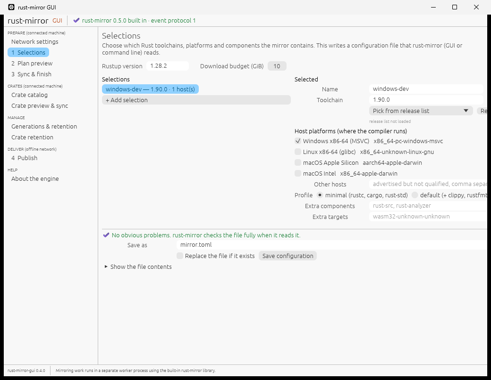

# Windows qualification of the crate workflow (2026-11-14)

Owner-approved task, 2026-11-13. This is a repeatable GitHub Actions job,
[`windows-qualification.yml`](../../.github/workflows/windows-qualification.yml)
(manual dispatch, and pull requests that change it). It drives the crate
workflow end to end on Windows through the GUI's own worker,
`rust-mirror-gui --worker`, built in release mode. It then launches the window
itself and captures it.

**Evidence run:**
[43563103813](https://github.com/rustcommons/rust-mirror-gui/actions/runs/43563103813)
(head `a9cd517`, which is main `12cfa02` (rust-mirror-gui 0.4.0 with rust-mirror
0.5.0) plus this harness), success. The run's artifact
`windows-qualification-evidence` holds `evidence.json` (every step with its exact
worker arguments, outcome and timing), the catalog, the Client setup snippet, the
fixture request and CRL logs, and the window capture.

The publish target is a **local HTTPS stand-in** for a Nexus raw hosted
repository, not a real Nexus server; see [Limits](#limits). The real Windows
Nexus harness that rust-mirror is building can replace it.

## Environment

- GitHub-hosted `windows-latest`: Windows Server 2025 Datacenter (build 26100).
  Display adapter "Microsoft Hyper-V Video"; **no GPU**. Primary screen
  1024×768.
- Rust 1.95.0 (`x86_64-pc-windows-msvc`), Python 3.12.10, OpenSSL from
  `C:\Program Files\OpenSSL\bin`.
- Real network access to crates.io. Isolated work, output and Cargo-home
  folders under the runner's temp folder.

## How the steps call the worker

[`tests/windows_qualification.rs`](../../tests/windows_qualification.rs) is an
ignored integration test. It builds every command with the window's own
`ops::*` builders and runs it with the window's `Job` process client. That is
the same code path as pressing the buttons; only the clicks are skipped. The
worker is the release `rust-mirror-gui.exe` (`cargo test --release`).
Upstream-facing commands get the window's network flags (`ops::with_network`,
direct connection).

## Results (run 43563103813)

| Step (window equivalent) | Result |
| --- | --- |
| Paste from Cargo.toml: `anyhow`, `itoa` and a path dependency | 2 usable; the path dependency refused (kind `path`, line 4) |
| Save catalog (the window's "New catalog" shape plus the pasted crates; one download at a time) | Written by rust-mirror as TOML |
| Cargo.lock import of [`qualification/demo/Cargo.lock`](../../qualification/demo/Cargo.lock) (17 packages, format 4, SHA-256 `1e1b2e72…6114f7f`): preview, then write | Accepted: 16 pins added, the project itself skipped as `local` (line 41). Written. |
| Preview with download sizes (`--estimate-sizes`) | `needs_approval`: 16 crates, 16 versions, 34 files, all 16 versions attributed to the `demo` lock source; no budget exceeded |
| Approve this preview and download, then **hard kill** (the window's "End process now": `TerminateProcess`) | Killed after 3 of 16 files (249,148 bytes) |
| Resume download (same approved plan, `--resume`) | Completed: 16/16 verified, 306,492 bytes reused, 2,034,256 downloaded |
| Second mirror with the first as previous: preview, approve | Completed, all reused |
| Discover generations; crate retention preview (keep newest 1, previous 0, next previous run-002) | Would remove run-001 (2,404,842 bytes). run-002 is kept, with keep sources: Cargo.lock "demo" (digest `1e1b2e72…`). Nothing deleted. |
| Client setup | `[source.crates-io] replace-with = "org-mirror"`, `registry = "sparse+https://127.0.0.1:8443/repository/crates-qual/cargo/index/"` |
| Publish: check destination (no writes) | 34 files, 2,507,822 bytes, all absent |
| Publish | 34 files uploaded; every remote byte read back and verified (2,507,822); inventory schema 5 |
| Check destination again | Refused with `remote_exists` before any write |

The fixture logged 68 `HEAD` 404 (two absence checks), 34 `PUT` 201, 67 `GET`
200 (verification and the Cargo client) and 1 `HEAD` 200 (the refused second
check). The publish password was random per run, masked in the log, passed only
in the worker's environment, and is absent from `evidence.json` (asserted).

### Cargo client on Windows

The client was a fresh `CARGO_HOME` containing only the Client setup snippet,
with the test CA trusted through `CARGO_HTTP_CAINFO`.
- `cargo fetch --locked` downloaded all 16 crates from `org-mirror`.
- `cargo build --locked --offline` built the fixture project, and its program
  ran.
- `Cargo.lock` was byte-identical afterwards (`1E1B2E72…`).

**TLS and revocation checks stayed on.** The certificates come from
rust-mirror's own fixture helper, `certificates()` in
[`scripts/prove_crates_https.py`](https://github.com/rustcommons/rust-mirror/blob/3f95e92060f7f89257e756bef79045e85af6e848/scripts/prove_crates_https.py),
pinned at `3f95e92` with SHA-256 `6bdbdca7…184fbbc9`. It makes:
- a disposable CA;
- a signed CRL served over local HTTP;
- a server certificate whose CRL distribution point names that CRL.

Windows' TLS stack, which Cargo uses on Windows, fetched `/fixture.crl` during
the run, so it checked revocation. rust-mirror's publisher (rustls with the
given CA) does not check revocation.

### The window on a GPU-less Windows Server

[`qualification/capture-window.ps1`](../../qualification/capture-window.ps1)
started the release `rust-mirror-gui.exe` with no `WGPU_BACKEND` (the 0.4.0
Windows default, Direct3D 12). It waited for the window titled
"rust-mirror GUI", waited 15 s, and captured the window with `PrintWindow`
(`PW_RENDERFULLCONTENT`).

- Graphics modules loaded by the app: `d3d10warp.dll`, `d3d12.dll`,
  `D3D12Core.dll`, `dxgi.dll`, `opengl32.dll`. **Direct3D 12 ran on WARP**,
  Windows' software rasterizer.
- The window drew its full first screen: 372 distinct colors, with the most
  common color covering 82.6%. The capture is below. The top bar reads
  "rust-mirror 0.5.0 built in · event protocol 1", and the sidebar shows the
  CRATES and MANAGE sections.
- The window is 1040×807, larger than the 1024×768 screen, so the right edge
  of the page is cut off. The app asks for 1280×860 with a 900×600 minimum.
- The light theme follows the runner's system setting.

**This is a partial no-GPU data point** for the
[no-GPU and Remote Desktop test plan](../plans/NO-GPU-TEST-PLAN.md),
environment W1 (Server 2025 only). It covers plan steps 1–2 (launch, adapter)
and one screenshot from step 3. It does not cover the rest of that plan:
- input, every screen, or the window doing a sync;
- resource use, resizing or scaling;
- Remote Desktop;
- Server 2022.

The crate workflow above ran through the worker, not by clicking the window.

## Harness problems found on the way (not app bugs)

Earlier runs on this branch failed because of the test harness, not the app:
- [43560079332](https://github.com/rustcommons/rust-mirror-gui/actions/runs/43560079332):
  - From PowerShell, `bash` is WSL's `bash.exe`, so the first certificate
    script never ran.
  - `MainWindowHandle` first pointed at a 16×16 untitled helper window. The
    capture now waits for the titled window.
- [43560831374](https://github.com/rustcommons/rust-mirror-gui/actions/runs/43560831374):
  Git Bash rewrote `-subj "/CN=…"` into a path.
- [43561396336](https://github.com/rustcommons/rust-mirror-gui/actions/runs/43561396336):
  - "publication transport failed" at the first HEAD. The fixture had been
    started in an earlier step, and the runner ends a step's processes when
    the step finishes; the fixture log shows no HEAD request reached it.
    Fixture, workflow, publish and client now run in one step.
  - That harness also turned Cargo's revocation check off. It was replaced
    by rust-mirror's CRL-serving `certificates()` helper, as the coordinator
    advised, and revocation stays on.

In every run that got past the certificate setup, all 16 worker steps up to the first publish request passed on Windows.

## Limits

- **Not a real Nexus server.** The publish target is
  [`qualification/nexus_fixture.py`](../../qualification/nexus_fixture.py):
  anonymous HEAD and GET, Basic-auth PUT, and 412 on overwrite with
  `If-None-Match: *`. Nexus behavior beyond that (permissions, redeploy
  policy, proxies, real TLS chains) is not covered here.
- One small real project (16 crates, about 2.4 MiB). The hard kill landed
  after 3 files with one download at a time. Larger catalogs and kills during
  a single large file were not covered.
- The window was launched and captured but not driven. Nothing ran over
  Remote Desktop, and nothing ran on Server 2022 or Windows 10/11 desktop
  editions. The owner's Windows 11 + RX 580 launch check is in the
  [0.4.0 validation record](2026-11-13-v0.4.0-validation.md).
- No release was needed: no app bug was found.
