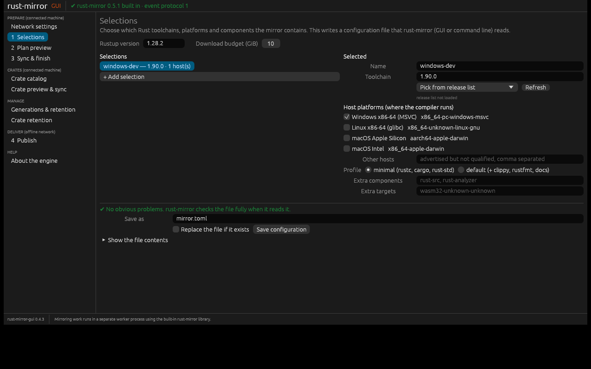

# How old a Linux can the GUI run on? (glibc experiments, CI only)

The owner asked for this measurement for 0.5.0 on 2026-11-15, then bounded it
the same day:
- run it once and record the results;
- anything that works below glibc 2.28 is documented as "may work, not
  supported";
- the published Linux download stays the glibc 2.28 build.

Nothing measured here was published.

- **Workflow:** [`glibc-experiments.yml`](../../.github/workflows/glibc-experiments.yml),
  [run 43740515744](https://github.com/rustcommons/rust-mirror-gui/actions/runs/43740515744).
  It ran on PR #21 at head `36bfbdd` (merge ref `22c03ed`), with 0.5.0's
  built-in fonts.
- **Method:** follows rust-mirror PR #46.
- **Raw results:** [`glibc-experiments-20261115.json`](glibc-experiments-20261115.json),
  60 rows.
- **Two earlier runs:** 43739144799 and 43740419108 were cancelled. My
  workflow script had passed the wrong `--artifact` path, and the launch
  jobs couldn't find the downloaded binaries. Both were fixed before this
  run.

## What was built

| Binary | How | Highest `GLIBC_` symbol |
| --- | --- | --- |
| `alma8` | The published method: `cargo build --release --locked` in `almalinux:8` (glibc 2.28) | 2.28 |
| `libc2.28` | cargo-libc 0.7.0 (commit `e68ca7b`), `--target x86_64-unknown-linux-gnu.2.28`, Clang 18.1.3 and GCC 13.3 on ubuntu-24.04 | 2.28 |
| `libc2.17` | the same, `--target x86_64-unknown-linux-gnu.2.17` | 2.17 |

All three use Rust 1.95.0 and `--locked`. cargo-libc built both targets
without problems; `cargo libc inspect --max-glibc` was run on each.

## What was run

Each binary was run in each container (images pinned by digest, as in
rust-mirror's gate):
- **Version:** `--worker --version`.
- **Window:** launched on Xvfb with the default renderer and with
  `WGPU_BACKEND=gl`. "Drawn" means the "rust-mirror GUI" window was mapped,
  the app was still running 5 s later, and the screen had at least 16
  colours.
- **Network:** once per binary, a real crate plan and sync from crates.io
  over HTTPS, checking DNS and TLS with certificate verification
  (`--worker crates sync`, then `--approve-plan`).
- **Environment:**
  - each container got Xvfb and the Mesa, xkbcommon and X libraries its
    archive offers;
  - all system fonts and fontconfig settings were deleted first.

## Results

✔ = worked; ✖ = failed. "Net" is the HTTPS plan and sync. For each binary
the cells read: version / window (default renderer) / window (GL) / net.

| Distribution | glibc | Mesa | `alma8` (published) | `libc2.28` | `libc2.17` |
| --- | --- | --- | --- | --- | --- |
| AlmaLinux 8.10 | 2.28 | 23.1.4 | ✔ / ✔ / ✔ / ✔ | ✔ / ✔ / ✔ / ✔ | ✔ / ✔ / ✔ / ✔ |
| Ubuntu 20.04 | 2.31 | 21.2.6 | ✔ / ✔ / ✔ / ✔ | ✔ / ✔ / ✔ / ✔ | ✔ / ✔ / ✔ / ✔ |
| Ubuntu 18.04 | 2.27 | 20.0.8 | ✖ needs GLIBC_2.28 | ✖ needs GLIBC_2.28 | ✔ / ✖ / ✖ / ✔ (A) |
| Debian 9 | 2.24 | 13.0.6 | ✖ needs GLIBC_2.27 | ✖ needs GLIBC_2.27 | ✔ / ✔ / ✔ / ✔ |
| Ubuntu 16.04 | 2.23 | 18.0.5 | ✖ needs GLIBC_2.27 | ✖ needs GLIBC_2.27 | ✔ / ✖ / ✖ / ✔ (B) |
| openSUSE Leap 42.3 (SLES 12 era) | 2.22 | not installed (C) | ✖ needs GLIBC_2.27 | ✖ needs GLIBC_2.27 | ✔ / ✖ / ✖ / ✔ (B) |
| Debian 8 | 2.19 | 10.3.2 | ✖ needs GLIBC_2.27 | ✖ needs GLIBC_2.27 | ✔ / ✖ / ✖ / ✔ (B) |
| CentOS 7 | 2.17 | 18.3.4 | ✖ needs GLIBC_2.18 | ✖ needs GLIBC_2.25 | ✔ / ✖ / ✖ / ✔ (D) |
| CentOS 6 (control) | 2.12 | 11.0.7 | ✖ needs GLIBC_2.18 | ✖ needs GLIBC_2.15 | ✖ needs GLIBC_2.14 |
| Debian 7 (control) | 2.13 | 8.0.5 | ✖ needs GLIBC_2.18 | ✖ needs GLIBC_2.15 | ✖ needs GLIBC_2.14 |

Why the window failed:
- **(A) Ubuntu 18.04:** `WGPU error: Parent device is lost`, with both
  renderers (Mesa 20.0 software rendering).
- **(B) Debian 8, Ubuntu 16.04, openSUSE 42.3:** the window library
  (x11rb 0.13) panics loading `libxcb.so.1`. Its libxcb lacks
  `xcb_discard_reply64` (Debian 8) or `xcb_send_request_with_fds64` (the
  others), so the window cannot start, whatever the renderer.
- **(C) openSUSE 42.3:** the archived repository had no `Mesa-dri` package
  under that name. The libxcb failure comes first anyway.
- **(D) CentOS 7:** Mesa 18.3 offers no Vulkan adapter, and wgpu's OpenGL
  backend could not create a surface (`Failed to create surface for any
  enabled backend`).

## Conclusions

- **The published download (built on AlmaLinux 8) needs glibc 2.28.**
  Below that the loader refuses to start it. The cargo-libc 2.28 build
  behaves the same, so cargo-libc gives no advantage at 2.28.
- **The cargo-libc 2.17 build loads on every glibc 2.17+ userland tested.**
  Its worker ran the HTTPS plan and sync everywhere (CentOS 7, openSUSE
  42.3, Ubuntu 16.04/18.04, Debian 8/9). The window, though, drew only on
  Debian 9. Elsewhere the old libxcb or Mesa stops it, which no glibc
  target can fix. So older Linux is a graphics-stack limit, not a glibc
  one.
- **Support decision (owner):** the GUI supports glibc 2.28 or newer. On
  older Linux, use the rust-mirror command line. A Debian 9 machine "may
  work" only with a 2.17 build, which isn't published, so it is not
  supported.
- **Built-in fonts:** with every system font deleted, the ✔ and ⚠ symbols
  drew from the built-in DejaVu Sans on all distributions where the window
  started.
- **cargo-libc:** no problems found, so nothing was reported to its
  maintainers.

## Limits of this measurement

- Containers share the CI runner's kernel (7.0, Azure), so old kernels are
  not tested.
- Rendering was software only (Xvfb with Mesa); real GPU drivers were not
  tested.
- openSUSE Leap 42.3 stands in for SLES 12; no commercial SLES image was
  used.
- One run, on one day; no repeats.
