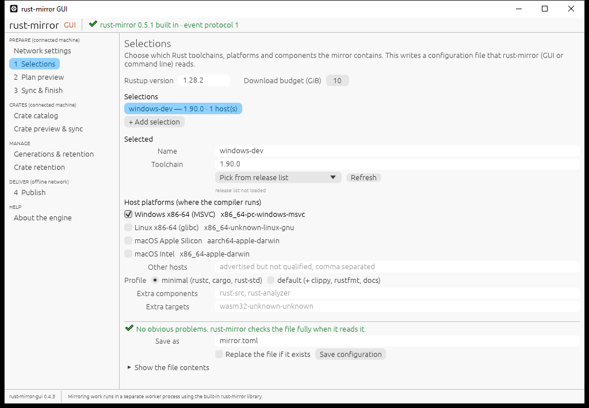

# rust-mirror-gui 0.4.3 publication record

The owner authorized the 0.4.3 release on 2026-11-15. It is the first release
with prebuilt downloads; the owner decided not to backfill 0.4.2. The
coordinator published from the owner's Windows machine with the owner's local
Cargo login. crates.io records the upload as 2026-11-15T15:01:46Z (UTC).

No version was republished and no source tag was moved. No release asset was
replaced or deleted. This record changes documentation only. It also adds a
read-only verification workflow.

## Source and upload

- PR #19 was merged normally as `25ec95ffd7992e58df9ad204ddf36e701935609c`.
  Its tree is identical to the CI-green reviewed head `f032216` (empty diff).
- The coordinator ran `cargo publish --locked` with Cargo 1.99.0
  (x86_64-pc-windows-msvc) from a clean worktree at the merge
  (coordinator-reported).
- Registry index dependencies: `eframe ^0.37`, `rust-mirror ^0.5.1`,
  `serde ^1.0`, `serde_json ^1.0`. They are unchanged since 0.4.2.

## Registry archive verification (this thread)

- The archive from `static.crates.io` is 152,579 bytes with SHA-256
  `5ba6a948c79ddcf8579d2f171bee956b3666042074aa708f6f1834ddbef900b0`.
  This matches the crates.io API checksum, the sparse-index `cksum` and the
  coordinator-reported value. Not yanked.
- `.cargo_vcs_info.json` names `25ec95ffd7992e58df9ad204ddf36e701935609c`.
- All 34 payload files are byte-identical to `git archive 25ec95f`, comparing
  `Cargo.toml.orig` against `Cargo.toml`.
- The packaged `Cargo.lock` pins rust-mirror 0.5.1 with checksum
  `29b547bb8b762beb0f403dda6f8f628ab7706a18ccd52bb0f01711382a0bda39`.

## docs.rs

`status.json` reported `doc_status: true` for 0.4.3.

## Fresh registry installation (Linux)

`cargo install rust-mirror-gui --version 0.4.3 --locked --root FRESH_ROOT` ran
with Cargo 1.99.1 on Debian 12 aarch64, an empty `CARGO_HOME` and an isolated
target directory.
- rust-mirror-gui 0.4.3 and rust-mirror 0.5.1 were downloaded from crates.io.
  The install took 180 s and exited 0.
- Exactly one executable was installed (`rust-mirror-gui`), SHA-256
  `b6ddc023e7519ca6b50a9bb862571741c2806097ac99f1ee365d0354f477e471`.
- `--worker --version` reported protocol 1 and `tool_version` 0.5.1.
- `qualification/linux-launch.sh` on Xvfb:
  - the window "rust-mirror GUI" was drawn;
  - the top bar read "✔ rust-mirror 0.5.1 built in · event protocol 1";
  - the status bar read "rust-mirror-gui 0.4.3".

## Tag and GitHub Release

- Annotated tag `v0.4.3` (message `rust-mirror-gui 0.4.3`) peels to
  `25ec95ffd7992e58df9ad204ddf36e701935609c`.
- [GitHub Release v0.4.3](https://github.com/rustcommons/rust-mirror-gui/releases/tag/v0.4.3),
  published 2026-11-15T15:02:28Z:
  - body identical to [`docs/releases/v0.4.3.md`](../releases/v0.4.3.md) at
    25ec95f;
  - not a draft, marked latest.
- Release-documentation checks:
  - local `--published-tag v0.4.3`: PASS (before and after the assets were
    attached);
  - the release-event workflow: success.

## Prebuilt downloads

The tag push started
[Release binaries run 43727623903](https://github.com/rustcommons/rust-mirror-gui/actions/runs/43727623903).
Every job succeeded:
- **prepare:** the tag, the commit and `Cargo.toml` agree; the live release
  matches the tagged notes.
- **build:** four builds with their smoke tests.
- **linux-launch:** AlmaLinux 8 and Ubuntu 20.04, default renderer.
- **checksums.**
- **publish:** attest, verify, upload, then download back and verify.

Live assets (the GitHub API's digests match):

```
1404f91f78b485ebe6887b981dc9e1ed9efa1cd384f6a1202b932829fcf61515  rust-mirror-gui-0.4.3-aarch64-apple-darwin.tar.gz
255d6f0347cfb818c449a8c4c6af73347682907360e323f4b30dc491756416e4  rust-mirror-gui-0.4.3-x86_64-apple-darwin.tar.gz
2fd309f9c72309d83eeb5944f45d94237958ecbdfe5feab377d7796be0cdd1ad  rust-mirror-gui-0.4.3-x86_64-pc-windows-msvc.zip
9d9a92ba5f47d43b803f77ac8750764e207e33882cc85780510e9a7ae62ab58e  rust-mirror-gui-0.4.3-x86_64-unknown-linux-gnu.tar.gz
```

`SHA256SUMS` (466 bytes) has SHA-256
`e12c65132dc124957ca54273d6933dd561642497c5114129f073ec9e4bae60f6`.

Verified independently in this thread, after downloading the five assets
with `gh release download`:
- `sha256sum -c SHA256SUMS`: all four OK.
- `gh attestation verify --signer-workflow
  rustcommons/rust-mirror-gui/.github/workflows/release-binaries.yml`:
  verified for all five files.
- The certificate names:
  - source ref `refs/tags/v0.4.3`;
  - source digest `25ec95ffd7992e58df9ad204ddf36e701935609c`;
  - trigger `push`;
  - run 43727623903.

## Running the downloads

The new read-only workflow `verify-release-download.yml` downloads the live
assets as a user gets them. It builds nothing and uploads nothing.
[Run 43729104207](https://github.com/rustcommons/rust-mirror-gui/actions/runs/43729104207)
on PR #20 succeeded:

- **assets:**
  - exactly the 4 archives and `SHA256SUMS` are on the release;
  - `sha256sum -c` passes;
  - every file's attestation verifies, signed by `release-binaries.yml`;
  - each archive lists one folder with the program, `LICENSE` and
    `README.txt`.
- **windows** (windows-2022, run without installing anything):
  - the zip's SHA-256 matched `SHA256SUMS`;
  - the folder holds `rust-mirror-gui.exe` (26,365,952 bytes), `LICENSE`
    and `README.txt`;
  - `--worker --version` reported protocol 1 and rust-mirror 0.5.1;
  - the PrintWindow capture had 429 distinct colours.
- **linux:** the archive was downloaded from the public release URL with
  `curl`, checked with `sha256sum -c --ignore-missing`, and run in
  `almalinux:8` and `ubuntu:20.04` (both pinned by digest). Only the
  runtime packages the README lists were installed.
  - `--worker --version` passed on both.
  - Under Xvfb with the default renderer, the window "rust-mirror GUI" was
    drawn on both.
  - On Ubuntu 20.04 the app logged that it lowered four limits for lavapipe
    (LLVM 12), including `max_color_attachments` 8 to 2.

An earlier attempt,
[run 43729025709](https://github.com/rustcommons/rust-mirror-gui/actions/runs/43729025709),
failed only in the Windows script. A GUI-subsystem program run with
PowerShell's `&` is neither waited for nor captured. The workflow now uses
`Start-Process -Wait` with redirected output. The download's checksum had
already matched.



No credential values appear in this record.
