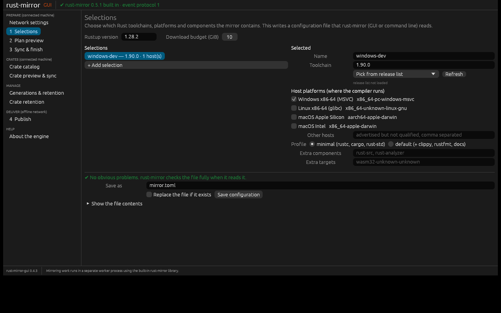

# rust-mirror-gui 0.4.3 validation record

0.4.3 fixes the window not opening on some Linux machines without a GPU, and
is the first release with prebuilt downloads. The owner authorized it on
2026-11-15 (option 2: no download backfill for 0.4.2). This record covers the
release pull request (#19) before the merge.

## The bug

The 0.4.2 Linux binary, launched under Xvfb in a GPU-less `ubuntu:20.04`
container with the default renderer, stopped at start:

```
rust-mirror-gui: WGPU error: Limit 'max_color_attachments' value 8 is better than allowed 2
```

The same binary started with `WGPU_BACKEND=gl` (release-workflow dry run
[43692804936](https://github.com/rustcommons/rust-mirror-gui/actions/runs/43692804936)).
egui-wgpu requests wgpu's default limits on Vulkan, and Ubuntu 20.04's
lavapipe offers less.

## The fix

`src/gpu.rs`, called from `src/main.rs`:
- **Fitting:** each requested limit is lowered to what the adapter offers,
  using wgpu's `Limits::or_worse_values_from`.
- **Floor:** what egui needs. That is wgpu's WebGL2 limits (egui-wgpu's own
  request on OpenGL), with one colour attachment and a 2048-pixel texture
  side.
- **Below the floor:** the app prints which limits are short, then still
  requests the floor, so the device request fails rather than drawing
  wrongly.
- **When it lowers anything,** it prints one line naming the lowered limits.

Unit tests (`gpu::tests`):
- the Ubuntu 20.04 case;
- a capable adapter, whose request stays unchanged;
- the floor itself;
- the error naming each short limit.

Local checks: `cargo fmt --check`, `cargo clippy --all-targets
--all-features -D warnings`, and `cargo test --all-features` (29 + 19 tests)
pass; the release-documentation check passes.

## Release-workflow dry run of the release source

The pull request dry run builds the PR's own head as the release would.
[Run 43723296376](https://github.com/rustcommons/rust-mirror-gui/actions/runs/43723296376)
(head `8dcb4cd`) succeeded; nothing was uploaded (the publish job was
skipped).

| Target | Runner | Smoke tests |
| --- | --- | --- |
| x86_64-pc-windows-msvc | windows-2022 | `--worker --version` reported protocol 1 and rust-mirror 0.5.1; PrintWindow capture 429 distinct colours; no Visual C++ or UCRT runtime DLL imported (`+crt-static`) |
| x86_64-unknown-linux-gnu | `almalinux:8` container on ubuntu-22.04 | `--worker --version` passed; highest `GLIBC_` symbol version 2.28 |
| aarch64-apple-darwin | macos-15 | `--worker --version` passed; Mach-O arm64, `minos 11.0` |
| x86_64-apple-darwin | macos-15-intel | `--worker --version` passed; Mach-O x86_64, `minos 11.0` |

All built with Rust 1.95.0 and `--locked`.

Windows imports: bcryptprimitives, shlwapi, kernel32, user32, dwmapi,
gdi32, shell32, oleaut32, api-ms-win-core-synch-l1-2-0, dwrite, advapi32,
uiautomationcore, ole32, opengl32, dxgi, setupapi, combase,
api-ms-win-core-winrt-error-l1-1-0, bcrypt, ws2_32, imm32, uxtheme and ntdll.

### Linux launch on old distributions

The packaged Linux archive was unpacked in containers that had only the
runtime packages the README lists, plus Xvfb and the test tools. The app
started its worker, mapped the "rust-mirror GUI" window, and drew it with the
**default renderer** (927 distinct colours in each screenshot).

| Container | glibc | Renderer | Result |
| --- | --- | --- | --- |
| `almalinux:8` | 2.28 | default (Mesa 23.1 software drivers; the log names no backend because nothing was lowered) | window drawn |
| `ubuntu:20.04` | 2.31 | default (Vulkan, lavapipe, LLVM 12) | window drawn; the app lowered four limits |

The app's line on Ubuntu 20.04:

```
rust-mirror-gui: llvmpipe (LLVM 12.0.0, 256 bits) (Vulkan) offers less than the default request; lowered max_dynamic_storage_buffers_per_pipeline_layout 4->3, max_storage_buffers_per_shader_stage 8->3, max_storage_textures_per_shader_stage 4->3, max_color_attachments 8->2
```

The OpenGL backend (`WGPU_BACKEND=gl`) was also launched on both, for
comparison, and drew the window.




### Fonts on minimal Linux

The ✔ symbol isn't in egui's built-in fonts. eframe looks it up through
fontconfig. Without fontconfig and a font such as DejaVu, ✔ showed as an
empty box on a minimal AlmaLinux 8 (dry runs
[43693863403](https://github.com/rustcommons/rust-mirror-gui/actions/runs/43693863403)
and [43694860881](https://github.com/rustcommons/rust-mirror-gui/actions/runs/43694860881)).
The documented package lists include them now. Bundling a font is planned for
0.5.0.

### Dry-run archives (not published)

```
4f33884a075a265912e658fea5d7a6f557ecd3c89c12d0f59add8d86030d69a6  rust-mirror-gui-0.4.3-aarch64-apple-darwin.tar.gz
152952175f17a5f99a2e1bcf5beeea59c7b0102c7ca8de0330ec9bc7239b5cc9  rust-mirror-gui-0.4.3-x86_64-apple-darwin.tar.gz
6f64d2d3c331bdc3aaa7d2e3dc99b7a3393e287b4e9340f60b898c54b2666ce9  rust-mirror-gui-0.4.3-x86_64-pc-windows-msvc.zip
749e18d430d05c291361c35f3360cede1102dc9fb9e43752bd7b0810b24cb4aa  rust-mirror-gui-0.4.3-x86_64-unknown-linux-gnu.tar.gz
```

The release's own archives are built again from the tag. Their `README.txt`
names the tag instead of "pull request (dry run, not a release)", so their
checksums differ.

## Not tested

- macOS beyond `--worker --version`: there is no window test.
- Linux on real old hardware: only containers on GitHub runners were used.
- RHEL 8 itself (AlmaLinux 8 has the same glibc) and SLES.
- Screen readers.
