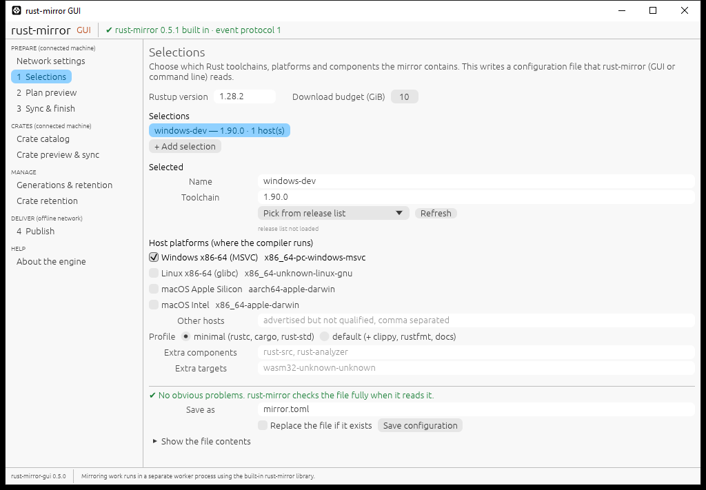

# rust-mirror-gui 0.5.0 publication record

The owner approved 0.5.0 on 2026-11-15 and authorized its publication once
green. The coordinator published from the owner's Windows machine with the
owner's local Cargo login. crates.io records the upload as
2026-11-15T18:52:30Z (UTC).

No version was republished and no source tag was moved. No release asset was
replaced or deleted. This record changes documentation only. It also updates
the read-only download check for 0.5.0.

## Source and upload

- PR #21 was merged normally as `3ac3b8978acb44752a341ebecde057cd50b1b88f`.
  Its tree is identical to the CI-green reviewed head `1692323` (empty diff).
- The coordinator ran `cargo publish --locked` with Cargo 1.99.0
  (x86_64-pc-windows-msvc) from a clean worktree at the merge
  (coordinator-reported).
- Registry index dependencies: `eframe ^0.37`, `rust-mirror ^0.5.1`,
  `serde ^1.0`, `serde_json ^1.0`. They are unchanged since 0.4.3.
  rust-mirror 0.5.2, a packaging-only release, is on crates.io; 0.5.0 stays
  on 0.5.1 by design.

## Owner's Windows 11 check before the merge (coordinator-reported)

On the owner's Windows 11 PC (AMD Radeon RX 580, Direct3D 12):
- the release build drew its window (checked with PrintWindow), with the
  built-in DejaVu ✔ symbols;
- the status bar read 0.5.0;
- settled idle CPU was 0.3%.

## Registry archive verification (this thread)

- The archive from `static.crates.io` is 542,396 bytes with SHA-256
  `2981df4476d9e01f70c9b3ad959b5c3f62f60a628a61f38e2baf8fba32a14007`.
  This matches the crates.io API checksum, the sparse-index `cksum` and the
  coordinator-reported value. Not yanked.
- `.cargo_vcs_info.json` names `3ac3b8978acb44752a341ebecde057cd50b1b88f`.
- All 38 payload files are byte-identical to `git archive 3ac3b89`,
  comparing `Cargo.toml.orig` against `Cargo.toml`. They include
  `assets/fonts/DejaVuSans.ttf`, `assets/fonts/LICENSE-DejaVu.txt` and
  `NOTICE`.
- The packaged `Cargo.lock` pins rust-mirror 0.5.1 with checksum
  `29b547bb8b762beb0f403dda6f8f628ab7706a18ccd52bb0f01711382a0bda39`.

## docs.rs

`status.json` reported `doc_status: true` for 0.5.0.

## Fresh registry installation (Linux)

`cargo install rust-mirror-gui --version 0.5.0 --locked --root FRESH_ROOT` ran
with Cargo 1.99.1 on Debian 12 aarch64, an empty `CARGO_HOME` and an isolated
target directory.
- rust-mirror-gui 0.5.0 and rust-mirror 0.5.1 were downloaded from crates.io.
  The install took 176 s and exited 0.
- Exactly one executable was installed (`rust-mirror-gui`), SHA-256
  `59c9fe64fe6c4eee30be5854d22dda1155103183a53db0273881bb51ae7a96b6`.
- `--worker --version` reported protocol 1 and `tool_version` 0.5.1.
- On Xvfb (`qualification/linux-launch.sh`):
  - the window was drawn;
  - the top bar read "✔ rust-mirror 0.5.1 built in · event protocol 1";
  - the status bar read "rust-mirror-gui 0.5.0".

## Tag and GitHub Release

- Annotated tag `v0.5.0` (message `rust-mirror-gui 0.5.0`) peels to
  `3ac3b8978acb44752a341ebecde057cd50b1b88f`.
- [GitHub Release v0.5.0](https://github.com/rustcommons/rust-mirror-gui/releases/tag/v0.5.0),
  published 2026-11-15T18:53:01Z:
  - body identical to [`docs/releases/v0.5.0.md`](../releases/v0.5.0.md) at
    3ac3b89;
  - not a draft, marked latest.
- Release-documentation checks:
  - the release-event workflow: success;
  - local `--published-tag v0.5.0`: PASS.

  The first local attempt ran without a token and hit GitHub's anonymous
  API limit (HTTP 403). It passed when rerun with a token.

## Prebuilt downloads

The tag push started
[Release binaries run 43749243732](https://github.com/rustcommons/rust-mirror-gui/actions/runs/43749243732).
Every job succeeded:
- **builds:** four, with their smoke tests;
- **Linux launch:** AlmaLinux 8 and Ubuntu 20.04, with the system fonts
  removed;
- **checksums.**
- **publish:** attest, verify, upload, then download back and verify.

Live assets (the GitHub API's digests match):

```
0159349305afde70d81526d0504e57218db641a56aca348b1626444a09f43f7c  rust-mirror-gui-0.5.0-aarch64-apple-darwin.tar.gz
e788cb8c559e88771a0d11961d56fb42f868fbdd457d188cd72f2817370846f6  rust-mirror-gui-0.5.0-x86_64-apple-darwin.tar.gz
884b7fa7002035f12a2cdcfc1b3eb8bfaf085fa0c8fe9f89d6d5eca4429bf9aa  rust-mirror-gui-0.5.0-x86_64-pc-windows-msvc.zip
9f22c5f9c2450d0059e4fedcdb73751de38e8918aefff90c3b8fd17eaf948e64  rust-mirror-gui-0.5.0-x86_64-unknown-linux-gnu.tar.gz
```

`SHA256SUMS` (466 bytes) has SHA-256
`3088651a7dcdd50220b1bff7bc89bf1f6b1c55e2c6320f8b0eef2b6bf67f4941`.

Verified independently in this thread, after downloading the five assets
with `gh release download`:
- `sha256sum -c SHA256SUMS`: all four OK.
- `gh attestation verify --signer-workflow
  rustcommons/rust-mirror-gui/.github/workflows/release-binaries.yml`:
  verified for all five files.
- The certificate names:
  - source ref `refs/tags/v0.5.0`;
  - source digest `3ac3b8978acb44752a341ebecde057cd50b1b88f`;
  - trigger `push`;
  - run 43749243732.
- Each archive holds one folder with the program, `LICENSE`,
  `LICENSE-DejaVu.txt` and `README.txt`.

## Running the downloads

`verify-release-download.yml` downloads the live assets as a user gets
them. It builds nothing and uploads nothing. This PR updates it to check
v0.5.0 by default, and, from 0.5.0 on, to run the Linux archive with all
system fonts and the fontconfig settings deleted.
[Run 43751113750](https://github.com/rustcommons/rust-mirror-gui/actions/runs/43751113750)
on PR #22 succeeded:

- **assets:**
  - exactly the 4 archives and `SHA256SUMS` are on the release;
  - `sha256sum -c` passes;
  - every file's attestation verifies, signed by `release-binaries.yml`.
- **windows** (windows-2022):
  - the zip's SHA-256 matched `SHA256SUMS`;
  - the folder holds `rust-mirror-gui.exe` (27,135,488 bytes), `LICENSE`,
    `LICENSE-DejaVu.txt` and `README.txt`;
  - `--worker --version` reported protocol 1 and rust-mirror 0.5.1;
  - the PrintWindow capture had 422 distinct colours, and its ✔ symbols are
    the built-in DejaVu glyphs.
- **linux:** the archive was downloaded from the public release URL with
  `curl` and checked with `sha256sum -c --ignore-missing`. It ran in
  `almalinux:8` and `ubuntu:20.04` (both pinned by digest), with every
  system font and the fontconfig settings removed:
  - `--worker --version` passed;
  - under Xvfb with the default renderer, the window was drawn on both
    (927 distinct colours).



No credential values appear in this record.
