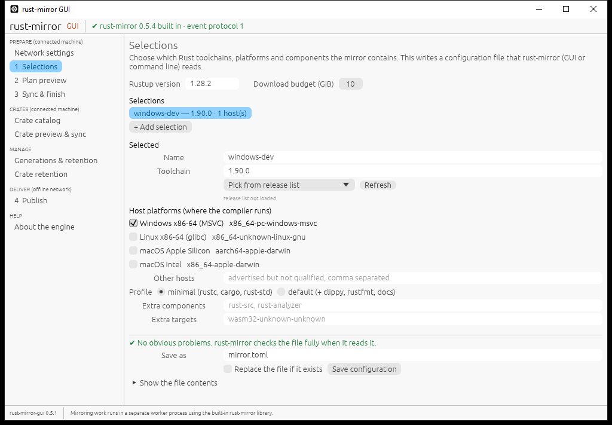

# rust-mirror-gui 0.5.1 publication record

The owner authorized 0.5.1 on 2026-11-16. It is the first GUI release
published to crates.io by Trusted Publishing, and the first whose downloads
come with an attested SBOM and SLSA Build Level 3 provenance.

No version was republished and no source tag was moved. No release asset was
replaced or deleted. This record changes documentation only. It also adds
the SLSA 3 badge, after the live verification below, and points the
download check at v0.5.1.

## Source

- PR #26 was merged normally as `2a7721a5a515de693f5abd946dd974f84c3f6161`.
  Its tree is identical to the CI-green reviewed head `93fc541` (empty diff).
- **The owner's Windows 11 check before the merge** (coordinator-reported):
  the release build draws (PrintWindow), the worker reports `tool_version`
  0.5.4, and the status bar reads 0.5.1.
- **Tag:** annotated `v0.5.1` (message `rust-mirror-gui 0.5.1`), peeling to
  `2a7721a5a515de693f5abd946dd974f84c3f6161`. It was pushed right after the
  merge, and v* tags are immutable under the org ruleset.
- **[GitHub Release v0.5.1](https://github.com/rustcommons/rust-mirror-gui/releases/tag/v0.5.1):**
  created right after the tag. Its body is identical to
  [`docs/releases/v0.5.1.md`](../releases/v0.5.1.md); not a draft, marked
  latest.
- **Release-documentation checks:** local `--published-tag v0.5.1` PASS; the
  release-event workflow succeeded.

## crates.io (Trusted Publishing)

The tag push started
[Trusted Publishing run 43870605390](https://github.com/rustcommons/rust-mirror-gui/actions/runs/43870605390)
(`trusted-publishing.yml`). Every job succeeded:
- **check:** the tag and `Cargo.toml` agree (0.5.1); the version was not
  on crates.io yet.
- **publish** (environment `crates-io`): it waited for approval, and the
  owner approved the deployment on 2026-11-18. It got a short-lived token
  through `rust-lang/crates-io-auth-action` (OIDC; no stored token) and ran
  `cargo publish --locked`, from 03:38:19Z to 03:40:23Z.
- **verify:** the archive, API and index checksums all equal `f5e589c2…`,
  and the job logged "published rust-mirror-gui 0.5.1 … is the tag's source
  (2a7721a…)". That covers `.cargo_vcs_info.json` and every file.

crates.io records the upload as 2026-11-18T03:40:18Z, with no user
publisher (`published_by: null`) and this provenance:

```json
"trustpub_data": {"provider": "github", "repository": "rustcommons/rust-mirror-gui",
                  "run_id": "43870605390", "sha": "2a7721a5a515de693f5abd946dd974f84c3f6161"}
```

**Registry archive, verified in this thread:**
- 543,432 bytes, SHA-256
  `f5e589c29e2f6793ecac5f5ee442f99f953cc1df92017c5ad422044a81d0d299`. It
  matches the crates.io API checksum and the sparse-index `cksum`. Not
  yanked.
- `.cargo_vcs_info.json` names `2a7721a5a515de693f5abd946dd974f84c3f6161`.
- All 38 payload files are byte-identical to `git archive 2a7721a`,
  comparing `Cargo.toml.orig` against `Cargo.toml`.
- Index dependencies: `eframe ^0.37`, `rust-mirror ^0.5.4`, `serde ^1.0`,
  `serde_json ^1.0`.
- The packaged `Cargo.lock` pins:
  - rust-mirror 0.5.4 (checksum `a11f6b58…`);
  - rustls 0.23.46;
  - rustls-webpki 0.103.17.

**docs.rs:** `status.json` reported `doc_status: true` for 0.5.1.

**Fresh registry installation (Linux):**
`cargo install rust-mirror-gui --version 0.5.1 --locked --root FRESH_ROOT`
ran with Cargo 1.99.1 on a freshly provisioned Debian 12 aarch64 machine,
with an empty `CARGO_HOME` and an isolated target directory.
- rust-mirror-gui 0.5.1 and rust-mirror 0.5.4 were downloaded from crates.io.
  The install took 183 s and exited 0.
- Exactly one executable was installed (`rust-mirror-gui`), SHA-256
  `35780b0f42d978ab7fc5c1f2e4b2929d9ad946e07905edf4ea58c7d2506577e6`.
- `--worker --version` reported protocol 1 and `tool_version` 0.5.4.
- **First launch:** the machine had no graphics libraries, and the window
  failed with `WGPU error: Failed to create surface for any enabled
  backend`. That is the minimal-machine case the README covers.
- **After installing exactly the README's Debian/Ubuntu runtime list**
  (`libxkbcommon-x11-0 libvulkan1 mesa-vulkan-drivers libegl1
  libgl1-mesa-dri libxcursor1 libxrandr2 libxi6`), on Xvfb
  (`qualification/linux-launch.sh`):
  - the window was drawn (938 distinct colours);
  - the top bar read "✔ rust-mirror 0.5.4 built in · event protocol 1";
  - the status bar read "rust-mirror-gui 0.5.1".

## Prebuilt downloads

The tag push started
[Release binaries run 43870603689](https://github.com/rustcommons/rust-mirror-gui/actions/runs/43870603689).

- **Attempt 1:** it did not finish. GitHub could not get a macOS arm64
  runner ("The job was not acquired by Runner of type hosted even after
  multiple attempts"; macOS arm64 capacity), so it cancelled that one build
  job. Windows, Linux and macOS x86_64 had built. Nothing was signed or
  uploaded.
- **Attempt 2** reran only the failed jobs, in the same run, so on the same
  tag commit. It succeeded:
  - the Linux launches in AlmaLinux 8 and Ubuntu 20.04, without system
    fonts;
  - the SBOM and `SHA256SUMS`;
  - the attest job inside `build-binaries.yml`;
  - the publish job: verify, upload, then download back and verify.

Live assets (the GitHub API's digests match):

```
9e75049bd33a717088d6ce91f77928b85ccb3a27212d34dcd2059875ae3ba5b5  rust-mirror-gui-0.5.1-aarch64-apple-darwin.tar.gz
64496937c7e5afd93a7005b31f6dc563c383fffe1d54a8165bbdf14c79ebc287  rust-mirror-gui-0.5.1-x86_64-apple-darwin.tar.gz
6f4a3c4521f0ce58071e974975b556913a2403591e64477f563421b5e6a7da9d  rust-mirror-gui-0.5.1-x86_64-pc-windows-msvc.zip
5ae5670839324adf5d8e67cd0266061f0def8e2b935be30867488d0720d6f23a  rust-mirror-gui-0.5.1-x86_64-unknown-linux-gnu.tar.gz
cd276fd1568e416733c12d5c3a81dfbbbaf6f4888d4bbb0aa66dd1afa6ac47a9  rust-mirror-gui-0.5.1.cdx.json
```

`SHA256SUMS` (563 bytes) has SHA-256
`3c8200890b89ea9b92d44f5f506adf430c8ed58ff40a1452504df489cd745863`. The
SBOM is CycloneDX 1.6 with 476 components.

## SLSA Build Level 3, live verification

I downloaded all six assets with `gh release download` and verified them.
- `sha256sum -c SHA256SUMS`: all five listed files OK.
- **Provenance for every file:**

  ```sh
  gh attestation verify FILE --repo rustcommons/rust-mirror-gui \
    --signer-workflow rustcommons/rust-mirror-gui/.github/workflows/build-binaries.yml \
    --signer-digest 2a7721a5a515de693f5abd946dd974f84c3f6161 \
    --source-digest 2a7721a5a515de693f5abd946dd974f84c3f6161 \
    --deny-self-hosted-runners
  ```

  All six passed.
- **SBOM attestation for each archive:** the same command with
  `--predicate-type https://cyclonedx.org/bom`. All four passed. In each,
  the attested SBOM is byte-for-byte the published
  `rust-mirror-gui-0.5.1.cdx.json`.
- **The certificate** (the Windows archive):

  | Field | Value |
  | --- | --- |
  | `buildSignerURI` | `https://github.com/rustcommons/rust-mirror-gui/.github/workflows/build-binaries.yml@refs/tags/v0.5.1` |
  | `buildSignerDigest` | `2a7721a5a515de693f5abd946dd974f84c3f6161` |
  | `sourceRepositoryRef` | `refs/tags/v0.5.1` |
  | `sourceRepositoryDigest` | `2a7721a5a515de693f5abd946dd974f84c3f6161` |
  | `buildTrigger` | `push` |
  | `runInvocationURI` | `…/actions/runs/43870603689/attempts/2` |
  | `runnerEnvironment` | `github-hosted` |

  The signer is the reusable `build-binaries.yml`, not the calling
  `release-binaries.yml`. That isolates the signing from the triggering
  workflow, which is GitHub's construction for SLSA v1 Build Level 3.
- **Negative check:** verifying with `--signer-workflow
  …/release-binaries.yml` (the 0.4.3 and 0.5.0 signer) is rejected.

## Running the downloads

[Verify release downloads run 43874757056](https://github.com/rustcommons/rust-mirror-gui/actions/runs/43874757056)
(manual dispatch, `tag: v0.5.1`) succeeded. It builds nothing and uploads
nothing.
- **assets:** all six files with `build-binaries.yml` provenance (digests
  pinned to the tag's commit, GitHub-hosted only). All four SBOM
  attestations match the published SBOM.
- **windows** (windows-2022):
  - the zip's SHA-256 matched `SHA256SUMS`;
  - `--worker --version` reported protocol 1 and `tool_version` 0.5.4;
  - the PrintWindow capture had 421 distinct colours.
- **linux:** the archive was fetched from the public URL and checked with
  `sha256sum`, then run in `almalinux:8` and `ubuntu:20.04` (pinned) after
  "system fonts and fontconfig settings removed". On both, `--worker
  --version` reported 0.5.4 and the window was drawn (928 colours).



## Reproducibility

The release's source was built twice before the merge, and both builds were
bit-identical for every target. See runs 43864255541 and 43867459322 in the
[validation record](2026-11-16-v0.5.1-validation.md). The live archives
differ from those dry-run archives only in `README.txt`, which names the tag
instead of the dry run.

No credential values appear in this record.
