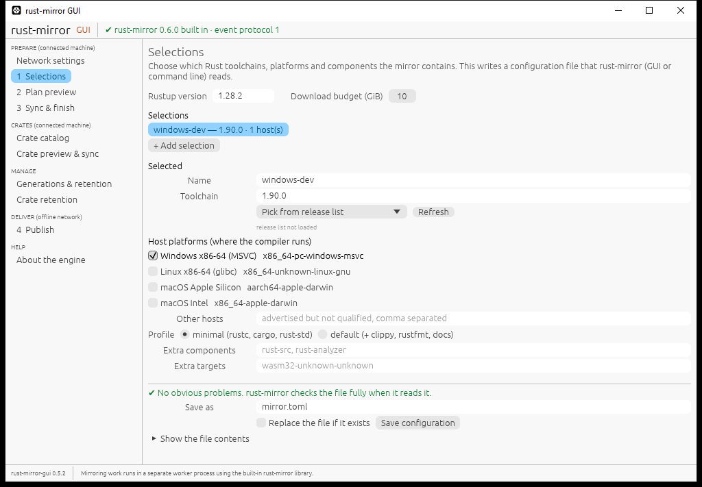

# rust-mirror-gui 0.5.2 publication record

The owner authorized 0.5.2 on 2026-11-21: rust-mirror 0.6.0 plus main as it
stood. It was published to crates.io by Trusted Publishing. It is the first
GUI release with the signed provenance bundle
`rust-mirror-gui-0.5.2.intoto.jsonl`.

No version was republished and no source tag was moved. No release asset was
replaced or deleted. This record changes documentation only. It also points
the download check at v0.5.2.

**One deviation from the normal flow:** the tag-bound binary run timed out
before the GitHub Release existed, so the binaries were attached by the
documented exact-tag dispatch (see [Prebuilt downloads](#prebuilt-downloads)).

## Source

- PR #31 was merged normally as `305cc6dfd0de6ab2f9192a18097529ee91c727cf`.
  Its tree is identical to the CI-green reviewed head `e4487b9` (empty
  diff).
- **Tag:** annotated `v0.5.2` (message `rust-mirror-gui 0.5.2`), pushed at
  15:05:05Z and peeling to `305cc6dfd0de6ab2f9192a18097529ee91c727cf`. v*
  tags are immutable under the org ruleset.
- **[GitHub Release v0.5.2](https://github.com/rustcommons/rust-mirror-gui/releases/tag/v0.5.2):**
  - created at 16:16:17Z, after the crates.io publication was confirmed;
  - its body is the tag's `docs/releases/v0.5.2.md`, byte for byte, and its
    title is that file's heading;
  - not a draft, marked latest.
- **Release-documentation checks:** the local `--published-tag v0.5.2`
  check passes. The release-event workflow runs 44923651810 and 44923658247
  succeeded.

## crates.io (Trusted Publishing)

The tag push started
[Trusted Publishing run 44917279499](https://github.com/rustcommons/rust-mirror-gui/actions/runs/44917279499)
(`trusted-publishing.yml`, unchanged in this release). Every job succeeded:
- **check** (15:08Z): the tag and `Cargo.toml` agree (0.5.2), and the
  version was not on crates.io yet.
- **publish** (environment `crates-io`): it waited for approval, and the
  owner approved the deployment. It got a short-lived token through
  `rust-lang/crates-io-auth-action` (OIDC; no stored token) and ran
  `cargo publish --locked`, from 16:05:11Z to 16:07:12Z.
- **verify** (16:07:14–16:07:25Z): the archive, API and index checksums
  agree, and every file is the tag's source.

crates.io records the upload as 2026-11-21T16:07:07Z, with no user
publisher (`published_by: null`) and this provenance:

```json
"trustpub_data": {"provider": "github", "repository": "rustcommons/rust-mirror-gui",
                  "run_id": "44917279499", "sha": "305cc6dfd0de6ab2f9192a18097529ee91c727cf"}
```

**Registry archive, verified in this thread:**
- 545,685 bytes, SHA-256
  `dd41f0426e6f187fdbd03f124ede0f294809cb33f54b3d55f0a5f4e1ebda2106`. It
  matches the crates.io API checksum and the sparse-index `cksum`. Not
  yanked.
- `.cargo_vcs_info.json` names `305cc6dfd0de6ab2f9192a18097529ee91c727cf`.
- The archive has 40 files. The 37 payload files are byte-identical to the
  tag, and `Cargo.toml.orig` is identical to the tag's `Cargo.toml`.
- Index dependencies: `eframe ^0.37`, `rust-mirror ^0.6`, `serde ^1.0`,
  `serde_json ^1.0`.
- The packaged `Cargo.lock` pins rust-mirror 0.6.0, toml 1.2.2, rustls
  0.23.46 and rustls-webpki 0.103.17.

**docs.rs:** `status.json` reported `doc_status: true` for 0.5.2.

**Fresh registry installation (Linux):**
`cargo install rust-mirror-gui --version 0.5.2 --locked --root FRESH_ROOT`
ran with Rust 1.95.0 (aarch64 Debian 12) and an empty `CARGO_HOME`.
- It exited 0 and installed exactly one executable (`rust-mirror-gui`).
  `.crates2.json` records `rust-mirror-gui 0.5.2` from the crates.io index.
- `--worker --version` reported protocol 1 and `tool_version` 0.6.0.

## Prebuilt downloads

### The tag run timed out (nothing attached, nothing signed)

The tag push started
[Release binaries run 44917279528](https://github.com/rustcommons/rust-mirror-gui/actions/runs/44917279528).
- Its `prepare` job waits at most 30 minutes for the GitHub Release. Under
  the procedure then in force, that release is created only after the
  crates.io publication is confirmed.
- The owner's approval came at about 16:05Z, but `prepare` gave up at
  15:37:10Z: "Release documentation FAIL: GitHub releases/tags/v0.5.2
  returned HTTP 404".
- `build` (which holds the signing job), `publish` and `build-dry-run` were
  skipped. **No attestation was created and no asset was uploaded.**

### Exact-tag recovery

After the release was created, `release-binaries.yml` was dispatched **on
the tag ref**, with the same workflow file and commit as the tag run:

```sh
gh workflow run release-binaries.yml --ref v0.5.2 -f tag=v0.5.2 -f dry_run=false
```

[Run 44923657717](https://github.com/rustcommons/rust-mirror-gui/actions/runs/44923657717)
(16:16:23–16:29:51Z) ran on `305cc6d`. Every job succeeded:
- **prepare:** the tag, the commit and `Cargo.toml` agree, and the live
  release matches the notes.
- **The four builds:**
  - `--worker --version` reported protocol 1 and engine 0.6.0;
  - the Linux build's highest `GLIBC_` symbol is 2.28;
  - Windows imports no C-runtime DLL.
- **Linux launches** in AlmaLinux 8 and Ubuntu 20.04, with the system fonts
  removed: the window was drawn (929 colours with the default renderer and
  with GL).
- **checksums, attest** (inside `build-binaries.yml`) and **publish**:
  verified, uploaded, then downloaded back and verified.

Because it was dispatched rather than pushed, its certificate says
`buildTrigger: workflow_dispatch`. Its signer and source are still the tag's
commit (below), so the strict verification passes unchanged.

Live assets (the GitHub API's digests match):

```
ae6275708db1bbf472374b7d468e053d4b745c83df5628f51e39fe737c48c542  rust-mirror-gui-0.5.2-aarch64-apple-darwin.tar.gz
4195904fb36d7f74a16610df4cfc2fafbff92d14e29300ff9af422e83caf30b9  rust-mirror-gui-0.5.2-x86_64-apple-darwin.tar.gz
91c26d5aff34d3f26fa1e94e601402bf2e012381d71a854f69db7b7ccd4aec47  rust-mirror-gui-0.5.2-x86_64-pc-windows-msvc.zip
eba12202d5cd6e1f53eb416db88e597022811b007b56f200e905be7485d3b948  rust-mirror-gui-0.5.2-x86_64-unknown-linux-gnu.tar.gz
192347e8ba47939c77e3da708d41e3c814d535271ccfed9a64789d716a2611d6  rust-mirror-gui-0.5.2.cdx.json
1b22f017fa65b534ff2333a5d14dfa493ee51742bf909667f6570908dc12d12d  SHA256SUMS
fbe534d4cf7873ad76cdfdd6f351284afdaa3069234e941a69cdc1d9a70e1322  rust-mirror-gui-0.5.2.intoto.jsonl
```

- `SHA256SUMS` is 563 bytes and lists the four archives and the SBOM.
- The SBOM is CycloneDX 1.6 with 474 components.
- Each archive's `README.txt` says "Built from: v0.5.2 at commit
  305cc6dfd0de6ab2f9192a18097529ee91c727cf".

**From 0.5.3 on**, the standard release pipeline creates the GitHub Release
itself after publication (PR #32). An approval later than the 30-minute wait
still needs this exact-tag dispatch, until phase 2 folds the binaries into
that pipeline.

## SLSA Build Level 3 and the bundle, live verification

I downloaded all seven assets with `gh release download` and verified them.
- **`sha256sum -c SHA256SUMS`:** all five listed files OK.
- **Provenance for every signed file** (the four archives, the SBOM and
  `SHA256SUMS`), both online and offline with
  `--bundle rust-mirror-gui-0.5.2.intoto.jsonl`:

  ```sh
  gh attestation verify FILE --repo rustcommons/rust-mirror-gui \
    --signer-workflow rustcommons/rust-mirror-gui/.github/workflows/build-binaries.yml \
    --signer-digest 305cc6dfd0de6ab2f9192a18097529ee91c727cf \
    --source-digest 305cc6dfd0de6ab2f9192a18097529ee91c727cf \
    --deny-self-hosted-runners
  ```

  All 6 files passed both ways (12 checks).
- **SBOM attestation for each archive:** the same command with
  `--predicate-type https://cyclonedx.org/bom`. All four passed. In each,
  the attested SBOM is exactly the published
  `rust-mirror-gui-0.5.2.cdx.json`.
- **The bundle** holds one line, one Sigstore bundle:
  - `provenance_bundle.py check`: its subjects are exactly the 6 files;
  - `provenance_bundle.py match`: it is GitHub's stored provenance
    attestation (from `gh attestation download`).
- **The certificate** (the Windows archive):

  | Field | Value |
  | --- | --- |
  | `buildSignerURI` | `https://github.com/rustcommons/rust-mirror-gui/.github/workflows/build-binaries.yml@refs/tags/v0.5.2` |
  | `buildSignerDigest` | `305cc6dfd0de6ab2f9192a18097529ee91c727cf` |
  | `sourceRepositoryRef` | `refs/tags/v0.5.2` |
  | `sourceRepositoryDigest` | `305cc6dfd0de6ab2f9192a18097529ee91c727cf` |
  | `buildTrigger` | `workflow_dispatch` (the exact-tag recovery) |
  | `runInvocationURI` | `…/actions/runs/44923657717/attempts/1` |
  | `runnerEnvironment` | `github-hosted` |

- **Negative check:** verifying with `--signer-workflow
  …/release-binaries.yml` (the 0.4.3 and 0.5.0 signer) is rejected.

## Running the downloads

[Verify release downloads run 44924910620](https://github.com/rustcommons/rust-mirror-gui/actions/runs/44924910620)
(manual dispatch, `tag: v0.5.2`) succeeded. It builds nothing and uploads
nothing.
- **assets:**
  - all six signed files have `build-binaries.yml` provenance, with digests
    pinned to the tag's commit and GitHub-hosted runners only;
  - all four SBOM attestations match the published SBOM;
  - the attached bundle covers exactly the 6 files, is GitHub's stored
    attestation, and every file verifies offline against it.
- **windows** (windows-2022):
  - the zip's SHA-256 matched the attested `SHA256SUMS` (`91c26d5a…`);
  - `--worker --version` reported protocol 1 and `tool_version` 0.6.0;
  - the PrintWindow capture had 423 distinct colours.
- **linux:**
  - the archive was fetched from the public URL and checked with
    `sha256sum`;
  - it then ran in `almalinux:8` and `ubuntu:20.04` (pinned), after "system
    fonts and fontconfig settings removed";
  - on both, `--worker --version` reported 0.6.0 and the window was drawn
    (929 colours).



## Reproducibility

The release's source (`e4487b9`, whose tree is the merge's) was checked
before the merge by reproducibility run 44915727670. All four targets'
executables and archives were bit-identical (Windows exe `f382b671…`,
Linux `d94a7b85…`). See the
[validation record](2026-11-21-v0.5.2-validation.md) and PR #31. The live
archives differ from those dry-run archives only in `README.txt`, which
names the tag instead of the dry run.

No credential values appear in this record.
