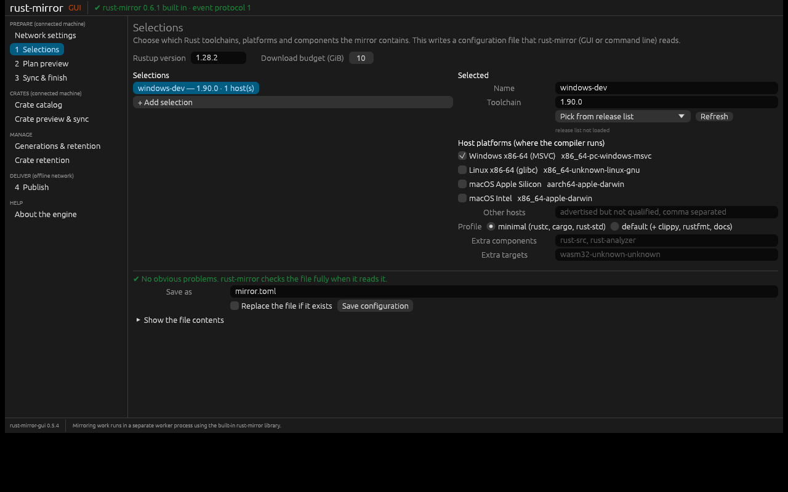

# rust-mirror-gui 0.5.4 validation record

Owner authorization: 2026-11-22. Scope is main after PR #38 (grouped metadata
warnings) and PR #39 (readable freshness ages). The engine stays at
rust-mirror 0.6.1. The owner merges, waits for main CI, tags and approves
Trusted Publishing; this release PR does none of those actions.

## Scope and source

- Prepared from main `2da7c79` (merge of PR #39), including PR #38's
  default-collapsed render regression test and mutation proof.
- App version 0.5.4 in `Cargo.toml`, `Cargo.lock` and `fuzz/Cargo.lock`.
  Both lockfiles change only the app's own version. No dependency is added
  or updated. The engine requirement remains `rust-mirror = "0.6"`, locked
  to 0.6.1; the exact fuzz pin remains `=0.6.1`.
- All Unreleased entries move to `## [0.5.4] - 2026-11-22`, the source for
  `docs/releases/v0.5.4.md`. Authorization, README and tutorial are updated.
- Grouped-warning counts/field unions, capped details and readable ages are
  the changes already reviewed in #38/#39. Release preparation changes no
  application logic, frozen-plan format or event protocol.

## Local validation

Completed with Rust 1.95.0 unless stated otherwise:

- Format and clippy (`--locked --all-targets --all-features`, warnings denied).
- All 45 unit and 19 integration tests pass with all features. One existing
  real-server qualification remains ignored locally.
- All 23 release-asset helper tests and the release-documentation check pass.
- Fuzz targets type-check, locked, with nightly-2026-11-15.
- Release build succeeds; `--worker --version` reports engine 0.6.1 and protocol 1.
- Window render: the qualification script on an isolated Xvfb display
  (`:101`) with Mesa GL drew a 1280×800 capture with 927 distinct colours
  and an empty app error log. Visually inspected: GUI 0.5.4 in the footer,
  engine 0.6.1 in the header. Both render processes stopped afterwards.
  This aarch64 GL check is separate from the x86-64 old-Linux CI gates.
- No deprecated attestation action names occur anywhere in `.github/`.
- The unchanged release layout has eight assets and six checksum entries.

Clean package build and audit pass: `cargo +1.95.0 package --locked`
packages 40 regular files and successfully builds the packaged source.
`scripts/release_assets.py audit-crate` verifies every payload byte and the
VCS record against the clean commit. No docs, workflow or fuzz files are
included in the `.crate`.

## Exact-head CI (pending)

Required before reporting the release PR green:

- Trusted publishing dry run at the exact release PR head, all four targets.
- Crate packaging, clean source audit and install.
- Windows PrintWindow capture; fontless AlmaLinux 8 and Ubuntu 20.04 launches.
- CycloneDX SBOM and one `SHA256SUMS` with six payload entries.
- Zero deprecation annotations, checked across every dry-run job; no
  deprecated attestation action names anywhere in `.github/`.
- Core CI, zizmor, cargo-deny, line endings and release docs pass.

Signing and publication are skipped by the dry run. After owner approval
and publication, a separate publication-record PR must record the tag,
main CI before the tag, every phase 2 job, live asset/attestation/SBOM/bundle
verification, registry/tag equality, docs.rs, clean install and any retries.
