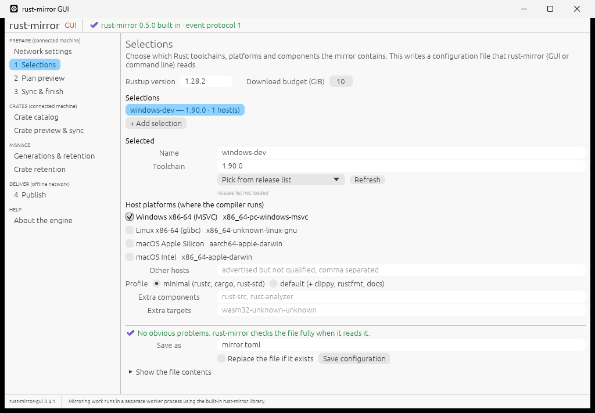
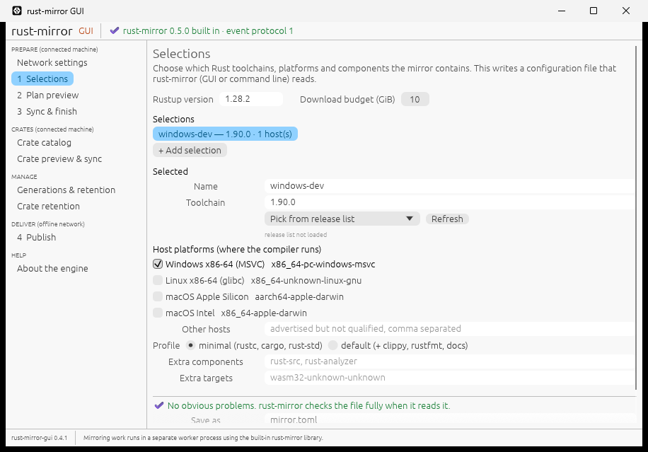

# rust-mirror-gui 0.4.1: usable on small windows and scaled displays

Released 2026-11-14. A patch release. On a window narrower than the default,
parts of some pages could not be reached. Every page now works down to the
minimum window size, also with display scaling, and the first window no
longer opens larger than the screen. The built-in engine is still
rust-mirror 0.5.0.

## Changes

- **Fixed: parts of pages could not be reached on narrow windows.** On a
  Windows Server with a 1024×768 screen, the Selections page's right column
  was cut off: **Refresh** and the "Other hosts" hint were out of view, with
  no way to scroll to them. Every page now stays fully usable down to the
  minimum window size (900×600 points), also at 125% and 150% display
  scaling.
  - The page area scrolls both ways, so nothing is ever out of reach.
  - Hint lines, "Same as" lines and long values wrap instead of running off
    the page.
  - **Selections** puts its two columns under each other when the window is
    narrow.
  - **Tables keep their columns and wrap only the last one.** Long text
    moved to the last column:
    - crate preview: the reason, with **Why?** just before it;
    - generation lists: the folder path;
    - toolchain plan: the file name.

    Crate flags wrap inside a narrow column.
  - The top bar's **Show** button now comes before the operation status. A
    long status is shortened with "…"; the full text is in its tooltip and
    on the operation's page.
- **The first window fits the screen.** It no longer opens larger than the
  monitor (it opened at 1280×860 even on a 1024×768 screen). It shrinks to
  fit, leaving room for the taskbar, but never below the minimum size. On
  larger screens nothing changes.

## Upgrade

```sh
cargo install rust-mirror-gui --version 0.4.1 --locked
```

- Rust 1.95 or newer is still required.
- The built-in engine is still
  [rust-mirror 0.5.0](https://crates.io/crates/rust-mirror/0.5.0); mirrors,
  catalogs and settings are unchanged.
- Windows still renders with Direct3D 12 unless `WGPU_BACKEND` is set.
- No new dependencies.

## Validation and limits

- **Automated layout checks** (part of `cargo test`) render every page at
  900×600 points, at 100%, 125% and 150% scaling. They fail if any page
  needs horizontal scrolling. Every page is checked empty, and eight
  pages again loaded with real reports recorded from the worker:
  - a crate catalog, paste refusals and a refused Cargo.lock import;
  - a crate preview with download sizes, a download log and client setup;
  - crate generations and a removal preview;
  - a toolchain plan;
  - a network check with certificate details;
  - activity logs on the Sync and Publish pages.

  Paths are replaced with long Windows-style paths. Without the fixes, these
  checks fail on 8 of the 10 pages.
- **Screenshots** (Linux, software rendering): every page at 900×600, with
  data where it matters, and Selections at 150% scaling. On a 1440×900 screen
  the first window opened at 1280×804 instead of 1280×860.
- **Windows CI** (GitHub-hosted Windows Server 2025, 1024×768 screen with a
  1024×720 work area, no GPU, Direct3D 12 on WARP) checks the window with
  `PrintWindow` in every CI run. In run
  [43612455126](https://github.com/rustcommons/rust-mirror-gui/actions/runs/43612455126):
  - the first window opened at 1024×711 (client area 1008×672), inside the
    work area. Before this release it opened at 1040×807, larger than the
    screen;
  - at the minimum size (client area 900×600), Selections showed its columns
    under each other, with **Refresh** and every field in view;
  - neither capture was blank.

  

  
- **Not tested:** real 125% and 150% scaling on Windows or macOS (covered by
  the automated checks and a Linux 150% screenshot only), Remote Desktop,
  and screen readers.

## Links

- [Source tag v0.4.1](https://github.com/rustcommons/rust-mirror-gui/tree/v0.4.1)
- [crates.io](https://crates.io/crates/rust-mirror-gui/0.4.1) and [docs.rs](https://docs.rs/rust-mirror-gui/0.4.1)
- [Changelog](https://github.com/rustcommons/rust-mirror-gui/blob/main/CHANGELOG.md)
- [Release notes 0.4.0](https://github.com/rustcommons/rust-mirror-gui/blob/main/docs/releases/v0.4.0.md)
- [Release policy](https://github.com/rustcommons/.github/blob/main/docs/RELEASING.md)
